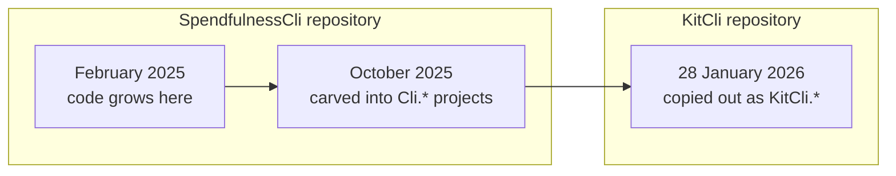
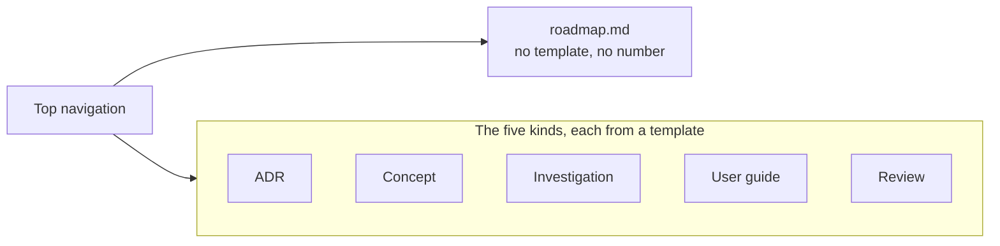

# Give the roadmap a page of its own, outside the five kinds

Status: Accepted
Date: 2026-08-26
Release: 3.1.0

## Context

**Nothing on the site said where KitCli came from, and no existing kind of doc can hold that story.**

The code is eleven months older than its repository:

That year explains most of the shapes a reader meets: why a command is a marker record, why artefacts exist, why the workflow reuses a run. None of it is recoverable from this repository's own history. The history lives in [SpendfulnessCli](https://github.com/joshuaedwardcrowe/SpendfulnessCli).

| Existing kind | Why it cannot hold the history |
|---|---|
| `CHANGELOG.md` | Starts at 1.0.11 and records released packages, not a year that predates the first package. |
| Review | A dated snapshot of what was wrong. |
| Concept doc | Present-tense by rule, and history is the one thing it may not narrate. |
| ADR | Records one decision, not a sequence of them. |

## Decision

**[`docs/roadmap.md`](../roadmap.md) is a single page at the docs root, in the top navigation, outside the five kinds.**

| Property | Detail |
|---|---|
| Layout | `layout: landing`, rendered as a vertical timeline. |
| Styles | Sit with the landing page's in `templates/kitcli/public/main.css`. |
| Entries | Written by hand from both repositories' git histories. One per month, or per run of months where nothing changed. Each names what changed rather than listing commits. |

It keeps the name **Roadmap** even though it looks backwards. That is the word a reader scans a navigation bar for. Forward-looking entries belong on the same timeline when there are any. Until then, milestones and the Ideas board carry the plan.

## Alternatives considered

- **A sixth kind, with its own `template.md`.** A template for a folder that will only ever hold one page. A kind says "more of these are coming"; none are.
- **A review.** The folder is dated snapshots of what was wrong, and its index page says "historical only". Close enough to attract the page, wrong enough to make both harder to describe afterwards.
- **Extending `CHANGELOG.md` backwards.** It is generated from squash-merge titles against released versions. The year that matters has neither.
- **Generating the page from `git log`.** The value is the judgement about which twenty commits out of a thousand mattered. A generator emits the thousand.
- **A plain markdown table**, which is what shipped first. Accurate, and read as reference material nobody scrolls. The timeline is the argument that the framework grew rather than that it was designed.

## Consequences

| Gets easier | Gets harder |
|---|---|
| A reader can see why the framework has the shapes it has. | `CONTRIBUTING.md` said five kinds live in `docs/` and that everything is copied from a template and numbered. Both now carry the exception, updated in the same change as this ADR. |
| The sticky year links give the page its only navigation. | `layout: landing` drops the breadcrumb and the affix table of contents. |
| | The page is hand-written HTML, and the only page besides the landing page with bespoke CSS. Editing it means copying a card, not writing markdown. |
| | It goes stale by construction. An entry is owed when a release or a change of shape lands, not every month. A month with nothing in it is worth saying, but only once the timeline is past it. |
| | Half the timeline cites a separate personal repository. If SpendfulnessCli ever goes private, the pre-2026 entries become unverifiable claims rather than checkable ones. |
