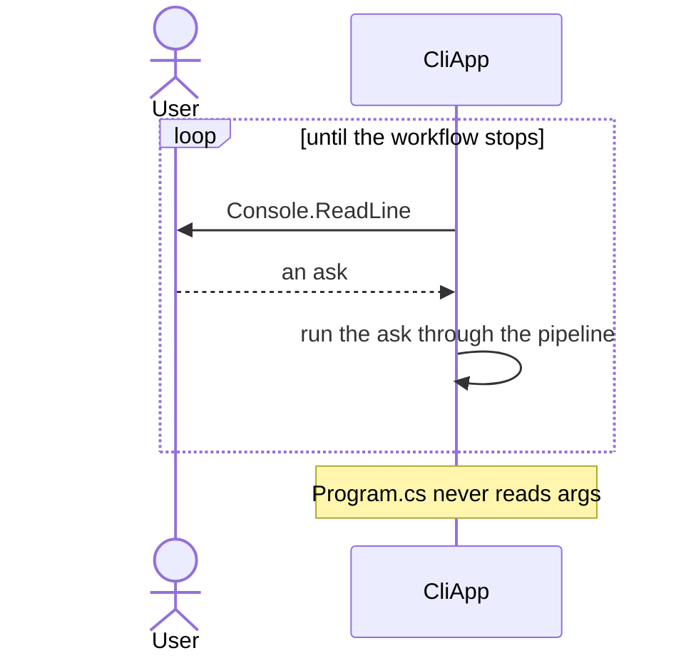
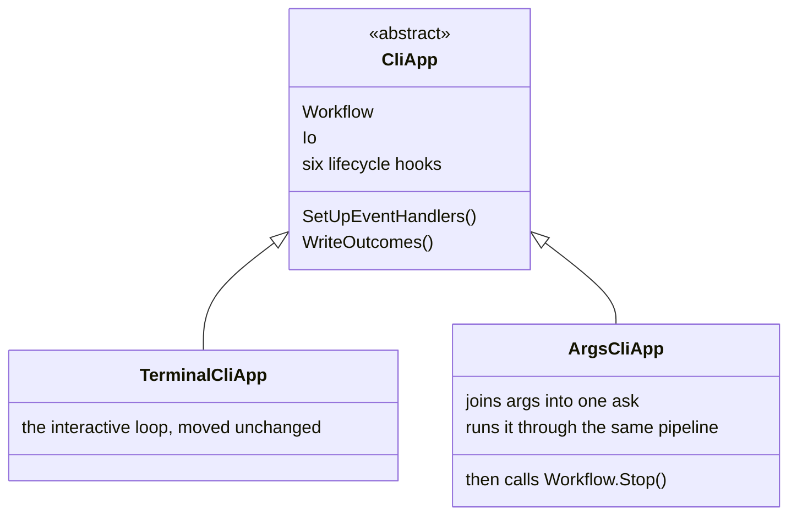

# Split CliApp into ArgsCliApp and TerminalCliApp

Status: Proposed
Date: 2026-08-22
Release: 1.0.11

Reversed by the [host-merge ADR](merge-the-hosts-and-name-the-variant-headless.md).
**The type names below no longer exist in the codebase.** `TerminalCliApp`
folded back into `CliApp`, and `ArgsCliApp` became `HeadlessCliApp`. Read
this for the reasoning that got KitCli a non-interactive host at all; read
the host-merge ADR for the shape that shipped.

## Context

**KitCli apps could only be driven interactively, so no command could run in one shot from process args.** `CliApp.Run` was a `while` loop calling `Console.ReadLine` every iteration. `Program.cs` never read `args`, and nothing had a seam for it.

| Term | Meaning |
|---|---|
| Ask | One line of input, fed through the pipeline to run a command. |
| Workflow | Owns the runs and their state. `Workflow.Stop()` ends it. |

## Decision

**Split `CliApp`'s execution model into two subclasses.** An app picks its mode by which subclass it extends, not by a flag checked at launch.

| Part | Role |
|---|---|
| `CliApp` | Keeps only what both share: the `Workflow` and `Io` references, `SetUpEventHandlers`, `WriteOutcomes` and the six lifecycle hooks. |
| `TerminalCliApp` | The pre-existing interactive loop, moved off the base class unchanged. |
| `ArgsCliApp` | New. Joins `args` into one ask, feeds it through the same pipeline an interactive ask uses, then calls `Workflow.Stop()`. |
| `CliAppBuilder.Run(string[]? args)` | Resolves the concrete app and dispatches. Throws a specific error for an `ArgsCliApp` with no args. |

Two renames ride along, **breaking for existing consumers**:

| Before | After |
|---|---|
| `BasicCliApp` | `BasicTerminalCliApp` |
| `WithBasicCli()` | `WithBasicTerminalApp()` |
| `WithCli<TCliApp>()` | `WithApp<TCliApp>()` |

The playground splits to match.

## Alternatives considered

- **One `Run(args)` branching on `args.Length`.** Hides the mode behind a runtime `if`, so the class declaration no longer says whether "run with no args" is supported or a bug.
- **An `ICliAppRunner` strategy chosen by `CliAppBuilder`.** Genuinely more flexible, and over-engineered for two ~20-line execution shapes an app commits to for its whole lifetime.
- **Mutating `run.State` from `CliApp` to force a final outcome.** Only `CliWorkflowRun` may change its own state. `Workflow.Stop()` was used instead, the same method `ExitCliCommandHandler` already calls.
- **Making `ICliWorkflow.CreateNewRun()` public and calling it directly.** Tried, then reverted: it bypasses `NextRun()`'s reuse logic and the single-active-run invariant.

## Consequences

| Fact | Consequence |
|---|---|
| An app's mode is a compile-time fact. | An app wanting both an interactive session *and* a one-shot invocation needs two classes. |
| `Workflow.Stop()` fires unconditionally after the single ask. | `ArgsCliApp` runs exactly one command per invocation, so a chained step is never driven. **This is the defect the host-merge ADR exists to fix** ([#167](https://github.com/KitCli/KitCli/issues/167)). |
| The renames above. | They break any consumer of the old names. |
| Surfaced, not fixed: `AddCli<TCliApp>()` hardcodes `Assembly.GetEntryAssembly()` as a required source of at least one `CliCommand`. | It does not fit a thin host plus a separate command library. The args playground needed a throwaway command to satisfy it. |
