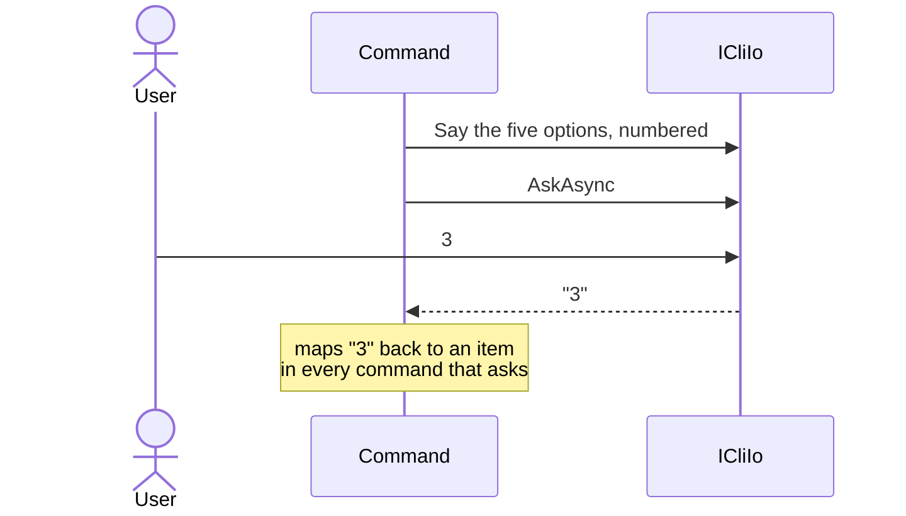
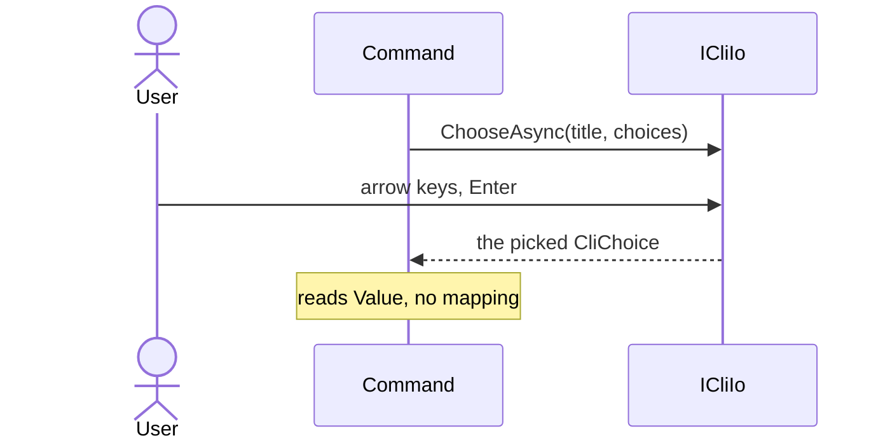

# Ask the person to pick through ICliIo, using CliChoice

Status: Accepted
Date: 2026-10-11
Release: 3.2.0

## Context

**A command could only ask for a line of typed text, so every command offering options rebuilt the same pick-from-a-list code.** See [#255](https://github.com/KitCli/KitCli/issues/255).

| Term | Meaning |
|---|---|
| `ICliIo` | What a command reads from and writes to. |
| Spectre.Console | A console library KitCli already depends on. It draws a list the person moves through with the arrow keys. |

To offer five options, a command printed them, numbered them, and turned the typed `3` back into the item it stood for:



## Decision

**`ICliIo` gains `ChooseAsync` and `ChooseManyAsync`, backed by Spectre's selection prompts.**

They take and return `CliChoice`: a `Label` to show, and an optional `Value` handed back with the pick. No Spectre type reaches a caller. Cancelling gives `null` or an empty list.



```csharp
public record CliChoice(string Label, object? Value = null);

Task<CliChoice?> ChooseAsync(string title, IEnumerable<CliChoice> choices, CancellationToken cancellationToken);

Task<IReadOnlyList<CliChoice>> ChooseManyAsync(string title, IEnumerable<CliChoice> choices, CancellationToken cancellationToken);
```

## Alternatives considered

- **`ChooseAsync<T>` over any type.** Flexible, but a caller cannot tell from the signature what `T` should look like, and the shown text depends on `ToString()`.
- **Plain strings in and out**, as `Table` does. Simplest, but the caller maps the text back to its own object, and a `Value` is one field.
- **A helper class beside `ICliIo`.** It leaves the interface alone, but an app that fakes `ICliIo` in a test finds the prompts still use the real keyboard.

## Consequences

| Fact | Consequence |
|---|---|
| An app with its own `ICliIo` implementation. | It adds both methods. Apps using `CliIo` need nothing. |
| A prompt waits for a keypress, and any line printed meanwhile scrambles it. | `CliApp.OnRunStarted` ran in that window, so it now runs before the command starts, straight after `OnRunCreated`, and is obsolete ([#305](https://github.com/KitCli/KitCli/issues/305)). |
| A headless app has nobody to ask. | A prompt there breaks. |
| Confirm, hidden-entry and typed-value prompts from #255. | Not built yet. |
