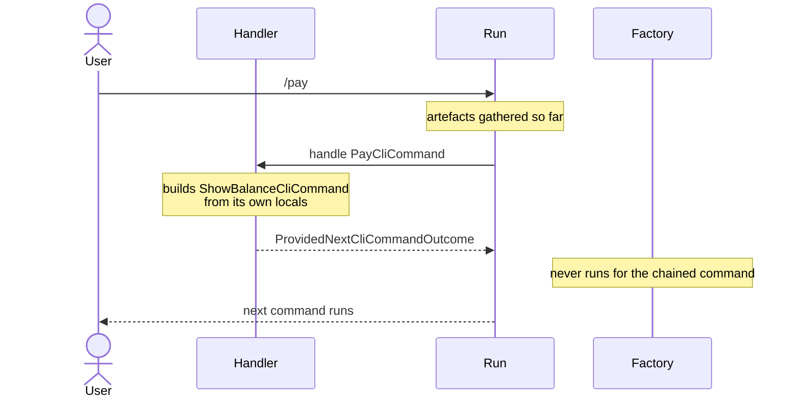
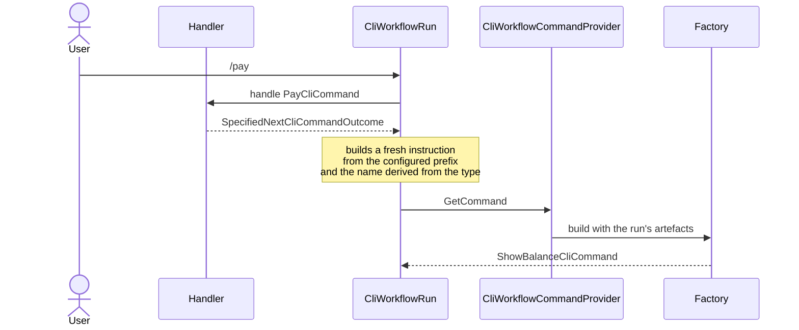

# Chain to a command by type, and let its factory build it

Status: Accepted
Date: 2026-08-25
Release: 2.0.0

Justified by
the [chained-command investigation](../investigations/how-should-a-chained-command-be-selected-and-constructed.md),
the spike on [#148](https://github.com/KitCli/KitCli/issues/148).

## Context

**A chained command was built from one handler's local variables, so it could not see what the run had gathered.** [#147](https://github.com/KitCli/KitCli/issues/147) asks that whichever command a chain moves to is built like any other.

| Term | Meaning |
|---|---|
| Chain | A handler handing straight on to another command, so one thing the user typed runs several commands in a row. |
| Run | Every command from the first one up to a final outcome. |
| Artefact | An outcome turned into a value a later command can look up by type and name. |
| Factory | The class that builds a command. It is handed every artefact the run has gathered. |
| Instruction | What the user typed, parsed into a prefix, a name and arguments. Factories are keyed by instruction name. |

Until now the handler built the chained command itself, with `ByMovingToCommand(new ShowBalanceCliCommand(id))`. Of the handler and the factory, only the factory can see the run.



## Decision

**`ByMovingToCommand<TCommand>()` names the type, and the run builds the command when the chain arrives.** An overload takes `NextCliCommandArgument<TValue>`s, for what the calling handler decides rather than what the run gathered.



The shape a handler writes:

```csharp
var limit = new NextCliCommandArgument<int>("limit", 10);

return FinishThisCommand()
    .ByMovingToCommand<ShowBalanceCliCommand>(limit)
    .EndAsync();
```

A chained hop *is* an instruction: "now run `show-balance`" is what an instruction says. So `CliWorkflowRun` builds a fresh instruction and resolves it through the existing `GetCommand`. `CliWorkflowCommandProvider` is untouched.

| Change | Effect |
|---|---|
| `CliCommand.GetInstructionName(Type)` derives the instruction name. | `AddCommandFactory` now calls it too, so registration and lookup share one derivation. |
| `NextCliCommandOutcome` becomes the abstract base of `ProvidedNextCliCommandOutcome` and `SpecifiedNextCliCommandOutcome`. | The provided outcome carries a command the handler built. The specified outcome carries a type. |
| The existing name stays on the base. | Every `OfType<NextCliCommandOutcome>()` keeps working. |
| `MoveToNext` resolves in its own try/catch. | A command the factory cannot build makes the run `Exceptional`. |

## Alternatives considered

- **`ActivatorUtilities.CreateInstance<TCommand>`.** Bypasses the factory, which is the thing being asked for.
- **Keep the instance overload and document passing data through artefacts.** Nothing makes the factory path happen.
- **A type-resolving method on the provider as a default interface member that throws**, per the chained-command investigation. A second lookup path, and a published method whose body is a throw.
- **Register factories under an extra `Type` key**, sliced as [#150](https://github.com/KitCli/KitCli/issues/150). The full-name derivation already exists and does not collide.
- **Suggest alternatives when a chained command will not build.** Suggestion is for a person who guessed wrong. A chain is written by an engineer.
- **Constrain `TCommand` to an empty constructor.** Excludes exactly the commands this exists for.

## Consequences

| Gets easier | Gets harder |
|---|---|
| A chained command reads what the run gathered. Its data arrives as artefacts rather than through the previous handler's locals. | A chained factory has two ways in: artefacts for what the run gathered, arguments for what the calling handler decided. The guides have to say which to reach for. |
| The instruction carries a prefix, a name and whatever arguments the calling handler passed, never the originating ask's. An argument the user typed was typed at the *first* command. | A command with constructor arguments and no factory of its own has no factory registered, so chaining to it throws at runtime. No compiler check can catch it. |
| Reading outcomes is unaffected. | `new NextCliCommandOutcome(command)` no longer compiles. It becomes `new ProvidedNextCliCommandOutcome(command)`. |
| | `MoveToNext()` still takes the last queued hop, so a handler that chains on twice loses the first. [#152](https://github.com/KitCli/KitCli/issues/152) rewrites that rule. |
| | Factories stay singletons holding per-command `Attach` state, and this adds a second construction path through them. [#142](https://github.com/KitCli/KitCli/issues/142) remains open. |
