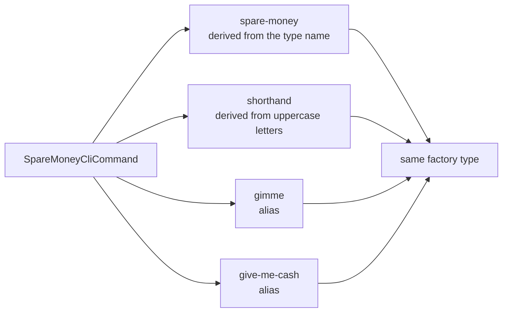

# Add extra instruction names via a `[CliCommandAlias]` attribute

Status: Accepted
Date: 2026-08-23
Release: 1.0.12

## Context

**A command could not have a memorable name, or more than one name, without renaming its type everywhere.** A command's instruction name is derived mechanically from its type name: remove `CliCommand`, dash-split, lowercase. A shorthand comes from its uppercase letters (see [command-registration.md](../concepts/command-registration.md)). Renaming the type was the only way to change either.

| Term | Meaning |
|---|---|
| Instruction name | What the user types to reach a command, e.g. `spare-money`. |
| Shorthand | The name built from the type name's uppercase letters. |
| Alias | An extra instruction name declared on the command type. |

The [reflection-registration ADR](reflection-based-automatic-registration.md) rejected supplying names at registration time, to avoid returning to hand-maintained lists. That is about how names are *supplied*, not how many a command may have. Declaring extras on the type keeps naming type-driven, so it does not reopen that trade-off.

## Decision

**Add `CliCommandAliasAttribute`, which declares an extra instruction name on the command type.** It is an `AttributeUsage(AttributeTargets.Class, AllowMultiple = true)` attribute taking a single `Name`. `AddCommandFactory` reads every one off a command type and registers one additional keyed `ICliCommandFactory` per alias, using the same factory type already resolved for that command.



The shape a consumer writes:

```csharp
[CliCommandAlias("gimme")]
[CliCommandAlias("give-me-cash")]
public record SpareMoneyCliCommand : CliCommand;
```

## Alternatives considered

- **A `name:` constructor argument on `CliCommand`.** Would let a command override its *primary* name, breaking the guarantee that the full name is predictable from the type name.
- **One attribute taking an `Aliases` array.** `[CliCommandAlias("a")] [CliCommandAlias("b")]` reads better at the declaration site and needs no array syntax explained.
- **A free-standing map from command type to names.** Reintroduces the place to forget to update, for the reason the reflection-registration ADR gave.

## Consequences

| Gets easier | Gets harder |
|---|---|
| A command can have any number of memorable names without a type rename. | A command's full set of names is no longer all visible from the type name alone. |
| | Alias collisions across command types fail where full-name and shorthand collisions already do: silently, at first resolution rather than at startup. Tracked as [#19](https://github.com/KitCli/KitCli/issues/19). |
