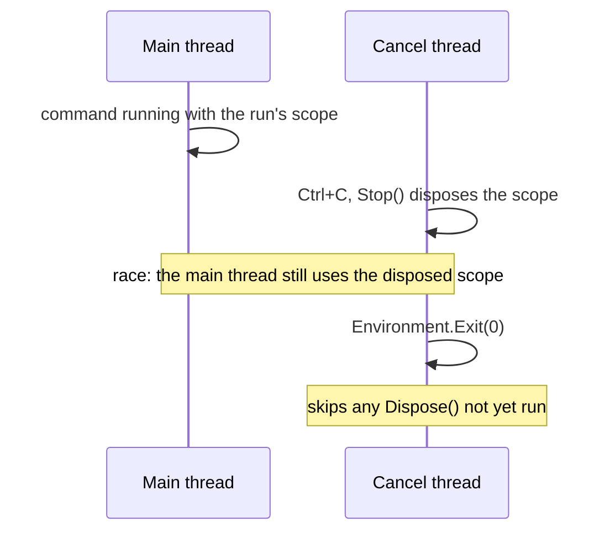
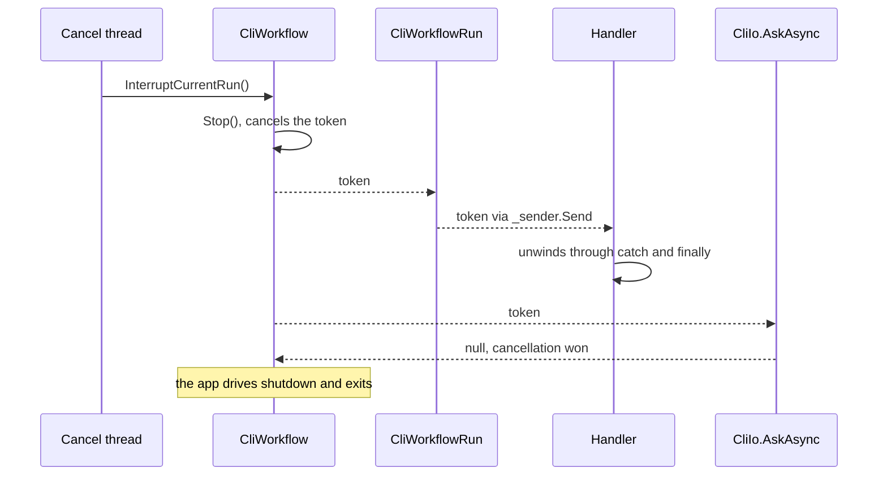

# Drive Ctrl+C shutdown with a CancellationToken, not Environment.Exit

Status: Proposed
Date: 2026-08-22
Release: 1.0.11

Written before the [host-merge ADR](merge-the-hosts-and-name-the-variant-headless.md)
renamed the hosts. Where this says `TerminalCliApp`, read `CliApp`; where it
says `ArgsCliApp`, read `HeadlessCliApp`.

## Context

**Ctrl+C tore the process down from a second thread while the main thread was still mid-command.** `CliApp.SetUpEventHandlers` wired `Io.OnCancel` to `Console.CancelKeyPress`, which .NET fires on its own thread pool thread:

```csharp
Io.OnCancel(() =>
{
    _workflow.Stop();
    OnSessionEnd(_workflow.Runs);
    Environment.Exit(exitCode: 0);
});
```

| Term | Meaning |
|---|---|
| Run | Every command from the first one up to a final outcome. |
| Scope | The run's `IServiceScope`, disposed when the run ends. |
| Cooperative cancellation | Code is asked to stop through a `CancellationToken` and unwinds itself. |



Reported in #74, two problems followed:

| Problem | Why it matters |
|---|---|
| `Stop()` ran on the cancel thread while the main thread could still use services from the in-flight run's scope. | A cross-thread dispose race. |
| `Environment.Exit` terminates immediately, skipping any `Dispose()` that has not already run. | Flushing writes, committing a transaction and releasing a lock can all be skipped. That is a correctness problem, not a leak. |

## Decision

**Replace the abrupt exit with cooperative cancellation, owned by `ICliWorkflow` rather than `CliApp`.**



| Part | Role |
|---|---|
| `CliWorkflow` | Owns a `CancellationTokenSource`, exposing `CancellationToken` and `InterruptCurrentRun()`. It hands the token to each run's constructor, exactly as it already hands over the `IServiceScope` (the [scope-per-run ADR](di-scope-per-workflow-run.md)), not threaded through `RespondToAsk`/`MoveToNext` on every call. |
| `CliApp.SetUpEventHandlers` | Wires `Io.OnCancel` to `Workflow.InterruptCurrentRun`, and nothing else. |
| `CliIo` handler | Sets `e.Cancel = true`, suppressing .NET's own abrupt termination so the app drives shutdown. |
| `CliWorkflowRun` | Passes the token to `_sender.Send`, so an in-flight run unwinds through its normal `catch`/`finally` instead of being disposed out from under it. |
| `ICliIo.AskAsync(CancellationToken)` | Replaces `Ask()`. Runs `Console.ReadLine` on a background thread and awaits it via `.WaitAsync(cancellationToken)`, returning `null` if cancellation wins. |

The wiring and the read:

```csharp
Io.OnCancel(Workflow.InterruptCurrentRun);
```

```csharp
var abandonableBackgroundConsoleRead = Task.Run(Console.ReadLine, CancellationToken.None);

try
{
    return await abandonableBackgroundConsoleRead.WaitAsync(cancellationToken);
}
catch (OperationCanceledException)
{
    return null;
}
```

`WaitAsync` is used rather than the older `WhenAny(read, Delay(Infinite, token))` idiom, because that one leaks a token registration per ask ([dotnet/runtime#46603](https://github.com/dotnet/runtime/issues/46603)).

**The implication between stopping and cancelling is deliberately one-directional.**

| Call | Effect | Why |
|---|---|---|
| `InterruptCurrentRun()` | Calls `Stop()`. | Cancelling always stops, so `Status` alone always answers "is this over". |
| `Stop()` | Never touches the token. | A handler calling `Stop()` to end normally does not see its own token read as cancelled. `IsCancellationRequested` separately answers "was it aborted, or did it end on its own". |

## Alternatives considered

- **Keep `Environment.Exit`, after an awaited drain.** Needs the same cross-thread signal this ADR adopts, then still hard-kills the process.
- **`CliApp` owns the token, threaded through `ICliWorkflowRun` as a parameter.** The first shape this shipped with. Rejected: the token is a per-run resource like the scope, so a call parameter was inconsistent and forced a public signature change for no benefit.
- **Cancel only between commands.** Simpler, and leaves the exact race #74 reported: Ctrl+C during a slow command hangs until it finishes.
- **Actually killing the blocked read, via `Console.In.Close()`.** `Console.In` is process-global state. Abandoning a background thread the CLR reclaims anyway is less fragile.

## Consequences

| Gets easier | Gets harder |
|---|---|
| Ctrl+C unwinds a run through its normal `catch`/`finally`, so pending `Dispose()` calls run. | `ICliIo.Ask()` becomes `AskAsync(CancellationToken)`, which breaks every implementation of a public interface. |
| `ICliWorkflowRun` keeps its exact signatures. | `ICliWorkflow` gains two members, also breaking. |
| | **A handler that ignores its token still runs to completion on Ctrl+C.** Cooperative cancellation only helps handlers that check. |
| | Ctrl+C during a read returns control to the app and exits shortly after, rather than instantly. A small, expected latency change. |
| | `Status == Stopped` no longer says *why* a workflow ended. The bit is there on `CancellationToken`, but nothing surfaces it to a consuming app today. |
