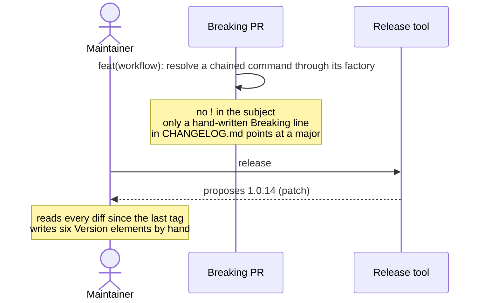
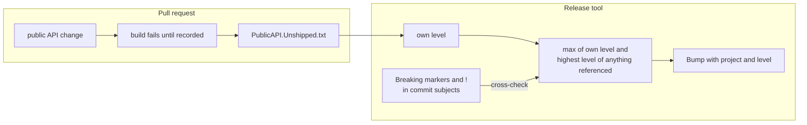

# Derive each package's version bump from its public API diff

Status: Rejected
Date: 2026-08-25
Release: Rejected

**Never built.** The release tool this changes was deleted in
[#285](https://github.com/KitCli/KitCli/pull/285). The sizing rule lives on as a
manual step in `CONTRIBUTING.md`'s
[Versioning & releases](https://github.com/KitCli/KitCli/blob/main/CONTRIBUTING.md#versioning--releases).

Justified by
the [SemVer investigation](../investigations/respect-semver-in-release.md),
the spike on [#135](https://github.com/KitCli/KitCli/issues/135).

## Context

**The release tool could only produce a patch bump, so the semver call fell to whoever ran the release, weeks after the change, reading a diff.**

| Term | Meaning |
|---|---|
| Bump level | Patch, minor or major: how far a package's version moves. |
| Public API | The types and members a consuming app can call. |
| `KitCli.Tooling.Release` | The release tool at the time of this decision. It was deleted in commit c5f1766 ([#285](https://github.com/KitCli/KitCli/pull/285)), along with `BumpPatchVersion` and `VersionBumper`. |

`KitCli.Tooling.Release` exposed one bump operation, `BumpPatchVersion`, and called it for every project it decided to bump ([#127](https://github.com/KitCli/KitCli/issues/127)). No argument made it produce anything but a patch.

v2.0.0 is what that cost. `NextCliCommandOutcome` went from a concrete record to an abstract base (the [chain-by-type ADR](chain-to-a-command-by-type.md)), so `new NextCliCommandOutcome(cmd)` stopped compiling for consumers. The tool proposed 1.0.14, and six `<Version>` elements were written by hand instead.

#127 proposes deriving the bump from Conventional Commit types. That would not have worked here: the commit had no `!`, so the derived bump would have been 1.1.0.

This ADR assumes per-package versioning, which is what shipped at the time. It decides how a bump is *sized*, not whether packages share a number. The [lockstep ADR](version-the-packages-in-lockstep.md) since decided they share one, which narrows the propagation below to a single maximum over the set.

## Decision

**Public API changes are recorded at compile time, and the release tool reads that record.**

Every packable project takes `Microsoft.CodeAnalysis.PublicApiAnalyzers` with committed `PublicAPI.Shipped.txt` and `PublicAPI.Unshipped.txt`. Changing public API fails the build until the change is written into `Unshipped`, in the PR that makes it. Releasing moves `Unshipped` into `Shipped`.

| What `Unshipped` holds | Bump |
|---|---|
| A `*REMOVED*` line | Major |
| Any other line | Minor |
| Empty, over changed files | Patch |

Semver then lives in two places:

- **`VersionBumper.BumpPatchVersion` becomes `Bump(project, level)`.** Its `switch` is the whole arithmetic.
- **The `changed || dependsOnBumped` sweep becomes `max(own level, highest level of anything referenced)`.** The walk is already dependencies-first. That `max` stops a package shipping a minor that drags an incompatible dependency behind it, since `dotnet pack` emits exact inter-package versions rather than ranges.

The `**Breaking:**` markers and the `!` in commit subjects become cross-checks, not derivers: they fail the release when they disagree with the API diff. On v2.0.0 both signals existed, contradicted each other, and nothing looked.

## Alternatives considered

- **Derive from Conventional Commits alone**, as #127 proposes. The breaking commit had no `!`. The marker is forgettable. A build error is not.
- **Derive from `CHANGELOG.md` alone.** It is repo-wide, so a line cannot be mapped to the package whose API moved. A good assertion that a break exists, a poor one about where.
- **Keep patch-only and hand-edit at release time.** What v2.0.0 did. It works exactly as long as the person releasing reads every diff since the last tag.
- **Diff the built assembly against the published nupkg at release time.** Needs the network and the previous package, and reports after the change has landed rather than failing the PR that made it.
- **Version all nine packages in lockstep.** A separate question, since answered by the [lockstep ADR](version-the-packages-in-lockstep.md). It changes how a level propagates, not how one is detected.

## Consequences

| Gets easier | Gets harder |
|---|---|
| Silent signature breaks become build failures, whether or not the tool ever reads the files. | A PR that changes public API cannot compile until it records the change. That is the mechanism, and it is friction on every such PR. |
| `VersionBumper` would have become unit-testable, which it never was. | Adoption needs a `PublicAPI.Shipped.txt` baseline for nine packages first. |
| The tool will not understate a signature break, and will not contradict a written `**Breaking:**`. | **Behavioural breaks are still missed.** v1.0.13 turned a captured `Scoped` dependency into a startup failure and v1.0.12 made an unhandled handler exception end the session. Both changed no signature and both shipped as patches. For these the `CHANGELOG.md` cross-check is the only signal, and it only fires if a human wrote the marker. |
| | The tool cannot catch a behavioural break nobody wrote down. |

The work would have sequenced as baseline, then derivation, then the release procedure. The last was to be a skill rather than code, including the step that bumped `KitCli.Tooling.Release`'s own `KitCli` pin, which nothing mechanical asked for.
