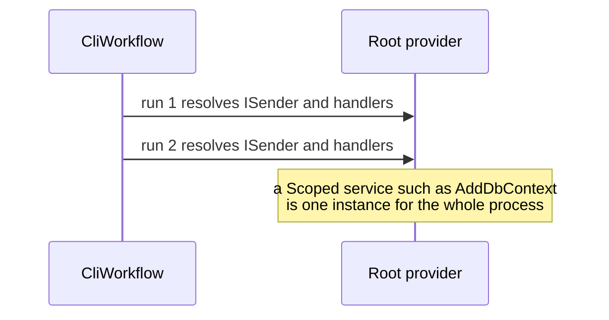
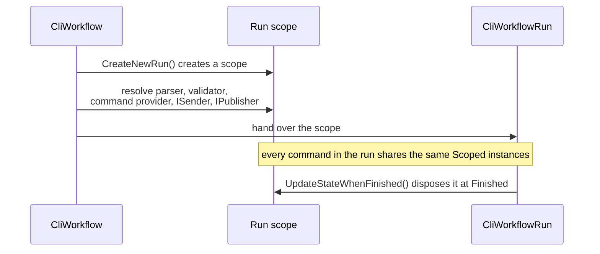

# Create a DI scope per workflow run

Status: Accepted
Date: 2026-08-22
Release: 1.0.11

The [run-scope ADR](resolve-the-whole-run-from-its-scope.md) proposes to
supersede this. It keeps the per-run scope and extends it to the whole run;
read it before relying on the lifetimes decided here.

## Context

**A `Scoped` service behaved like a singleton for the whole process, silently.** A consumer registering one got a single instance, not one per unit of work. This surfaced as issue #71.

| Term | Meaning |
|---|---|
| Run | Every command from the first one up to a final outcome. |
| Scope | An `IServiceScope`: the boundary inside which a `Scoped` service has one instance. |
| Multi-turn run | A run that loops through `ReachedReusableOutcome` or `MovePastAsk`. |

`CliAppBuilder.Run()` called `_services.BuildServiceProvider()` once and resolved `CliApp` and everything it depends on from that root provider. `CliWorkflow.CreateNewRun()` did the same for each run's `IInstructionParser`, `IInstructionValidator`, `ICliWorkflowCommandProvider`, `ISender` and `IPublisher`. A repo-wide search for `CreateScope`, `IServiceScope` and `ValidateScopes` found nothing, and `ValidateScopes` defaults to `false`, so nothing caught the misuse.

## Decision

**`CliWorkflow` depends on `IServiceScopeFactory` instead of `IServiceProvider`, and creates one `IServiceScope` per run.**

| Fact | Consequence |
|---|---|
| `CreateNewRun()` resolves `IInstructionParser`, `IInstructionValidator`, `ICliWorkflowCommandProvider`, `ISender` and `IPublisher` from `scope.ServiceProvider`. | Each run gets its own set of `Scoped` instances. |
| `CliWorkflowRun` holds the scope and disposes it in `UpdateStateWhenFinished()`, the moment its state reaches `Finished`. | The scope ends once per run. See [workflow-run-state-machine.md](../concepts/workflow-run-state-machine.md) for how that guard fires exactly once. |
| The scope is per *run*, not per *command*. A multi-turn run keeps the same scope across every command. | It mirrors ASP.NET Core's per-request scope in spirit: one unit-of-work boundary, here the whole run. |
| `ICliWorkflowCommandProvider` stays `Singleton`. It only resolves the also-singleton `ICliCommandFactory` and `IArtefactFactory` implementations. | It does not need the per-run scope. |
| `ISender` and `IPublisher` come from the run's scope. | MediatR resolves `IRequestHandler<T>` instances, and their constructor-injected dependencies, from it at `Send()` time. That is where the per-run isolation comes from, and the run-scope ADR revisits that reasoning. |

## Alternatives considered

- **`BuildServiceProvider(new ServiceProviderOptions { ValidateScopes = true })`.** Turns the misuse into a loud failure instead of a silent one, but gives consumers no correct `Scoped` semantics. It only stops them registering `Scoped` services at all without a scope existing somewhere.
- **A scope per command instead of per run.** Gives the tightest isolation, but breaks any multi-turn run that expects a `Scoped` service to survive from one command to the next, e.g. a `DbContext` tracking entities across a paging interaction.

## Consequences

| Gets easier | Gets harder |
|---|---|
| Any `Scoped` service gets a fresh instance per run, matching what `AddDbContext<T>()` and similar registrations already assume. | `CliWorkflow`'s public constructor changed from `IServiceProvider` to `IServiceScopeFactory`. That is a breaking change for any direct consumer of it. |
