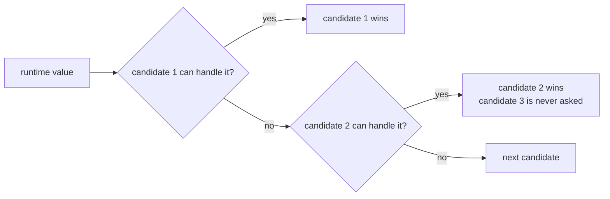

# Resolve ambiguous candidates by first match in registration order

Status: Accepted (retroactive — reconstructed from current source, not
original notes)
Date: 2026-07-26
Release: 1.0.0

## Context

**Given a runtime value and candidates that each say whether they can handle it, which one runs when more than one says yes?** Four independent parts of KitCli face this. Each was arrived at separately, and all four behave the same. Naming one pattern means learning it once.

| Chooser | Picks the first | Whose check returns `true` | Concept doc |
|---|---|---|---|
| `InstructionParser.Parse` | `IInstructionArgumentBuilder` | `For(value)` | [instruction-parsing-pipeline.md](../concepts/instruction-parsing-pipeline.md) |
| `CliWorkflowCommandProvider.GetCommand` | `ICliCommandFactory`, among those keyed under the resolved name | `CanCreateWhen()` | [command-registration.md](../concepts/command-registration.md) |
| `CliWorkflowCommandProvider.ConvertOutcomesToArtefacts` | `IArtefactFactory` | `For(outcome)` | [artefacts.md](../concepts/artefacts.md) |
| `CliApp.WriteOutcomes` | `IOutcomeIoWriter` | `CanWriteFor(outcome)` | [outcome-writing.md](../concepts/outcome-writing.md) |

## Decision

**Wherever KitCli chooses among candidates that self-report "can I handle this", take the first that says yes, by DI registration order, or by list order where the caller controls it.**

There is no priority system, no ambiguity error, and no detection of a second candidate that would also have said yes.

## Alternatives considered

- **Throw on ambiguity.** Safer, but requires evaluating every candidate rather than short-circuiting, and turns an overlapping registration into a runtime crash. Command factory registration already throws on *type*-level ambiguity at startup. The four points here do not.
- **Explicit priority metadata on each candidate.** Removes the order dependency, and adds a second thing every implementer must get right on top of the `For`/`CanCreateWhen` check.
- **Keyed lookup instead of scan-and-test.** Works only where a natural string key exists, which is why command resolution narrows by name *before* falling back to this pattern. The other three resolve from a runtime value, not a string a user typed.

## Consequences

| Gets easier | Gets harder |
|---|---|
| Short-circuit evaluation, and nothing for an implementer to declare beyond the check. | All four points share one fragility: correctness depends on registration order. |
| Registration stays out of consuming code. | That order lives in whichever `Add...` call wired things up, not in the candidate types. Moving or inserting a registration can silently change which candidate wins, with no error anywhere. |

This is an accepted cost of keeping registration out of consuming code (the [reflection-registration ADR](reflection-based-automatic-registration.md)), not an oversight repeated four times.
