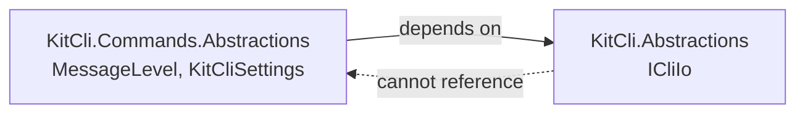
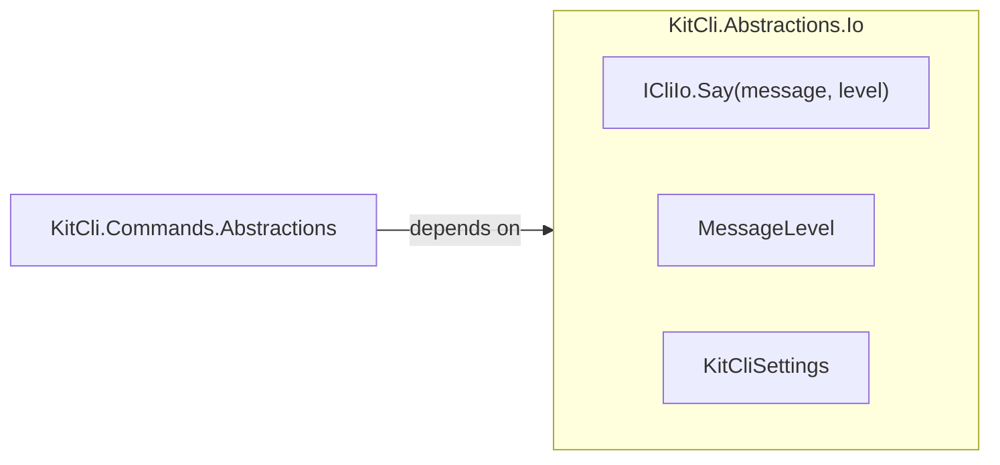

# Keep MessageLevel and KitCliSettings beside ICliIo

Status: Accepted
Date: 2026-10-12
Release: 3.3.0

## Context

**The "hide messages below a minimum level" rule works only for outcomes, so code that writes straight to the console had to copy it.** See [#310](https://github.com/KitCli/KitCli/issues/310).

| Term | Meaning |
|---|---|
| `MessageLevel` | How important a message is. |
| `KitCliSettings` | App settings, including `MinimumMessageLevel`. |
| `ICliIo` | What a command reads from and writes to. Lives in `KitCli.Abstractions`. |

`BySaying(message, level)` hides a message below `KitCliSettings.MinimumMessageLevel`, but only for outcomes. Progress lines from a pipeline inside a command write straight to the console, so each app wrote its own copy of the rule.

The rule belongs on `ICliIo`. But `MessageLevel` and `KitCliSettings` lived in `KitCli.Commands.Abstractions`, which depends on `KitCli.Abstractions`, so `ICliIo` could not reach them:

## Decision

**`MessageLevel` and `KitCliSettings` move to `KitCli.Abstractions.Io`, the namespace of `ICliIo`. `ICliIo` gains `Say(message, level)`, and `CliIo` takes an optional `KitCliSettings` to apply the minimum.**

## Alternatives considered

- **An extension in `KitCli.Commands.Abstractions`.** Nothing moves, but the caller passes the settings in every time.
- **`Say(message, level)` that never filters.** It needs the move anyway and leaves each app to write the filter again.

## Consequences

| Gets easier | Gets harder |
|---|---|
| Code that writes straight to the console shares the outcomes' filter. | Code that names `MessageLevel` or `KitCliSettings` adds `using KitCli.Abstractions.Io;`. This breaks code that references `KitCli.Commands.Abstractions` directly. Apps that reference only the `KitCli` package are unaffected. |
| Apps using `CliIo` need nothing. | An app with its own `ICliIo` implementation adds the new method. |
| | The outcome writers still do their own check, so the rule exists twice until they call `Say(message, level)` instead. |
