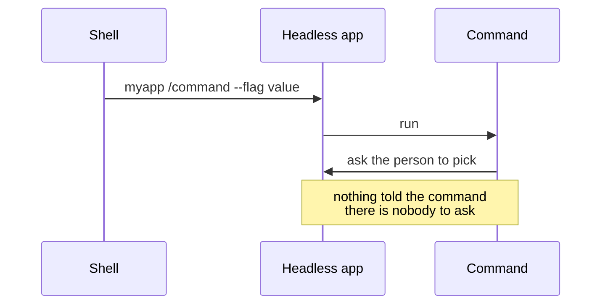
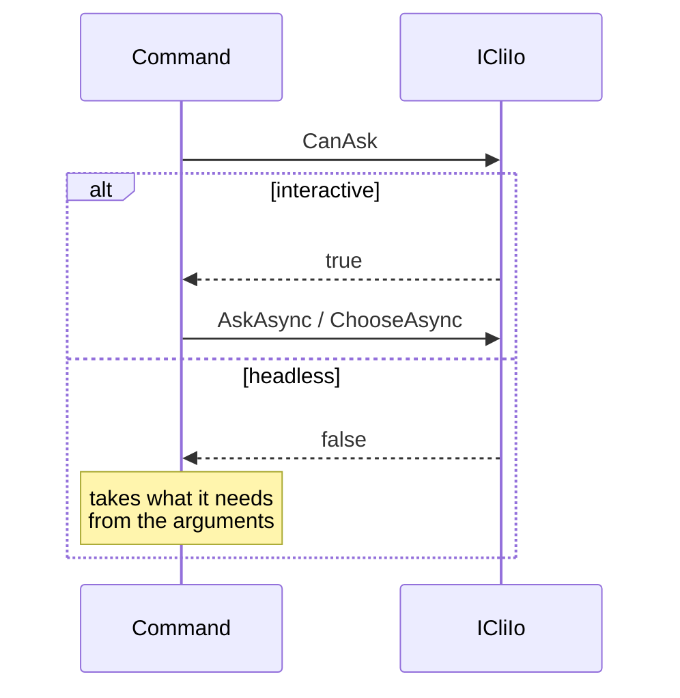

# Let a command ask its I/O whether anyone can answer

Status: Accepted
Date: 2026-09-05
Release: 3.4.0

## Context

**A command had no way to learn whether its app is headless, so one that prompts in an interactive session had nobody to ask under `myapp /command --flag value`.**

| Term | Meaning |
|---|---|
| Headless | An app run in one shot, as `myapp /command --flag value`, with no one at the keyboard. |
| `ICliIo` | What a command reads from and writes to. Every command already has one. |

A command that would confirm, page or prompt got no signal that nobody could answer:

The wider practice phrases the question as "can I prompt?" and hangs it on the I/O object, not the app:

| Ecosystem | Name |
|---|---|
| gh | `CanPrompt()` |
| Spectre.Console | the `Interactive` capability |
| Symfony | `isInteractive()` |

## Decision

**A command that works in both a headless and an interactive app reads `CanAsk` before it prompts.**

| Piece | Change |
|---|---|
| `ICliIo` | Gains `CanAsk`, with a default body of `true`, so no existing I/O breaks. |
| `HeadlessCliIo` | Derives from `CliIo`, answers `false`, and throws `NoInputException` from `AskAsync`, `ChooseAsync` and `ChooseManyAsync`. That is a programming error, not an end of input. |
| `CliAppBuilder.Run` | Registers the I/O from the app it was given, unless a registry registered an `ICliIo` first, so a consumer's own I/O still wins. |
| `AddCli<TCliApp>` | No longer calls `AddCliAbstractions()`, which only ever registered `CliIo`. That method is deprecated rather than removed. |

## Alternatives considered

- **The app answers `IsHeadless`** under a one-member interface. No wiring, but an interface invented to carry a boolean, and not where the ecosystem puts the question.
- **A `canAsk` flag threaded through registration** into `CliIo`'s constructor. A flag passed down three layers to set one property.
- **Register `CliIo`, then `Replace` it** for a headless app. It registers the wrong one first.
- **A second builder door, `WithHeadlessApp<T>()`**, each door registering its I/O. More public API than the question needs.
- **Split `CliApp` into interactive and headless siblings** so the doors constrain at compile time. Every custom interactive app would extend a new name, which is too dramatic for the gain.
- **`CloseInput()` on the I/O**, called by the headless app at session start. A singleton that flips state once, and a custom I/O could ignore it.
- **Detect a terminal on stdin.** It answers "is a person at the keyboard?", which disagrees with a headless run launched by hand.

## Consequences

| Gets easier | Gets harder |
|---|---|
| Additive. An app that still calls `AddCliAbstractions()` keeps `CliIo`, as it does today, and gets a deprecation warning. | The builder reads the registered app's type to pick the I/O. That is the one runtime choice left, and it sits in the composition root beside the existing "headless app with no args" check. |
| A command can check `CanAsk` and fall back to its arguments. | Asking or offering a choice through a headless I/O throws, so a command must check `CanAsk` first. |
