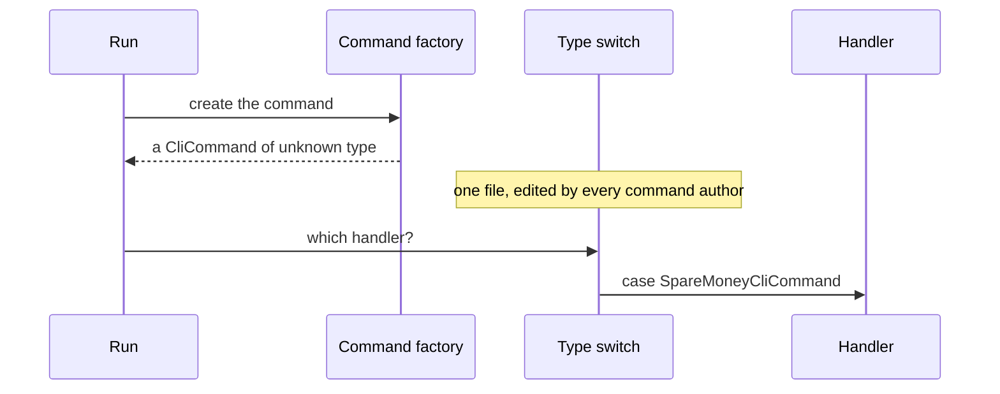
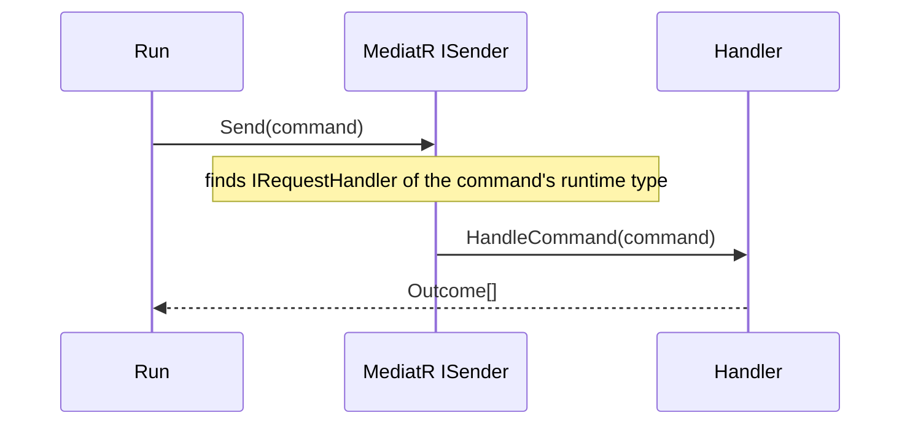

# Use MediatR for command dispatch

Status: Accepted (retroactive — reconstructed from code, not original notes)
Date: 2026-07-24
Release: 1.0.0

## Context

**A run finds a command by reflection, so it holds an object whose concrete type it cannot name, and must still reach the one handler written for that type.** Doing that by hand is a type switch that every command author has to edit.

| Term | Meaning |
|---|---|
| Command | What the user types, e.g. `/spare-money`. |
| Handler | The class that runs one command and returns its outcomes. |
| Run | Every command from the first one up to a final outcome. |



## Decision

**Model each `CliCommand` as an `IRequest<Outcome[]>` and dispatch it through MediatR's open-generic `IRequestHandler<>` resolution.**



The shape a consumer writes:

```csharp
public record SpareMoneyCliCommand : CliCommand;

public class SpareMoneyCliCommandHandler : CliCommandHandler<SpareMoneyCliCommand>
{
    public override Task<Outcome[]> HandleCommand(SpareMoneyCliCommand command, CancellationToken cancellationToken)
        => FinishThisCommand()
            .ByFinallySaying("Here you go.")
            .EndAsync();
}
```

## Alternatives considered

- **Hand-written type switch or visitor.** Puts dispatch in one file every command author must touch, and grows with the command count.
- **Direct DI resolution of `ICliCommandHandler<T>`.** What MediatR does internally, minus the pipeline-behaviour seam if logging or validation is ever wanted.

## Consequences

| Gets easier | Gets harder |
|---|---|
| A command author writes a handler and never edits dispatch code. | MediatR and MediatR.Contracts join the dispatch path for what is structurally a single-request use case. That is heavier than strictly necessary, but it solves the real type-erasure problem rather than being ceremony. |
| Logging or validation can be added later as pipeline behaviours. | |
