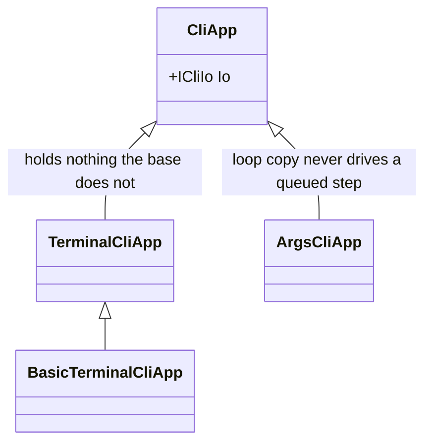
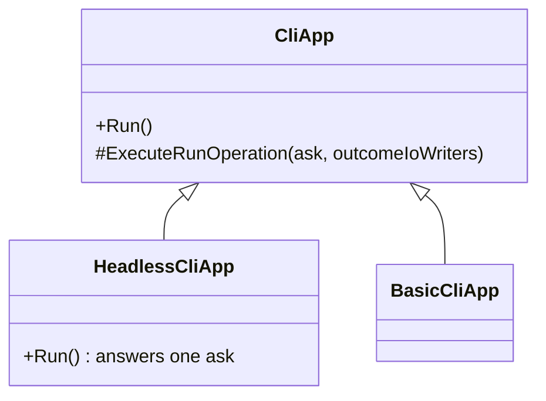

# Merge the hosts and name the variant headless

Status: Accepted
Date: 2026-08-26
Release: 3.0.0

Reverses the [CliApp-split ADR](args-driven-cli-app.md). Informed by
the [shared-run-loop investigation](../investigations/how-much-of-the-run-loop-can-the-two-hosts-share.md).

## Context

**A one-shot invocation ran the first command of a chain and exited 0, dropping the rest in silence** ([#167](https://github.com/KitCli/KitCli/issues/167)).

| Term | Meaning |
|---|---|
| Host | The app class that owns the loop: read an ask, run it, write the outcomes. |
| Chain | A handler handing straight on to another command, so one ask runs several commands. |
| Ask | One line the user typed, or the process args joined into one. |
| Run | Every command from the first one up to a final outcome. |

The [CliApp-split ADR](args-driven-cli-app.md) split `CliApp` into `TerminalCliApp` and `ArgsCliApp`. That copied the host loop into two places, and the args copy is the one that never drove a queued step.

The split never paid for itself. `CliApp` already holds `ICliIo`, which it needs for `Pause`, `Say` and `OnCancel`, so `TerminalCliApp` held nothing the base did not. Every attempt to abstract "where an ask comes from" pushed a seam into the base that only one subclass ever meant.

## Decision

**`TerminalCliApp` folds into `CliApp`, which *is* the interactive app, and `ArgsCliApp` becomes `HeadlessCliApp`.**

| Change | Detail |
|---|---|
| `TerminalCliApp` | Folds into `CliApp`. |
| `ArgsCliApp` | Becomes `HeadlessCliApp`, overriding `Run` to answer one ask with nobody to prompt. |
| `ExecuteRunOperation` | Keeps its name, takes the ask, and drives the run past every step it queues. Both hosts need it, and it is now written once. |
| `BasicTerminalCliApp` and `WithBasicTerminalApp()` | Become `BasicCliApp` and `WithBasicApp()`. |
| The playground apps | Become `KitCli.Playground.App` and `KitCli.Playground.App.Headless`. |

**Headless, not one-shot.** A headless invocation is not limited to one command, since a chain runs every step. It is limited to one *run*, because nothing is attached to its input, so no second ask can start another. "One-shot" names a symptom that is not even true, and is the misreading behind #167. Prose may still say "a one-shot invocation".

## Alternatives considered

- **An ask-source seam on `CliApp`** (`SourceAsk`, defaulting to none). It made the base know about sourcing asks, and made `HeadlessCliApp` implement a member meaning "not me". A refused bequest.
- **An args-backed `ICliIo`** yielding the args once, then end-of-input. Honest, but it moves the mode into DI registration and leaves both app classes empty.
- **Copying `TerminalCliApp`'s continuation into `ArgsCliApp`.** Fixes #167 and keeps the duplicate that caused it.
- **Merging both hosts into one class.** Loses the type test `CliAppBuilder` uses to reject a headless launch with no args, turning a named error into a process waiting on input that never comes.

## Consequences

| Gets easier | Gets harder |
|---|---|
| The continuation loop is written once, so a chain runs every step in both hosts. | Reverses the CliApp-split ADR, now marked superseded. Breaking for every consumer naming the old types. |
| A headless app rethrows an `ExceptionOutcome` like an interactive one, so a throwing handler ends it with a non-zero exit instead of 0. | `KitCli.Tooling.Release` consumed the published `KitCli` package, not the project, so it stayed on `ArgsCliApp` until a release shipped the new name and its pin was bumped. The rename was a two-step. That tool has since been deleted. |
| | The continuation loop reads the run's *current* status rather than `WasChangedTo`'s history, which a `while` requires. History answers true forever once a run has moved past an ask. |
| | **A chain that never ends now leaves a headless invocation running** rather than truncating it silently. That is [#168](https://github.com/KitCli/KitCli/issues/168), and it is why #168 blocks the rest of this work. |
