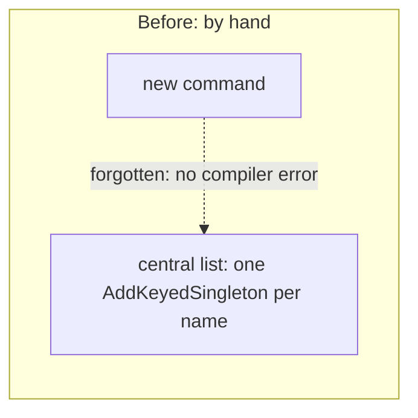
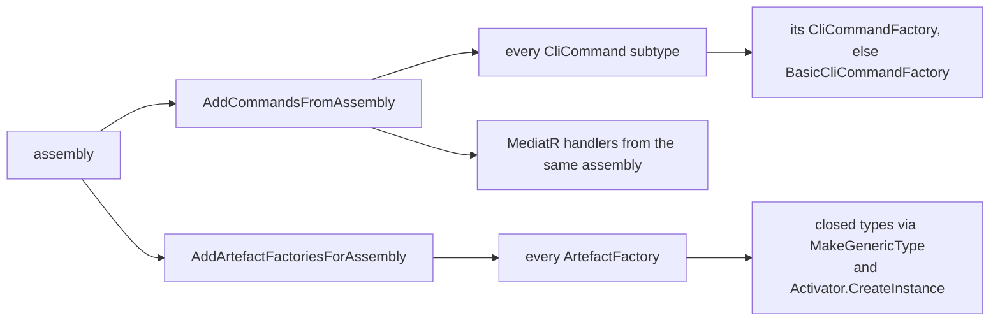

# Discover commands, factories, and handlers by reflection over manual DI wiring

Status: Accepted (retroactive — reconstructed from KitCli and SpendfulnessCli
history, not original notes)
Date: 2026-07-26
Release: 1.0.0

## Context

**Adding a command meant editing a central list, which is easy to forget and gives no compiler error when you do.** The codebase KitCli was extracted from registered every command generator by hand, one `AddKeyedSingleton` per instruction name.

The same shape kept recurring as the framework grew: some registerable type identified by a shared base type, that a consuming application should not have to enumerate.

| Term | Meaning |
|---|---|
| Command | What the user types, e.g. `/spare-money`. |
| Command factory | Builds the `CliCommand` from what the user typed. |
| Artefact factory | Turns an outcome into an artefact a later command can look up. |
| Handler | The class that runs one command. |

## Decision

**Wherever KitCli needs "every implementation of X in a given assembly", it reflection-scans that assembly at startup and registers what it finds.**

| Method | Finds | See |
|---|---|---|
| `AddCommandsFromAssembly` | Every `CliCommand` subtype. Matches it to a `CliCommandFactory<>`, or falls back to `BasicCliCommandFactory<>`. Registers MediatR handlers from the same assembly. | [command-registration.md](../concepts/command-registration.md) |
| `AddArtefactFactoriesForAssembly` | Every `ArtefactFactory<>`, building closed generic types with `MakeGenericType` and `Activator.CreateInstance`. | [artefacts.md](../concepts/artefacts.md) |

## Alternatives considered

- **Manual registration, one line per implementation.** Explicit and traceable, but every new type becomes a second place to remember, with no compiler check when it is missed.
- **Keyed DI driven by a name argument at registration time.** Needs the call site to know the key up front, which reflection derives from the type instead.

## Consequences

Adding a command, artefact factory or handler needs no DI code: write the class and it is found.

| Gets easier | Gets harder |
|---|---|
| No central list to edit or forget. | `Activator.CreateInstance` needs a parameterless constructor on anything discovered this way, so consumer artefact factories can take no dependencies. |
| | A class in an assembly nobody told KitCli to scan is silently unregistered. Nothing names what was missed, and a consumer notices at runtime. |

See the "Gaps" sections of [artefacts.md](../concepts/artefacts.md) and [command-registration.md](../concepts/command-registration.md) for the failure shape in each subsystem.
