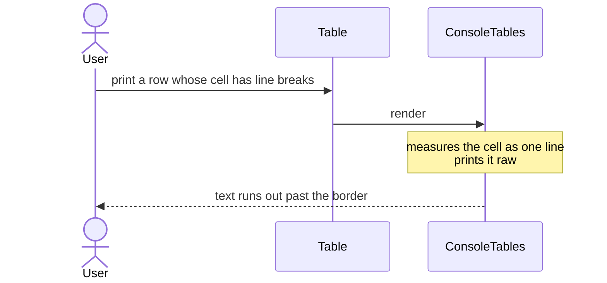
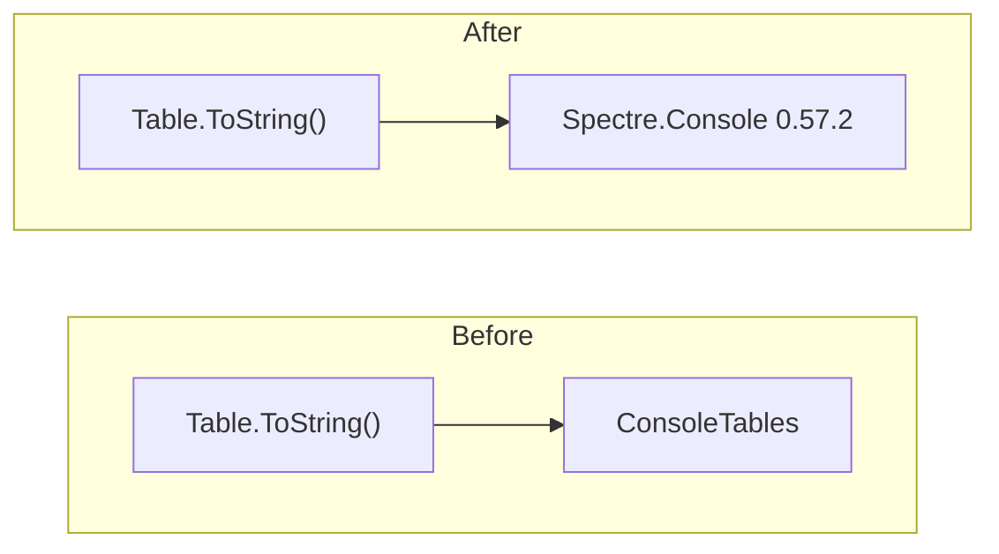

# Render tables with Spectre.Console

Status: Accepted
Date: 2026-09-10
Release: 3.1.1

## Context

**A table cell holding line breaks broke the box around it, and the library behind `Table.ToString()` cannot be fixed to do better.** See [#214](https://github.com/KitCli/KitCli/issues/214).

| Term | Meaning |
|---|---|
| `Table` | The KitCli type an app fills with rows and prints. |
| ConsoleTables | The library `Table.ToString()` rendered through. |
| Spectre.Console | A console library KitCli already depends on. |

ConsoleTables measured a whole cell as one line, then printed it raw, so the text ran out past the border:

Four other open issues asked for things that library cannot do:

- a chosen border style
- numbers lined up on the right
- a row count
- a per-column format

Its author closed the same line-break request upstream with "I don't think this library supports it", recommended Spectre.Console, and described his project as "a fun experiment". The spike that followed is the [Spectre.Console investigation](../investigations/should-table-rendering-be-rebuilt-on-spectre-console.md).

## Decision

**Render through Spectre.Console 0.57.2 instead.**

One method changes: `Table.ToString()`. The library appears only as a local variable inside it, so no public name or signature moves. What changes is the printed text, not the code anyone writes.

## Alternatives considered

- **Patch the old library.** Splitting each value on its line breaks stops the spill in about ten lines, but the old library rules a divider after every line it prints, so a stack trace would still read as several rows.
- **Wait for [#14](https://github.com/KitCli/KitCli/issues/14)** to move the renderer out of `KitCli.Abstractions` first, so a pre-1.0 dependency lands somewhere a consumer can decline. Its milestone is one issue of eight done with no due date, and pinning a version contains the risk meanwhile.
- **Keep ConsoleTables and expose more of it.** Its column-type hints have no public setter, so right-aligned numbers stay unreachable however much of the rest is exposed.

## Consequences

| Fact | Consequence |
|---|---|
| Every table an app prints changes appearance. | The `Ascii` border with row separators keeps it close, but not identical. |
| A cell holding line breaks renders inside its own row. | #214, #210 and #211 are answered together. |
| A table is sized to fit the console it prints to. | A long value wraps inside its column instead of running off the window. This is the change a reader notices most. |
| `Table.MaxColumnWidth` keeps its name. | It applies only to columns already wider than it, because a Spectre column width is exact, not a maximum. |
| Two old abilities are lost, neither used: a trailing row count, and choosing the character a long cell breaks at. | Both sit under [#212](https://github.com/KitCli/KitCli/issues/212). |
| KitCli takes on a pre-1.0 dependency in the package everything else depends on. | Spectre.Console breaks things on minor updates (one of its last three did), so the version is pinned. Moving it out under #14 stays the right destination. |
