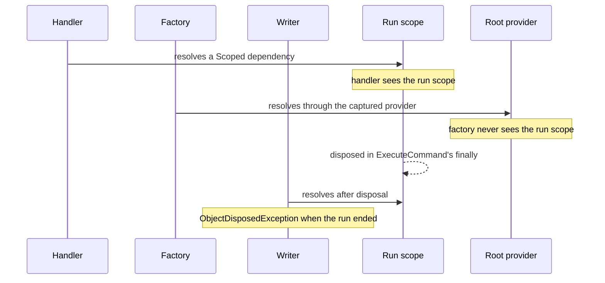
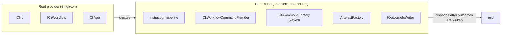

# Resolve the whole run from its scope

Status: Proposed
Date: 2026-08-24
Release: Unreleased

Supersedes the [scope-per-run ADR](di-scope-per-workflow-run.md).

## Context

**A command handler is the only extension point that can reach run-scoped state.** Factories and writers resolve from the root, so a consumer's registration is silently promoted to process lifetime.

| Term | Meaning |
|---|---|
| Run | Every command from the first one up to a final outcome. |
| Run scope | The DI scope created for one run. |
| Root provider | The process-wide `IServiceProvider`. Singletons are built from it. |
| Extension point | Code a consumer writes and KitCli calls: a handler, a factory, a writer. |

The [scope-per-run ADR](di-scope-per-workflow-run.md) created one scope per run. It kept `ICliWorkflowCommandProvider` a `Singleton` because it only resolves other singletons. That reasoning holds today and is circular: those factories are singletons because nothing made them otherwise.

Two mechanisms cause the gap:

| Fact | Consequence |
|---|---|
| `CliWorkflowCommandProvider` is a singleton injecting `IServiceProvider`. Singletons are constructed in the root, so the provider it captures is the root provider, even though `CreateNewRun()` resolves it *from* the run's scope. | Factories resolving through it never see the run scope. MediatR's `ISender` is transient and constructed inside the scope, which is exactly why handlers do see it. |
| The run's scope is disposed inside `ExecuteCommand`'s `finally`, before `CliApp.WriteOutcomes` runs. | A writer resolving from the scope gets `ObjectDisposedException` when the command ended the run, and succeeds when it did not. Correct in testing, broken on the last step. |

Neither is caught by `ValidateScopes`/`ValidateOnBuild`. See [microsoft-dependency-injection.md](../technology/microsoft-dependency-injection.md).

## Decision

**The scope stays per run, and the whole run resolves from it, end to end.** A run is the unit of work, not a command. This matches how an ASP.NET Core request scope wraps writing the response too.

Every KitCli service that executes during a run is registered `Transient` and resolved from the run's scope. Only services that genuinely outlive a run stay `Singleton`: `ICliIo`, `ICliWorkflow` and `CliApp`.

`Transient` rather than `Scoped`, because the lifetime KitCli registers constrains what a consumer can inject into their own implementation:

| Extension point registered | Consumer's `Scoped` dep | Consumer's `Transient` dep |
|---|---|---|
| `Scoped` | honoured | captured for the whole run |
| `Transient` | honoured | honoured |

`Transient` is a strict superset. MediatR's handlers are already registered this way, and are the one part of the framework that honours a consumer's lifetimes today.

The rule reaches:

| Type | Change |
|---|---|
| Instruction pipeline | `Transient`, from the run's scope. |
| `ICliWorkflowCommandProvider` | `Transient`, from the run's scope. |
| `ICliCommandFactory` | Keyed-`Transient`. |
| `IArtefactFactory` | `Transient`. |
| `IOutcomeIoWriter` | Resolved **per run from the run's scope** instead of once from the root, the shape ASP.NET Core uses for factory-activated middleware. `Write`'s signature is unchanged. |

The scope is therefore disposed **after** its outcomes are written. `UpdateStateWhenFinished` still marks `Finished`, and the host owns disposal.

The point is not that KitCli's own types need a particular lifetime. A consumer's registration is honoured wherever their code runs, instead of being silently promoted to process lifetime by a root-resolved holder.

## Alternatives considered

- **Keep the scope-per-run ADR and document the limit.** Free and honest, but the framework advertises a per-run scope only one extension point can use, which is the more expensive kind of surprise.
- **A scope per command.** Rejected in the scope-per-run ADR and still rejected: it breaks any multi-turn run expecting a scoped service to survive between steps.
- **Leave writers alone and tell consumers to use `IDbContextFactory<T>`.** Solves one library's case, and still hands the writer a different instance from the one its own handler used.
- **Register run participants `Scoped`.** The obvious reading, and it honours only one of the two lifetimes a consumer can register.
- **Give `Write` a context object carrying the run's `IServiceProvider`.** A service locator, breaking every writer's signature. ASP.NET Core treats `RequestServices` as the escape hatch for when per-request activation is impossible. Here it is not.

## Consequences

| Gets easier | Gets harder |
|---|---|
| `IOutcomeIoWriter.Write` keeps its signature, so no custom writer breaks. | Writers are constructed once per run instead of once per process, so a writer holding state across runs changes behaviour. |
| A consumer's `Scoped` and `Transient` registrations are honoured by factories and writers, not only handlers. | `ICliWorkflowCommandProvider` changing lifetime breaks anyone resolving it from the root provider directly. |
| | Disposal moves out of `CliWorkflowRun` into the host, so `ICliWorkflowRun` exposes its scope. The trigger is "the write that followed the command that finished the run", not every write. |
| | **Consumer artefact factories still cannot take constructor dependencies.** They are built by `Activator.CreateInstance`, not by DI. This ADR knowingly leaves that unfixed: a separate defect in how those factories are registered, not a lifetime decision. |
