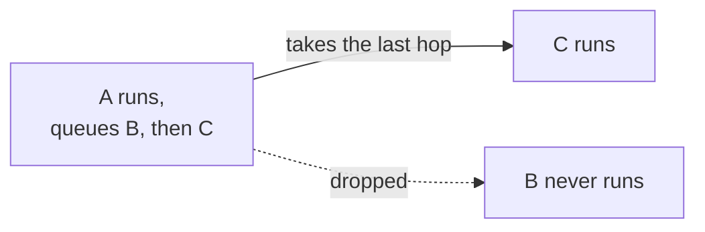
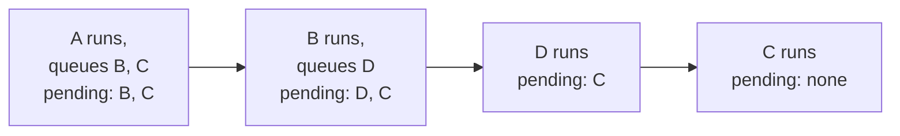

# Run every queued hop, depth-first

Status: Proposed
Date: 2026-08-29
Release: Unreleased

Settles the selection rule left open by
[#152](https://github.com/KitCli/KitCli/issues/152), ticket 3 of
[#147](https://github.com/KitCli/KitCli/issues/147).

## Context

**A handler can queue several hops, but the run executes only the last one. The rest vanish silently.**

| Term | Meaning |
|---|---|
| Hop | A command a finished command queues to run next. |
| Chain | The commands that run in turn after one ask, before the app asks again. |
| History | Every step the run took, with the outcomes each produced. |
| Pending | Hops queued and not yet run. |

The fluent builder appends whatever it is given, so queueing five hops is legal. `MoveToNext()` then scans everything the run has produced and takes the last hop queued. Whether the run continues at all depends on which outcome sits last in the handler's list, so a hop followed by a message never hops.

Nothing records which hops were already taken. The run keeps its full history, including a record of each command that ran, but `CliWorkflowRun` re-reads that raw history itself, in place, each time.

## Decision

**Every queued hop runs, in the order written. When a hop queues further hops, those run first, then the earlier queue resumes.**

A queues B then C, and B queues D. The order is A, B, D, C. Each box shows what runs, what it queues, and what waits afterwards:

B's hop D lands at the front of the pending list, so it runs before A's remaining plan resumes. An existing chain keeps its exact meaning when a sibling is stacked behind it.

The pending hops are derived, not stored. Replaying the history gives them:

| Step in the history | Effect on pending |
|---|---|
| A step executed. | It consumes the front of the pending list. |
| That step queued new hops. | They go on the front. |

| Piece | Shape |
|---|---|
| The replay | An extension over `ICliWorkflowRunState.AllOutcomeStateChanges()`, not a new interface member. |
| `CliWorkflowRun` | Asks "any hop pending?" and "which is next?". It never interprets raw history itself. |
| Factories | Still receive the flat outcome history as data. The state hides interpretation, not the outcomes. |

## Alternatives considered

- **One hop only, throw on a second** (#152's fallback). It bans a shape the builder invites, since the fluent calls read "then B, then C".
- **New hops at the back of the queue.** The derivation is one line (skip one hop per step taken), but stacking a sibling reorders an existing chain's own follow-ups.
- **Earliest hop with no matching ran-record** ([#124](https://github.com/KitCli/KitCli/issues/124)). It matches on the command, so two hops to the same command type are indistinguishable.
- **An explicit queue field on the run.** It is state that can drift from a history that already holds enough.

## Consequences

| Gets easier | Gets harder |
|---|---|
| List position stops mattering: a hop followed by a message now hops. | That is a behavior change, so a `CHANGELOG.md` entry ships with the code. |
| The public API only gains. No type changes shape and the interface gains no member, so this is a minor release, not a major. | It rewrites the chain-by-type ADR's "still takes the last queued hop" consequence. |
| The move-past-ask guard asks the state, so hops consumed steps ago no longer count as pending. A latent bug is gone. | Depth-first costs a replay instead of a skip-count. It is one well-named method on the state, pinned by ordering tests. |
| | Still nothing detects an unending chain ([#173](https://github.com/KitCli/KitCli/issues/173)). |
