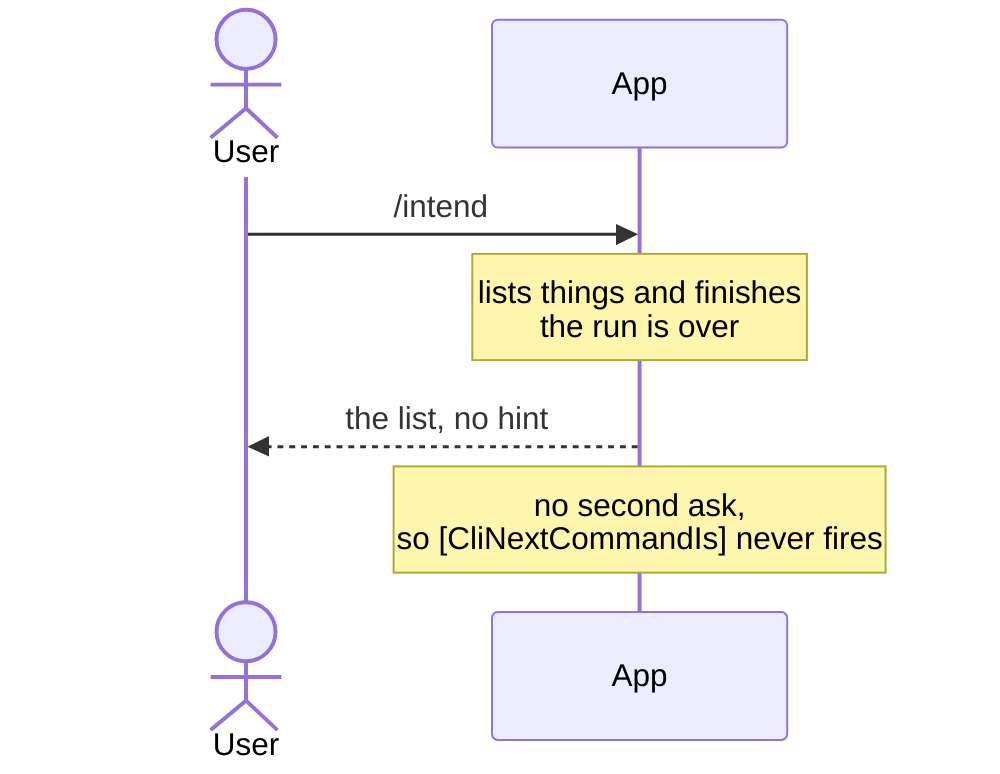
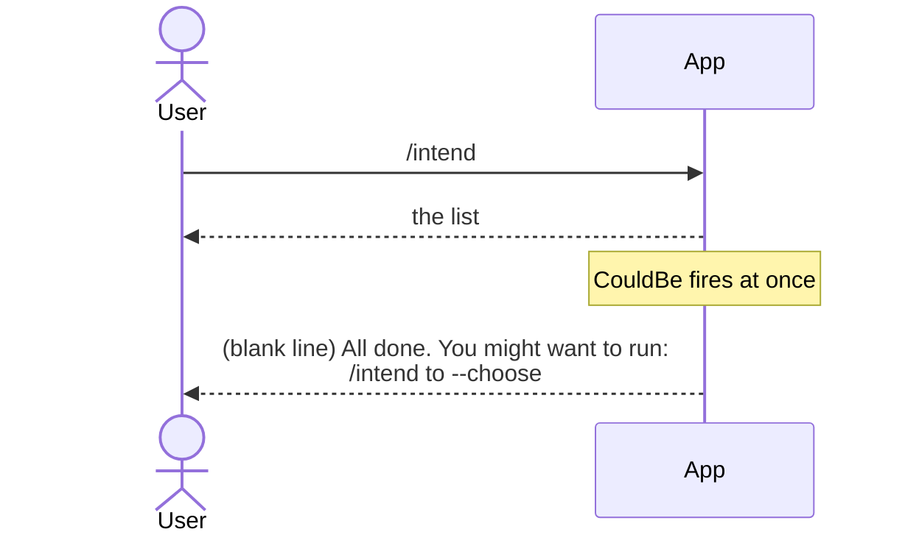

# Suggest commands that could be next via a `[CliNextCommandCouldBe]` attribute

Status: Proposed
Date: 2026-10-10
Release: 3.2.0

## Context

**A command that ends its run outright, such as a listing command, never gets a second ask, so it can never suggest a next step.** See [#294](https://github.com/KitCli/KitCli/issues/294).

| Term | Meaning |
|---|---|
| Run | Every command from the first one up to a final outcome. |
| Ask | One line the user types. |
| Suggestion | A command name and description the app prints as a hint. |

The [next-command ADR](suggest-next-commands-attribute.md) added `[CliNextCommandIs]`. A command declares its likely next step, and the run suggests it if a later ask resolves to nothing. That only happens while the run is still open, waiting on one more valid ask.



`/intend` has no way to hint that `/intend to --choose` is the obvious next step.

#294 proposes a second attribute rather than widening `CliNextCommandIs`. `Is` reads as "the run expects one of these", a claim a one-shot command's hint is not making.

## Decision

**Add `CliNextCommandCouldBeAttribute(name, description)`, the same shape as `CliNextCommandIsAttribute`, printed right after a command finishes whether or not the run stays open.**

| Attribute | Fires when | Says |
|---|---|---|
| `Is` | The run is still open and the last thing typed did not resolve. | Here is what would. |
| `CouldBe` | A command just finished. | Here is what is often asked next. |

A command may declare both:

```csharp
[CliNextCommandIs("next", "Show the next page.")]
[CliNextCommandCouldBe("export", "Export the current results.")]
public record ShowPageCliCommand : CliCommand;
```

Both now print under a header line instead of bare, so a reader knows why suggestions appear:

| Attribute | Header |
|---|---|
| `Is` | `"You might have meant:"` |
| `CouldBe` | `"All done. You might want to run:"` |



The header needs a blank line in front of it, so a small `PauseOutcome` type exists again. The next-command ADR had rejected this exact type for having only one use. It now has two.

## Alternatives considered

- **A flag on `CliNextCommandIsAttribute`** marking a suggestion non-binding. Rejected: the two cases still need separate handling wherever they are read, so the flag buys only an attribute whose meaning depends on an argument.
- **Widen `Is` to fire on every finish**, the option #294 itself raises. Rejected: a run that is still open would print the same suggestion twice in one exchange, once on finishing and once when the next ask fails.
- **One shared entry point for both attributes.** Rejected: `Is` looks back at what already ran, while `CouldBe` fires straight off the command that just ran, with nothing to look back at.
- **No header, just the suggestions.** Tried first. It read as noise with no explanation, and one line of header earns its keep.

## Consequences

| Gets easier | Gets harder |
|---|---|
| Each attribute has one fixed meaning. | Two attributes to know instead of one. |
| A command can declare both. `CouldBe` shows once on finishing, and `Is` shows again only if the run stays open and the next ask fails. Never the same event, so never twice. | `PauseOutcome` exists again, reversing that part of the next-command ADR. Its core decision, the `[CliNextCommandIs]` attribute itself, still stands. |
