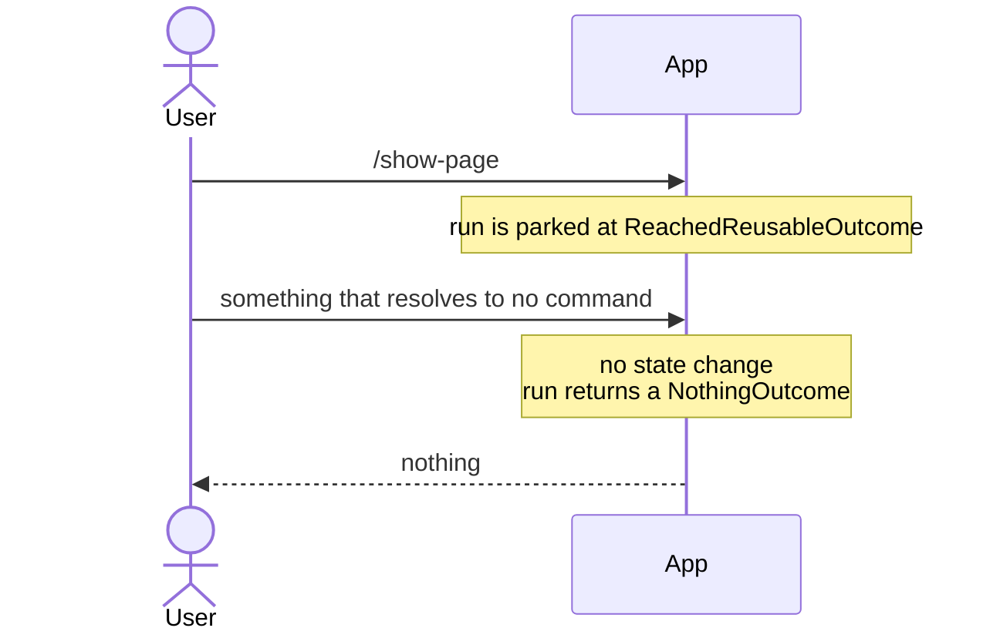
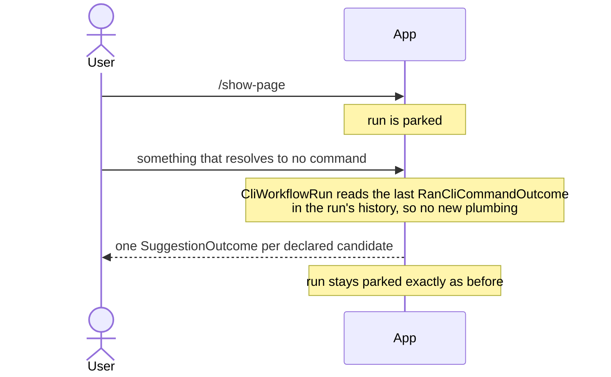

# Suggest declared next commands via a `[CliNextCommandIs]` attribute

Status: Accepted
Date: 2026-08-23
Release: 1.0.12

## Context

**A user who types something unrecognised while paging through a list gets silence, with no hint of what would have worked.**

| Term | Meaning |
|---|---|
| Run | Every command from the first one up to a final outcome. |
| Parked | The run's status `ReachedReusableOutcome`: it reached a reusable outcome, such as a page of a list, and waits for the next ask. |
| Outcome | What a command returns: "show this", or "here's what happens next". |

How it behaves today:



## Decision

**A command declares what to try next with `CliNextCommandIsAttribute`, and the run suggests those names when the next ask resolves to nothing.**

The attribute is `AttributeUsage(AttributeTargets.Class, AllowMultiple = true)` and takes a `Name` and a `Description`. It goes on the command type that reaches the checkpoint:

```csharp
[CliNextCommandIs("next", "Show the next page.")]
[CliNextCommandIs("prev", "Show the previous page.")]
public record ShowPageCliCommand : CliCommand;
```

How it behaves after:



| Fact | Consequence |
|---|---|
| `SuggestionOutcomeIoWriter` calls the existing `ICliIo.Pause()` before each suggestion. | Every suggestion is visually separated. |
| Each name is prefixed with the configured `InstructionSettings.Prefix`. | The prefix is never a hardcoded `/`. |
| A command that declares none. | The run still returns a silent `NothingOutcome`, and its state is untouched. |

## Alternatives considered

- **A separate `PauseOutcome`/writer pair before every suggestion.** An earlier draft. Once the pause became unconditional it was emitted 1:1 with a suggestion and had no other consumer, so folding it into `SuggestionOutcomeIoWriter` gives the same output with one fewer type.
- **Falling back to `InstructionConstants.DefaultNamePrefix` when the failed ask parsed no prefix.** The run synthesises a suggestion rather than echoing one back, so it should reflect the app's configured convention, not a default that a reconfigured host would contradict.
- **A single free-text message, "Did you mean 'next'?"** Filler. The bare name plus its description reads clearly on its own.
- **Two `SayOutcome`s plus an empty one as a separator.** Fakes a blank line through the message writer and gives the suggestion no outcome type to match on.
- **A `BySuggestingNextCommand` method on `OutcomeList`.** `OutcomeList` is the builder *handlers* use for their own outcomes. `CliWorkflowRun` is not a handler and builds raw `Outcome[]` everywhere else in that method.
- **One attribute taking an array.** Settled the same way the [command-alias ADR](cli-command-alias-attribute.md) settled it.

## Consequences

| Gets easier | Gets harder |
|---|---|
| A command that parks a run can declare what to try next, with no new state machinery. | One more attribute to know about. |
| A command that declares none behaves exactly as before, so the change is purely additive. | The rejected `PauseOutcome`/writer pair came back in the [could-be-next ADR](suggest-commands-that-could-be-next.md) once a second call site needed a bare blank line. |

The `[CliNextCommandIs]` attribute itself is otherwise unaffected by that ADR.
