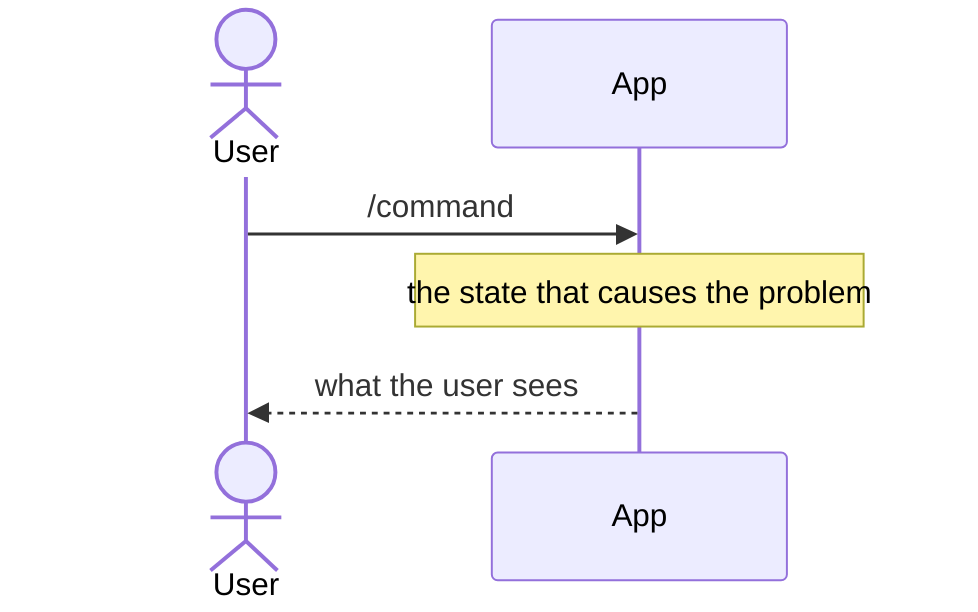
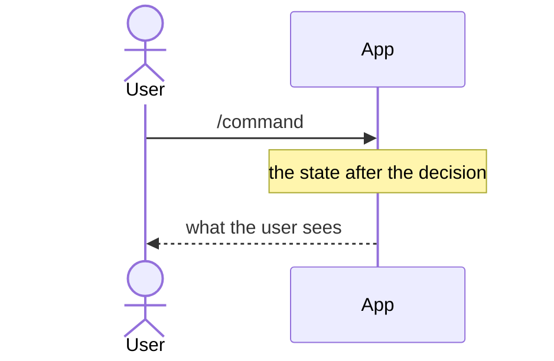

<!--
An ADR records a decision, the alternatives that lost, and what follows.
Write for a reader with no context on this codebase: the problem before the
decision, a type named only when they'd have to type it.

How to explain. The model is
docs/investigations/can-an-artefact-outlive-the-run-that-made-it.md.

- Lead with the answer, in one or two bold sentences.
- Using more than two KitCli terms? Define them first in a
  Term | Meaning table, with the codebase's real names.
- Let diagrams carry the explanation. Pick the mermaid type by what it shows:
  - sequenceDiagram: what happens over time. `Note over` shows the state
    at each step. Show a change as a "before" and an "after" diagram.
  - stateDiagram-v2: a lifetime or a status.
  - classDiagram: the types a reader writes or extends. Generics are `Artefact~T~`.
  - flowchart LR: data moving through stages. One `subgraph` per run,
    request or package.
- Show usage with real code that compiles on `main`.
- Put facts in tables: Fact | Consequence, File | Shows.
- Prose only connects the visuals: a sentence or two saying what the next
  one shows. No paragraph that a diagram, snippet or table could replace.
  Keep prose under 60 lines; diagrams, code and tables don't count.
- Verify every name, signature and sample against source.
-->

# Short title in imperative mood

Status: Proposed | Accepted | Rejected | Superseded by <ADR title>
Date: YYYY-MM-DD
Release: Unreleased | X.Y.Z | Rejected

## Context

**The problem, in one or two bold sentences.** Link the GitHub issue.

| Term | Meaning |
|---|---|
| Run | Every command from the first one up to a final outcome. |

How it behaves today:



## Decision

**What we're doing, in one sentence, no hedging.**

How it behaves after:



The shape a consumer writes:

```csharp
public record ExampleOutcome(string Value) : Outcome(OutcomeKind.Reusable);
```

## Alternatives considered

- **The alternative.** Why it lost, in one line.

## Consequences

| Gets easier | Gets harder |
|---|---|
| One line each. | One line each, including any debt taken on knowingly. |
