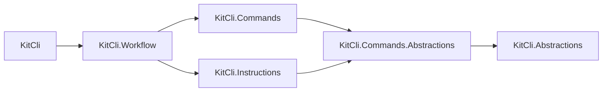
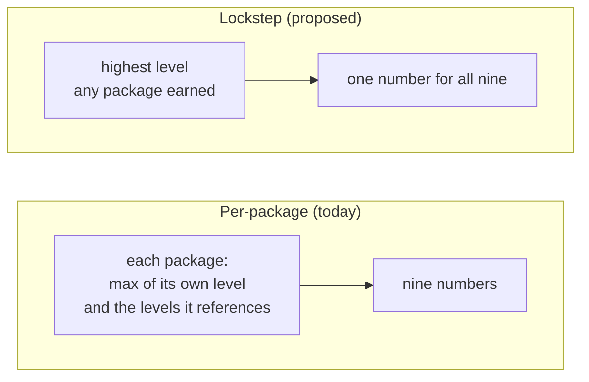

# Version all nine packages in lockstep

Status: Proposed
Date: 2026-08-29
Release: Unreleased

Answers the question the [API-diff versioning ADR](derive-version-bumps-from-the-public-api-diff.md)
deferred, on [#128](https://github.com/KitCli/KitCli/issues/128).

## Context

**The nine packages carry nine version numbers and nothing records why. No consumer installs a subset, so independent numbers buy nothing.**

| Term | Meaning |
|---|---|
| Package | One NuGet package, built from one packable project. |
| Lockstep | Every package shares one version number. |
| Level | The size of a bump: major, minor or patch. |

Today the numbers are `KitCli` 3.1.0, `KitCli.Commands` 2.0.1, `KitCli.Instructions` 1.0.9, and so on. Two of the three documents are wrong whichever way this lands:

| Document | Says | Verdict |
|---|---|---|
| `CONTRIBUTING.md` | The packages do not ship in lockstep. | Wrong if this lands. |
| `CHANGELOG.md` and `CLAUDE.md` | The packages publish as one unified set ([#178](https://github.com/KitCli/KitCli/issues/178)). | Wrong if this does not land. |

`KitCli` references every other package, directly or not. Six of the nine are shown:

Independent versions exist so a consumer picks up only what changed. Installing `KitCli` installs all eight others, so there is no partial install to optimise for.

The cost of independence is already paid. `dotnet pack` writes exact inter-package versions, not ranges, so a fix in `KitCli.Instructions` forces a new version of the seven packages above it. The blast radius is lockstep's. Only the bookkeeping is independent's.

## Decision

**Every packable project shares one version number, bumped together on every release, whether or not that project changed.**

The release tool still derives the level from the public API diff, as the API-diff versioning ADR sets out. Only the scope changes:

The API-diff versioning ADR's `max(own level, highest level of anything referenced)` walk collapses into one maximum over the set. The dependencies-first ordering it relies on stops mattering for versioning.

This is a proposal. Each package still has its own `<Version>` in its `.csproj`.

## Alternatives considered

- **Per-package, as shipped today.** Its benefit needs a consumer who takes a subset, and the dependency graph shows there is none.
- **Per-package with version ranges** instead of exact pins, which would make the benefit real. NuGet supports it, `dotnet pack` does not emit it, and it buys untested version combinations.
- **Lockstep on a platform band**, as `Microsoft.Extensions.*` does. Its major tracks the annual .NET release train, not API breakage, and KitCli has no such external cadence to track.
- **Split the repo** so the packages are genuinely independent. That answers the versioning question by deleting the framework's shape.

## Consequences

| Gets easier | Gets harder |
|---|---|
| One number to state and reason about. | **A one-time renumbering.** `KitCli.Instructions` jumps from 1.0.9 to the common number. Nothing broke, but the version stops meaning what it meant, and the release notes have to say so. |
| No combination of packages a consumer can assemble that was never built together. | A package with no change in it still ships a new version. On this graph that is close to what already happens. |
| #163 shrinks: the propagation walk becomes one maximum. | [#162](https://github.com/KitCli/KitCli/issues/162)'s API baseline is untouched, since something must still detect that a break happened. |
| `CHANGELOG.md` and `CLAUDE.md` become right. | `CONTRIBUTING.md` becomes wrong, reversing #178. That holds only once the tooling ships and a release equalises the numbers. Until then all three describe a state that does not exist. |
