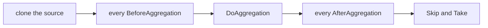

# Aggregators

**Every list command filters, projects, sorts and pages. `Aggregator<TSource, TAggregate>` is that pipeline as one reusable object, so a later "next page" command re-runs it instead of rebuilding it.**

| Term | Meaning |
|---|---|
| Aggregator | Subclass of `Aggregator<TSource, TAggregate>` that implements `DoAggregation`. |
| `BeforeAggregation` | A function that filters the raw source. |
| `AfterAggregation` | A function that sorts or filters the aggregated rows. |
| `AggregatorFilter` | A labelled record of which filter a command applied. |

```csharp
var aggregator = new TestAggregator(source)
    .BeforeAggregation(p => p.Where(ts => ts.Cost > 50))
    .AfterAggregation(a => a.OrderByDescending(ta => ta.TotalCost));
```

## Pipeline order

`Aggregate(pageSize, pageNumber)` runs these steps:



**Paging always happens last.**

## Keeping one across commands

| To... | Do |
|---|---|
| Remember an aggregator | `ByAggregating(aggregator)`. `AggregatorArtefactFactory` makes it queryable ([Artefacts](artefacts.md)). |
| Re-run it with different paging | Remember a `TableBuilder` instead ([Tables](tables.md)). |

`AggregatorFilter` is separate. `Aggregator` never reads it, and nothing ties it back to the function passed to `BeforeAggregation`.

## Gaps

The base class is abstract, so even "page a list, no real aggregation" needs a subclass: [#50](https://github.com/KitCli/KitCli/issues/50).

## See also

- [Tables](tables.md): the builder that holds an aggregator and a page.
- [Outcomes](outcomes.md): how an aggregator is remembered.
- [Artefacts](artefacts.md): how a later command finds it.
