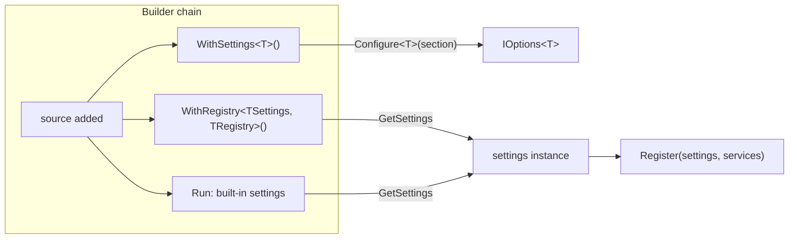

# App configuration

**`CliAppBuilder` reads settings from a file or user secrets, and hands them
to your app two ways.** `WithSettings<T>()` registers them for injection.
`WithRegistry<TSettings, TRegistry>()` passes them to a registry while the
builder chain runs.

| Term | Meaning |
|---|---|
| Source | A file or user secrets added with `WithJsonSettings` or `WithUserSecretSettings`. |
| Section | The part of a source that holds one settings type. Its name is the type name minus "Settings". |
| Registry | A class that registers an app's commands and services. |

## How it works

```csharp
new CliAppBuilder()
    .WithBasicApp()
    .WithJsonSettings("appsettings.json")
    .WithSettings<MySettings>()
    .WithRegistry<MyRegistry>()
    .Run(args);
```

`WithSettings<MySettings>()` looks up the section `My` and registers it as
`IOptions<MySettings>`. Nothing resolves it until something asks for it.



`GetSettings` is the shared lookup. `WithRegistry<TSettings, TRegistry>()`
calls it, and `Run` calls it for `InstructionSettings` and `KitCliSettings`.
`WithRegistry<TSettings, TRegistry>()` passes the result to
`Register(settings, services)`.

## The rule people miss

**What happens to a missing section depends on which method reads it.**

| Method | No source added | Source added, section missing |
|---|---|---|
| `WithSettings<T>()` | Throws: "You must call With[..]Settings before calling WithSettings." | Binds to the type's defaults. |
| `WithRegistry<TSettings, TRegistry>()` | Throws, unless `TSettings` is `InstructionSettings` or `KitCliSettings`. | Throws "No configuration section found for ...", unless `TSettings` is `InstructionSettings` or `KitCliSettings`. |
| `Run`, for `InstructionSettings` and `KitCliSettings` | Uses their own defaults. | Uses their own defaults. |

An app that never calls `WithSettings<KitCliSettings>()` still gets a
`KitCliSettings`, because `Run` resolves it.

## A registry runs at build time, not at resolution time

`WithRegistry<TRegistry>()` constructs `TRegistry` and calls
`Register(services)` immediately, before the container is built.
`WithRegistry<TSettings, TRegistry>()` does the same after resolving
`TSettings`. Registration happens once, synchronously, while the builder
chain runs.

## See also

- [CliApp host loop](cli-app-host.md): what `Run` builds once the chain ends.
- [Command registration](command-registration.md): what a registry registers.
- [Outcome writing](outcome-writing.md): how outcomes reach the screen.
