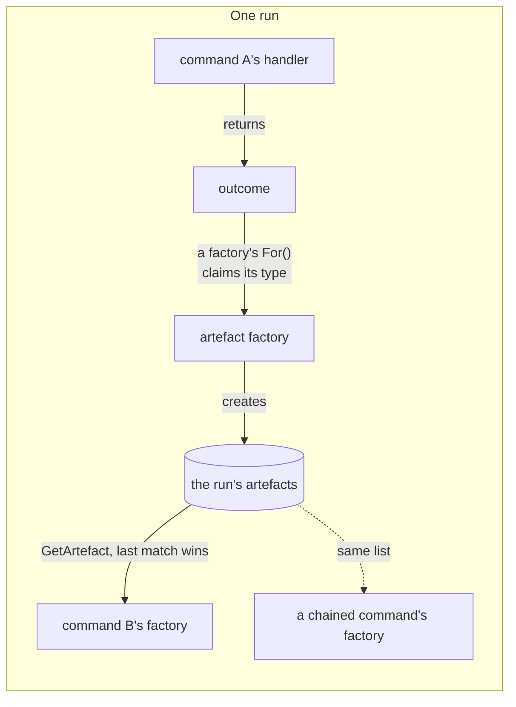

# Artefacts

**An artefact is an outcome that any later command can look up by type and
name.** An outcome belongs to the command that returned it. An artefact makes
the same data readable across the run, and across later runs when the outcome
lasts the session.

| Term | Meaning |
|---|---|
| Outcome | What a command returns: "show this", or "here's what happens next". |
| Artefact | An outcome turned into a value a later command can look up by type and name. |
| Artefact factory | The class that turns one outcome type into an artefact. |
| Run | Every command from the first one up to a final outcome. |

## How it works

A handler returns an outcome. A registered artefact factory claims its type
and creates the artefact. The next command's factory reads it back.



Three types make one:

```csharp
public record ThresholdOutcome(int Threshold) : Outcome(OutcomeKind.Reusable);

public record ThresholdArtefact(int Threshold)
    : Artefact<int>(nameof(Threshold), Threshold);

public class ThresholdArtefactFactory : ArtefactFactory<ThresholdOutcome>
{
    protected override AnonymousArtefact CreateArtefact(ThresholdOutcome outcome)
        => new ThresholdArtefact(outcome.Threshold);
}
```

A factory reads the value with `GetArtefact<T>(name)` or
`GetRequiredArtefact<T>(name)`. Both filter by type, then by name if given,
and take the **last** match. Set a value twice in a run and later commands see
the second.

**A chained command reads artefacts too.** A handler naming its successor with
`ByMovingToCommand<TCommand>()` has that command built by its factory, over the
same artefacts. Data reaches a chain through artefacts, not through the
previous handler's local variables. See
[Chaining commands together](../user-guides/chaining-commands.md).

An outcome with a session lifetime stays readable in every later run too. See
[Outcomes](outcomes.md#how-long-an-outcome-lasts).

## The rule people miss

**Registering commands does not register artefact factories.** The registry
must also call `AddArtefactFactoriesForAssembly(assembly)`.

| Fact | Consequence |
|---|---|
| `AddCommandsFromAssembly` registers commands, factories and handlers, not artefact factories. | Artefacts need their own call. |
| `AddArtefactFactoriesForAssembly` registers four built-ins, including the one behind `LastCommandIs<T>()`. | Skip it and `LastCommandIs<T>()` breaks too. |
| It then finds every `ArtefactFactory<>` in the assembly, plus one for every closed `Aggregator<,>` and `TableBuilder<,>`. | Aggregators and table builders need it as well. |
| Nothing fails at startup when the call is missing. | The first symptom is `GetRequiredArtefact` throwing at runtime. |
| An outcome becomes an artefact when a registered factory's `For()` claims its type. | `OutcomeKind` plays no part. |

## Gaps

`GetRequiredArtefact` and `GetRequiredArgument` throw bare `Exception`
despite a typed `CliException` hierarchy existing. Tracked as
[#34](https://github.com/KitCli/KitCli/issues/34).

## See also

- [Outcomes](outcomes.md): the lifetimes that decide how long an artefact stays readable.
- [Command registration](command-registration.md): where `AddArtefactFactoriesForAssembly` fits.
- [Instruction parsing pipeline](instruction-parsing-pipeline.md): how a typed ask becomes a command.
