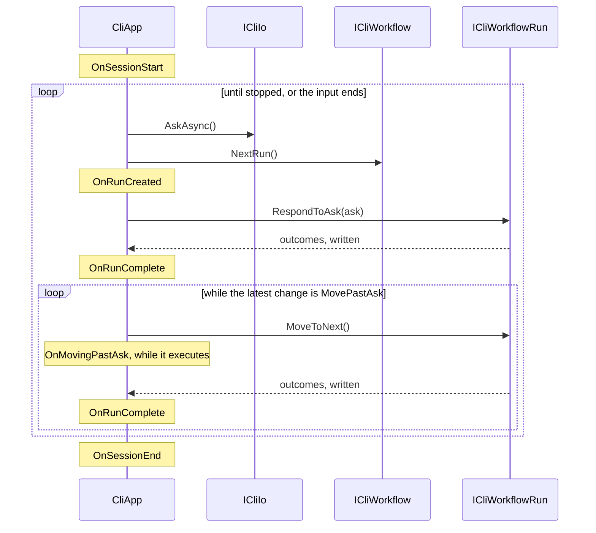

# CliApp host loop

**`CliApp` fetches what the user typed, runs it, and prints what came back.**
It is the shell around a workflow. `CliApp` is the interactive app: ask, run,
ask again. `HeadlessCliApp` handles `myapp /command --flag value`, where
nothing is attached to the input.

| Term | Meaning |
|---|---|
| Host | The class that drives the ask, run, print loop. `CliApp` or `HeadlessCliApp`. |
| Ask | What the user typed, or the process args joined. |
| Run | Every command from the first one up to a final outcome. |
| Hook | A `protected virtual` method an app overrides to watch a session. |

## How it works

Both hosts are abstract. `BasicCliApp` is the ready-made interactive one that
`WithBasicApp()` gives you. The interactive loop is `CliApp.Run`:

```csharp
OnSessionStart();
Io.Pause();
SetUpEventHandlers();

while (Workflow.Status != CliWorkflowStatus.Stopped)
{
    var ask = await Io.AskAsync(Workflow.CancellationToken);
    if (ask is null) break;
    await ExecuteRunOperation(ask, outcomeIoWriters);
}

OnSessionEnd(Workflow.Runs);
```

`ExecuteRunOperation` responds to the ask, then calls `MoveToNext()` while the
run's latest state change is `MovePastAsk`, writing each step's outcomes. A
chain arrives whole under either host.



`HeadlessCliApp` runs the outer loop's body once, with the process args joined
into the ask. The inner loop still runs a whole chain. It runs with
`HeadlessCliIo`, so a command learns which host it is under from
`ICliIo.CanAsk` ([CLI I/O](cli-io.md)).

## Hooks

Hooks let an app watch a session without overriding `Run`. None redirects
flow. All fire under both hosts.

| Hook | When it fires |
|---|---|
| `OnSessionStart` | Once, before the loop. |
| `OnRunCreated` | After `NextRun()` hands back a run, before the run is driven. Writes land ahead of anything the command prints or asks. |
| `OnMovingPastAsk` | While a queued step executes, so it suits progress indicators rather than setup. |
| `OnRunComplete` | Once per step, not once per ask. |
| `OnSessionEnd` | Once, after the loop. |
| `OnRunStarted` | `[Obsolete]`. Fires straight after `OnRunCreated`. Override `OnRunCreated` instead. |

An `ExceptionOutcome` is rethrown before its outcomes are written.

## The rule people miss

**A headless session is one run, however far it gets.** `HeadlessCliApp.Run`
opens the session, calls `ExecuteRunOperation` once, stops the workflow, and
ends.

| Fact | Consequence |
|---|---|
| Chained steps run. | A whole chain finishes under a headless app. |
| Nothing can be asked, so no second run starts. | A run left waiting at a reusable checkpoint stops there, unfinished, its DI scope undisposed. |
| The class you extend decides the mode for the life of the class. | There is no switching at runtime. |
| `CliAppBuilder.Run` throws if a `HeadlessCliApp` gets no args. | See the [host-merge ADR](../adr/merge-the-hosts-and-name-the-variant-headless.md). |

**Everything outside a run is a singleton.** `CliAppBuilder.Run` registers the
I/O the chosen app needs unless a registry did. It builds the provider with
`ValidateScopes` and `ValidateOnBuild` on, then resolves the `CliApp` and its
writers once from the root. Only handlers get per-run instances. A singleton
depending on a `Scoped` service fails at startup, naming both types, instead
of silently capturing one.

## Gaps

- A chain that hands on forever never returns, and nothing detects it.
  `/test-unending-chain` in the playground does it.
  [#173](https://github.com/KitCli/KitCli/issues/173)
- A chain that stops without a final outcome leaves its run unfinished and
  its scope undisposed, silently.
  [#168](https://github.com/KitCli/KitCli/issues/168)

## See also

- [Workflow run state machine](workflow-run-state-machine.md): the statuses each run moves through.
- [CLI I/O](cli-io.md): `CanAsk` and the I/O each host uses.
- [Outcome writing](outcome-writing.md): how outcomes are written.
- [App configuration](app-configuration.md): the builder chain before `Run`.
