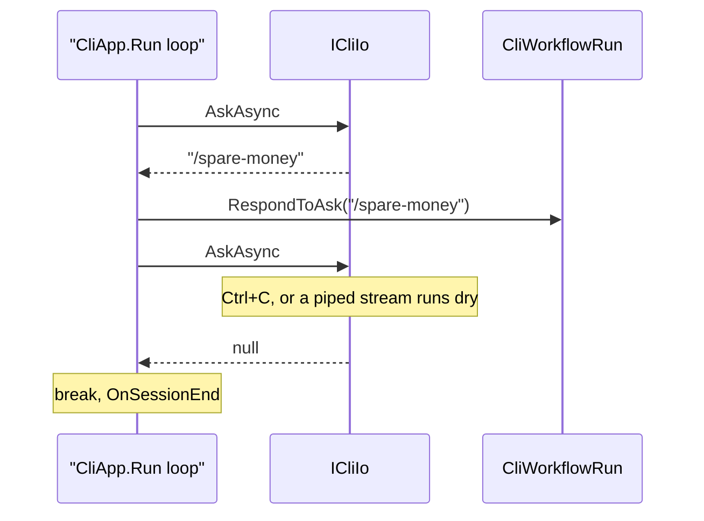
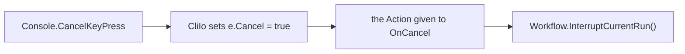

# CLI I/O

**`ICliIo` is the one place KitCli touches `Console`. Everything an app reads, writes or learns about Ctrl+C goes through it, so a test or another host can swap it.**

| Term | Meaning |
|---|---|
| Ask | One line the user types. |
| `ICliIo` | The interface for reading asks, picking from lists, saying messages and hearing Ctrl+C. |
| `CliIo` | The `Console`-backed `ICliIo`. |
| `HeadlessCliIo` | The `ICliIo` of a `HeadlessCliApp`: it writes, but nothing can answer a prompt. |

```csharp
public interface ICliIo
{
    bool CanAsk => true;
    Task<string?> AskAsync(CancellationToken cancellationToken);
    Task<CliChoice?> ChooseAsync(string title, IEnumerable<CliChoice> choices, CancellationToken cancellationToken);
    Task<IReadOnlyList<CliChoice>> ChooseManyAsync(string title, IEnumerable<CliChoice> choices, CancellationToken cancellationToken);
    void Pause();
    void Say(string something);
    void Say(string something, MessageLevel level);
    void SetTitle(string title);
    void OnCancel(Action cancel);
}
```

## Which I/O an app gets

`CliAppBuilder.Run` registers the I/O as a singleton from the app you chose, unless a registry registered an `ICliIo` first. Register your own to assert on what a command printed, or to host KitCli with no console.

| App | I/O | `CanAsk` | Asking anyway |
|---|---|---|---|
| Console app | `CliIo` | `true` | Reads a line. |
| `HeadlessCliApp` | `HeadlessCliIo` | `false` | Throws `NoInputException`, a programming error. |
| Your own I/O | Yours | `true`, from the default body | Yours. |

A handler or factory that injects `ICliIo` reads `CanAsk` to skip a prompt nobody would answer.

## When an ask ends the session

`Console.ReadLine` cannot be cancelled once it blocks. `AskAsync` runs it on a background thread, races it against the token, and returns `null` if cancellation wins.



**`null` ends the session, and `RespondToAsk` never sees it.** `CliApp.Run` breaks its loop on a `null` ask. A blank ask is different: `RespondToAsk` rejects a `null` or empty ask and returns a `NothingOutcome`, and the session asks again.

## Picking from a list

`ChooseAsync` and `ChooseManyAsync` show a Spectre selection prompt: arrow keys to move, enter to pick, space to tick in the many-choice list. A `CliChoice` is a `Label` to show and an optional `Value` handed back with the pick.

| Fact | Consequence |
|---|---|
| Spectre's prompt takes the cancellation token itself. | Ctrl+C returns `null` or an empty list, with no background-thread race. |
| An empty list of choices throws. | Check before you ask. |
| A prompt redraws itself in place. | **A line printed while one is showing scrambles it.** Print before asking or after the answer. |
| `CliIo` takes an optional `IAnsiConsole`. | A test drives the prompt with Spectre's `TestConsole`. |

## Saying a message at a level

`Say(something, level)` writes only when `level` meets `KitCliSettings.MinimumMessageLevel`, the rule leveled outcomes follow ([Outcome writing](outcome-writing.md)). Use it where no outcome list is returned, such as progress lines from a pipeline inside a command. `CliIo` reads the setting from its optional `KitCliSettings` argument and falls back to `Information`.

## What a Ctrl+C does



Setting `e.Cancel` suppresses .NET's abrupt exit. `CliApp.SetUpEventHandlers` registers that action once, with no `OnSessionEnd` and no `Environment.Exit`. The token belongs to `ICliWorkflow`.

**Cancellation is cooperative: a handler that ignores its token runs to completion.**

## See also

- [CliApp host loop](cli-app-host.md): which app, and so which I/O, runs.
- [Outcome writing](outcome-writing.md): how outcomes reach `Say`.
- [Cooperative cancellation ADR](../adr/cooperative-cancellation.md): why Ctrl+C asks a run to stop.
