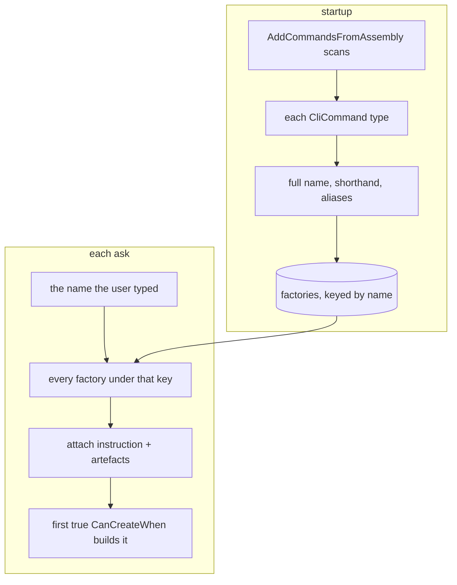

# Command registration

You never tell KitCli that a command exists. `AddCommandsFromAssembly`
scans an assembly, finds every `CliCommand`, and wires each one to a name,
a factory, and a MediatR handler. So the only question worth answering is
the one you cannot see from your own code: **what name did my command end
up with?**

## The name comes from the type name

`GetInstructionName()` removes `CliCommand` from the type name, inserts `-`
before each uppercase letter except the first, and lowercases it. The
shorthand keeps only the uppercase letters:

```
SpareMoneyCliCommand  →  SpareMoney  →  spare-money   and   sm
```

**The string removed is `CliCommand`, not a trailing `Command`, and it goes
wherever it appears.** So `SpareMoneyCommand` keeps its suffix and becomes
`spare-money-command`. Name command types `...CliCommand`.

`[CliCommandAlias("gimme")]` adds further names, repeatable, author-chosen.

## Which factory runs

A factory is what turns the name a user typed into a command object.
Registration pairs each command type with the `CliCommandFactory<>` whose
generic argument is that type. A sub-command's factory still declares its
*primary* command's type, not its own — that's what puts `/hello` and
`/hello there` under one key, "hello" — so registration first groups every
command type by the longest other command name it starts with
(`HelloMateCliCommand` groups under `HelloCliCommand`) before deciding
what each one needs:

| Factory found for the type | Result |
|---|---|
| one or more, naming this exact type | each registered under the full name, shorthand, and aliases |
| none for this type, but another family member has one | `FallbackCliSubCommandFactory<TPrimary, T>` registered, matching only this type's own sub-command word |
| none at all, and no family member shares this type's key | `BasicCliCommandFactory<T>` registered, matching unconditionally |
| none, and the command has no parameterless constructor | no factory, and nothing says so until a user types the name |

"Found for this exact type" is read off a hand-written factory's own class
name — `HelloThereCliCommandFactory` is taken as building
`HelloThereCliCommand` — not from its declared generic argument, which
only ever says which family it belongs to.

When an ask arrives, `CliWorkflowCommandProvider.GetCommand` fetches every
factory keyed under that name, attaches the instruction and the run's
artefacts, and takes the **first** whose `CanCreateWhen()` returns `true` —
the same first-match-wins rule used for argument builders and outcome
writers ([ADR 0004](../adr/0004-first-match-wins-resolution.md)). This is
what lets several `CliCommandFactory<T>` share one command type, each
picking a different subcommand with `CanCreateWhen()`.

Registration and resolution are two flows meeting at one keyed registry:



## Gaps

Two command types stemming to one instruction name fail only when a user's
ask resolves there, not at startup. Tracked as
[#19](https://github.com/KitCli/KitCli/issues/19).

Grouping by the longest matching name is a guess, confirmed unreliable in
general — a false match in this codebase's own tests, and a genuine
ambiguity when a primary command's own name is more than one word. See
investigation
[0011](../investigations/0011-handling-fallback-command-factories-when-sub-commands-are-in-use.md).

## See also

[instruction-parsing-pipeline.md](instruction-parsing-pipeline.md) ·
[artefacts.md](artefacts.md) ·
[../user-guides/0015-giving-a-command-extra-names.md](../user-guides/0015-giving-a-command-extra-names.md) ·
[../adr/0007-cli-command-alias-attribute.md](../adr/0007-cli-command-alias-attribute.md)
