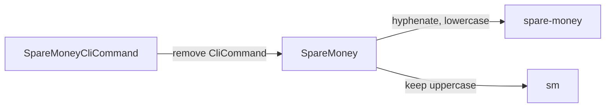
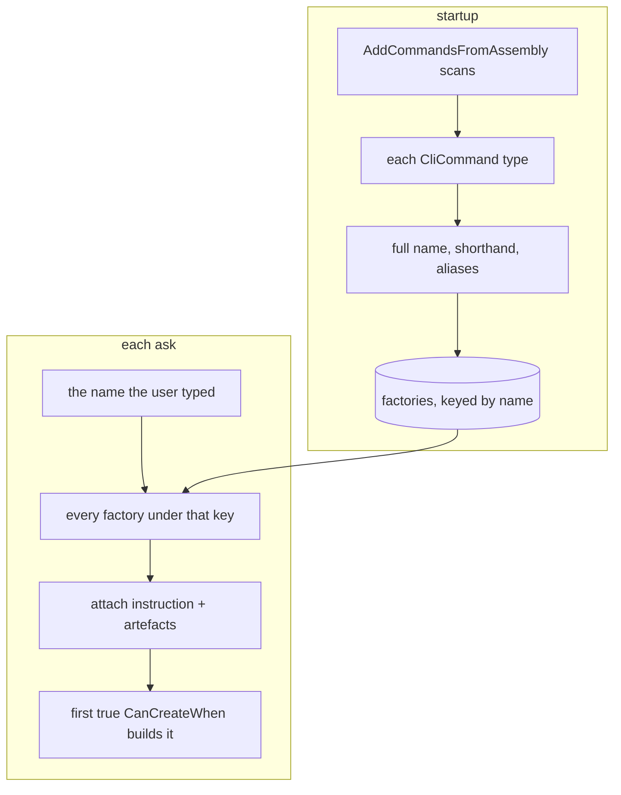

# Command registration

**You never tell KitCli that a command exists. `AddCommandsFromAssembly` scans an assembly and wires each `CliCommand` to a name, a factory and a MediatR handler. The question worth answering is the one you cannot see: what name did my command end up with?**

| Term | Meaning |
|---|---|
| Instruction name | What the user types after `/`, such as `spare-money`. |
| Shorthand | The instruction name's uppercase letters, such as `sm`. |
| Factory | A `CliCommandFactory<T>` that turns what the user typed into a command object. |
| Ask | One line the user types. |

## The name comes from the type name

`GetInstructionName()` removes `CliCommand` from the type name, inserts `-` before each uppercase letter except the first, and lowercases it. The shorthand keeps only the uppercase letters.

**The string removed is `CliCommand`, not a trailing `Command`, and it goes wherever it appears.** `SpareMoneyCommand` keeps its suffix and becomes `spare-money-command`. Name command types `...CliCommand`.

`[CliCommandAlias("gimme")]` adds further author-chosen names. It is repeatable.

## Which factory runs

Registration pairs each command type with the `CliCommandFactory<>` whose generic argument is that type:

| Factories found for the type | Result |
|---|---|
| One or more | Each registered under the full name, shorthand and aliases. |
| None, and the command has a parameterless constructor | `BasicCliCommandFactory<T>` registered for you. |
| None, and it has not | No factory, and nothing says so until a user types the name. |

When an ask arrives, `CliWorkflowCommandProvider.GetCommand` fetches every factory keyed under that name, attaches the instruction and the run's artefacts, and takes the **first** whose `CanCreateWhen()` returns `true`. This is the same first-match-wins rule as argument builders and outcome writers (the [first-match-wins ADR](../adr/first-match-wins-resolution.md)). It lets several factories share one command type, each picking a different subcommand with `CanCreateWhen()`.

Registration and resolution are two flows meeting at one keyed registry:

## Gaps

Two command types stemming to one instruction name fail only when a user's ask resolves there, not at startup: [#19](https://github.com/KitCli/KitCli/issues/19).

## See also

- [Instruction parsing pipeline](instruction-parsing-pipeline.md): where the instruction name comes from.
- [Artefacts](artefacts.md): what a factory reads from earlier outcomes.
- [Giving a command extra names](../user-guides/giving-a-command-extra-names.md): the alias task, step by step.
- [Command alias ADR](../adr/cli-command-alias-attribute.md): why aliases are an attribute.
