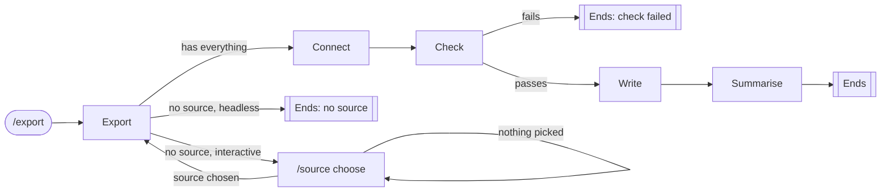

# Command stacking

Command stacking builds one long job out of small commands. Each command
does one thing, then names the command that runs next, so a single ask can
run six handlers in a row. A command that lacks something sends the run to
a command that gets it, and that command sends the run back.



`/export` is the entry command: it checks what the job needs and picks the
route, and does none of the work. Every box is its own command.

## Three moves

| Move | The handler returns | Use it for |
| --- | --- | --- |
| Forward | `ByMovingToCommand<TNext>()` | The next stage |
| Detour and return | `ByMovingToCommand<TChoose>()`; the detour later returns `ByMovingToCommand(command.ReturnTo)` | Getting something the entry command lacks |
| Ask again | `ByMovingToCommand(command)`, the same built command, so it keeps its return target | A choice left blank or not recognised |

**A detour returns to the entry command, not past it.** The entry command
runs again, its factory reads the new choice as an artefact, and it checks
everything from the top. It stays the one place that decides the route.

## One command, several factories

The detour learns where to return from the factory that built it. Give it
one factory per caller, gated on `LastCommandWas<TCaller>()`:

```csharp
public record ChooseSourceCliCommand(Type? ReturnTo) : CliCommand;

public class ChooseSourceAfterExportCliCommandFactory : CliCommandFactory<ChooseSourceCliCommand>
{
    public override bool CanCreateWhen() => LastCommandWas<ExportCliCommand>();

    public override CliCommand Create() => new ChooseSourceCliCommand(typeof(ExportCliCommand));
}
```

Typed directly as `/source choose`, a factory for the parent `/source`
command, gated on `SubCommandIs("choose")`, builds it with no return target,
so it ends after the choice. **The same command is a step in a stack and a
command of its own**; the factory that built it decides which.

## Data rides in artefacts

Each stage returns what later stages need as outcomes: the chosen source,
the open connection, the flags. The next stage's factory reads them back as
artefacts. The entry command reads the flags once and returns them as one
outcome, so no later stage parses `--headless` again.

A detour asks the user something, and a headless run has no one to ask.
There the entry command ends the run with `ByFinallySaying` instead.

## Sharp edges

- `LastCommandWas<T>()` is true only when `T` ran immediately before. That is
  why each caller gets its own factory: the detour returns to whichever
  command sent it.
- A chain that keeps moving on to another command, and never reaches a
  `Final` outcome or parks on a reusable one, never returns. Nothing catches
  it, though this is read from source and not yet reproduced
  ([#173](https://github.com/KitCli/KitCli/issues/173)).

## See also

[artefacts.md](artefacts.md) ·
[specified-vs-provided-outcomes.md](specified-vs-provided-outcomes.md) ·
[../user-guides/0007-chaining-commands.md](../user-guides/0007-chaining-commands.md) ·
[../user-guides/0006-gating-a-command-with-cancreatewhen.md](../user-guides/0006-gating-a-command-with-cancreatewhen.md)
