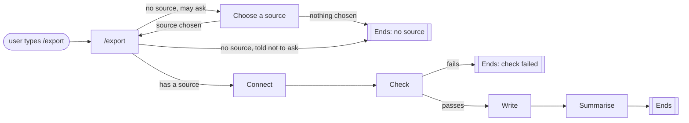

# Command stacking

A task often takes several steps that share one decision. An export, for
example, needs to know where to read from, its **source**: chosen once,
then used to connect, check, write and summarise. Command stacking builds
the task from small commands, one per step. Each command
[chains](../user-guides/chaining-commands.md) to the next and passes
on what it decided.



Every box from `/export` to Summarise is its own command. The names are
examples, not part of KitCli.

## The parts

- A **command** is one step the app can run, such as `/export`.
- A **handler** does a command's work.
- An **outcome** is what a handler returns: a message to show, a value to
  remember, or the command to run next.
- An **artefact** is a remembered outcome that any later command can read.
- A **factory** builds a command, reading artefacts to fill it in.
- A **run** is everything that follows one typed command, until a command
  ends it.

In `/export`'s handler, remember the source and name the next command.
KitCli runs that command next:

```csharp
return FinishThisCommand()
    .ByResultingIn(new SourceOutcome(command.Source))
    .ByMovingToCommand<ConnectCliCommand>()
    .EndAsync();
```

In the next command's factory, read the source back:

```csharp
public override CliCommand Create()
    => new ConnectCliCommand(GetRequiredArtefact<string>(nameof(SourceArtefact)).Value);
```

`SourceOutcome`, `SourceArtefact` and `ConnectCliCommand` are the app's own
types. [Remembering your own state](../user-guides/remembering-your-own-state.md)
shows how to write the first two.

## Why a decision travels as an outcome

**Only the command the user typed can read what they typed.** A command
the run moves on to sees only the artefacts and any arguments the previous
handler passes it. To let every later command see a flag such as
`--dry-run`, the first command returns it as an outcome.

## Where services fit

**Services do the work; commands make the decisions.** A service reaches
something outside the run: a database, an API, settings. A choice kept in
a service outlives the run that made it, so a later run can act on a stale
one. An artefact ends with its run.

| Put it in a service | Put it in a command |
| --- | --- |
| Reading and writing data | Choosing which source to use |
| Calling an API | Deciding which command runs next |
| Loading settings | Passing a choice to later commands |

## Gaps

- [Nothing catches a chain that hands on forever (#173)](https://github.com/KitCli/KitCli/issues/173).
  A command that keeps moving on, and never ends the run, never returns.

## See also

[Artefacts](artefacts.md) · [Outcomes](outcomes.md) ·
[Asking for a missing value and carrying on](../user-guides/asking-for-a-missing-value-and-carrying-on.md)
