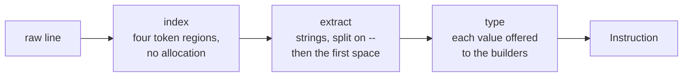

# Instruction parsing pipeline

**`InstructionParser.Parse` turns one line of terminal input into a typed `Instruction`. Each value's type comes from the value itself, claimed by the first matching builder, and nothing downstream sees the raw string again.**

| Term | Meaning |
|---|---|
| Instruction | The parsed line: a name, a sub-name and typed arguments. |
| Argument | A `--name value` pair on the line. |
| Builder | A class that claims a raw value and turns it into one type. |

```text
/spare-money help --argumentOne hello world --argumentTwo 1
   └ name      └ sub-name  └ arguments
```

## Three stages



A `--` only splits where an argument can start: at the beginning of a word, with a letter straight after it. So `--range 10--20` and `--note see -- there` keep their values whole.

## Type comes from the value, not the command

No command declares that `--dueDate` is a `DateOnly`. Each raw value is offered to the registered builders in order, and the first to claim it wins:

| Order | Builder | Claims a value that... |
|---|---|---|
| 1 | `DirectoryInfo` | is a rooted path, or starts with `.` |
| 2 | `Guid` | parses as a GUID |
| 3 | `String` | has a letter, and isn't `true`/`false` |
| 4 | `Int` | parses as a whole number |
| 5 | `Decimal` | parses as a decimal |
| 6 | `DateOnly` | parses as a date |
| 7 | `Bool` | always |

| Input | Becomes | Why |
|---|---|---|
| `--count 5` | `int` | `String` needs a letter. |
| `--name 42` | `int` | The argument's name is never consulted. |
| `--verbose` | `true` | No value falls through to `Bool`. |

**Order is the whole contract.** Move a builder and every value once claimed by the one ahead of it silently changes type.

## Gaps

- A `--` immediately followed by a word is read as an argument, wherever it sits. `--note see --help for options` becomes two arguments, because nothing tells the parser that this command has no `help` argument: [#39](https://github.com/KitCli/KitCli/issues/39).
- `Int`, `Decimal` and `DateOnly` parse with the current thread culture, not invariant: [#22](https://github.com/KitCli/KitCli/issues/22).
- `Bool` matching everything makes the builder extension point unreachable from consuming code: [#9](https://github.com/KitCli/KitCli/issues/9).
- The indexer honours a configured argument prefix and the extractor hard-codes `--`, so configuring a different one fails halfway.

## See also

- [Command registration](command-registration.md): how the instruction's name finds a command.
- [Artefacts](artefacts.md): how typed values reach later commands.
- [Reading command arguments](../user-guides/reading-command-arguments.md): the task, step by step.
