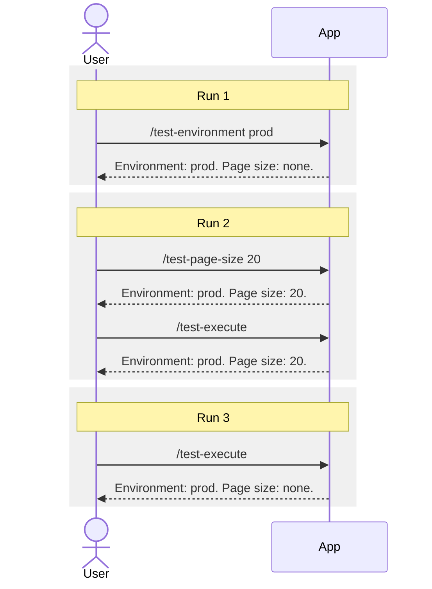

# Outcomes

**Every command handler returns `Outcome[]`. Each outcome says one of two things: show the user this, or change what the run does next. The run, not the handler, decides what happens after the command.**

| Term | Meaning |
|---|---|
| Outcome | What a command returns. |
| `OutcomeKind` | Whether an outcome has no say, keeps the run open, or ends it. |
| `OutcomeLifetime` | Whether an outcome lasts one run or the whole session. |
| Run | Every command from the first one up to a final outcome. |
| Session | App launch to app exit. Holds many runs. |

```csharp
public override Task<Outcome[]> HandleCommand(MyCommand command, CancellationToken ct)
    => FinishThisCommand()
        .ByShowingTable(table)
        .ByRememberingPageSize(20)
        .EndAsync();
```

`FinishThisCommand()` starts an empty `OutcomeList`. Each `By...` method appends one outcome and returns the list. The API reference lists them all.

## The three kinds

| Kind | Effect on the run | Examples |
|---|---|---|
| `Anonymous` | None. | `SayOutcome`, `TableOutcome`, `ReactionOutcome` |
| `Reusable` | Continues, keeping context for the next ask. | `PageSizeOutcome`, `NextCliCommandOutcome` |
| `Final` | Ends it. | `FinalSayOutcome`, `NothingOutcome` |

`NextCliCommandOutcome` is abstract. `ByMovingToCommand` appends `SpecifiedNextCliCommandOutcome` when a handler names a type, and `ProvidedNextCliCommandOutcome` when it hands over a command it built.

## The rule people miss

**Only the last outcome that is not anonymous decides the run's next state.** An anonymous outcome has no say, wherever it sits.

| Handler ends with | The run |
|---|---|
| `.ByRememberingPageSize(20).ByFinallySaying("Done.")` | Ends, discarding the page size. |
| `.ByRememberingPageSize(20).BySaying("Done.")` | Stays open with the page size. |
| `.ByResultingIn(session outcome).ByFinallySaying("Done.")` | Ends, and the session outcome lives on. |

`Kind` decides that and nothing else. Whether a later command can query an outcome depends on whether an artefact factory claims its type. `AggregatorFilterOutcome` is `Anonymous` and still becomes an artefact.

## How long an outcome lasts

`Kind` decides when a run ends. `Lifetime` decides whether an outcome outlives it. Every outcome lasts its run (`OutcomeLifetime.Run`) unless its type passes `OutcomeLifetime.Session` to `Outcome`'s second constructor:

```csharp
public record TestEnvironmentChosenOutcome(string Environment)
    : Outcome(OutcomeKind.Anonymous, OutcomeLifetime.Session);
```

When a run ends, the workflow hands its session outcomes to the next run, which reads them like its own until the app exits. The playground's `/test-environment` keeps an environment for the session. `/test-page-size` keeps a page size for one run. Each command prints both values, as `TestVisibleValues.Describe` formats them:



## Gaps

Duplicates in one array are unhandled. Return two `TableOutcome`s and nothing merges or rejects them. No issue tracks it.

## See also

- [Artefacts](artefacts.md): how outcomes become values a later command looks up.
- [Outcome writing](outcome-writing.md): how outcomes reach the screen.
- [Workflow run state machine](workflow-run-state-machine.md): how kinds move a run between states.
- [Specified vs provided outcomes](specified-vs-provided-outcomes.md): the two next-command outcomes.
