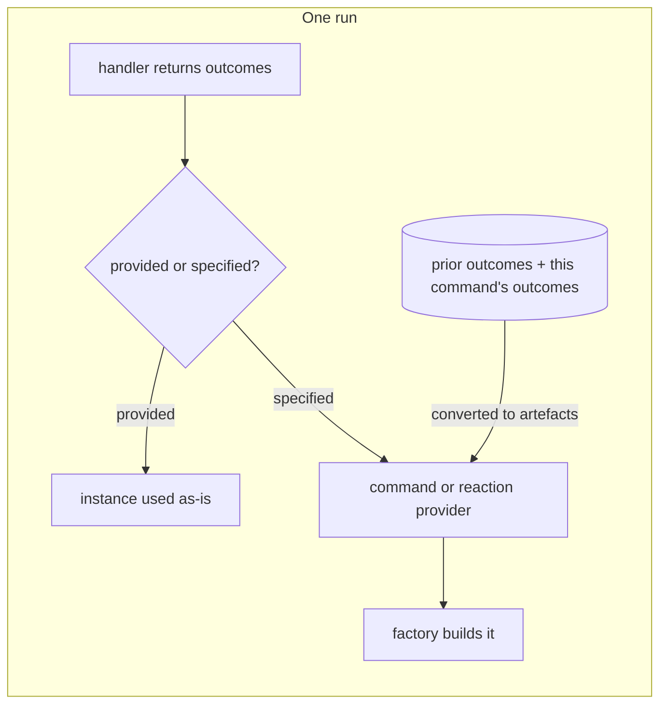

# Specified vs provided outcomes

**A handler can hand off to a command or reaction by building it
(provided) or by naming its type (specified).** A specified one is built
later by the run, so its factory sees the run's artefacts.

| Term | Meaning |
|---|---|
| Provided | The handler builds the command or reaction and passes the instance. |
| Specified | The handler names the type. The run builds it through the normal factory path. |
| Artefact | An outcome turned into a value a later command can look up by type and name. |

## How it works

Provided:

```csharp
.ByMovingToCommand(new ExportReport(reportId))
.ByReacting(new SendEmail(address))
```

Specified:

```csharp
.ByMovingToCommand<ExportReport>()
.ByReacting<SendEmail>()
```

The run builds a specified one after the handler returns:



| Handoff | Resolved by |
|---|---|
| Command | `ICliWorkflowCommandProvider.GetCommand`, given a fresh `Instruction`. |
| Reaction | `ICliWorkflowReactionProvider.GetReaction`, given `AllPriorOutcomes()` plus the current outcomes. |

## The rule people miss

**Specify when the thing you hand off to needs data the handler cannot build
with yet.** A provided value must be complete in the handler, by constructor,
right now. A specified one has its factory read the run's accumulated
artefacts, including outcomes the current command just produced.

| Fact | Consequence |
|---|---|
| A provided command or reaction is already built. | Nothing it needs can come from the run. |
| Both providers convert every prior outcome into artefacts first. | A specified factory sees what the current command just returned. |
| `ByMovingToCommand<TCommand>(arguments)` takes arguments the handler decides. | They layer on top of the artefacts the factory already gets. A provided command cannot offer this. |
| `CliWorkflowRun.GetNextCommandToMoveTo` and `GetReactionToPublish` are the two call sites. | A provided value is unwrapped there. A specified one goes to the provider. |

## See also

- [Outcomes](outcomes.md): the outcome kinds a handler returns.
- [Artefacts](artefacts.md): what a specified factory reads.
- [Workflow run state machine](workflow-run-state-machine.md): how a run moves to the next command.
