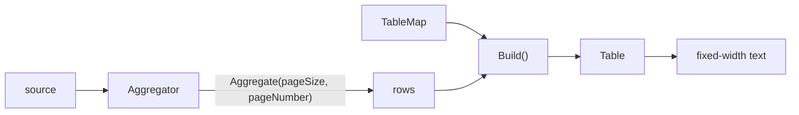

# Tables

**A `Table` is columns, rows and a frame, drawn as fixed-width text. A `TableBuilder` makes one and keeps everything needed to rebuild it, so a later command can show the next page from nothing.**

| Term | Meaning |
|---|---|
| `Table` | Columns, rows and the frame around them. |
| `TableBuilder<TSource, TAggregate>` | Holds the aggregator, the column map and the page, and builds a `Table`. |
| `TableMap<T>` | Names the columns of a row type. |
| Row type | The record whose public properties become columns. |
| `CliTableStyle` | One of nineteen frame looks. |

## How a table is built



```csharp
var table = new ExpenseTableBuilder()
    .WithAggregator(aggregator)
    .WithMap<ExpenseTableMap>()
    .WithPageSize(20)
    .WithPageNumber(1)
    .Build();
```

## The rule people miss

**An unmapped property throws rather than hiding its column.** `Build()` walks every public property of the row type and reads the map through a plain dictionary indexer.

```csharp
public record ExpenseRow(string Category, decimal TotalCost, int ReceiptId);

public class ExpenseTableMap : TableMap<ExpenseRow>
{
    public ExpenseTableMap() => Map(x => x.Category).Name("Category");
}
```

```text
System.Collections.Generic.KeyNotFoundException:
The given key 'System.Decimal TotalCost' was not present in the dictionary.
```

| Fact | Consequence |
|---|---|
| Every public property is looked up. | Keep data off a table by keeping it off the row type. |
| Column order follows the row type's declaration order. | The `Map(...)` calls decide names only. |

## Style and row lines

`Style`, or `WithStyle(...)` on the builder, picks one `CliTableStyle`. [Styling a table](../user-guides/styling-a-table.md) draws all nineteen. `Ascii` is the default.

**Lines between rows are not settable.** The ten styles that draw a box draw them; the other nine let rows run on, because lines inside a frameless table read as clutter.

```text
+------------------------+      Category  Total Cost
| Category  | Total Cost |      Groceries 412.80
|-----------+------------|      Rent      1150.00
| Groceries | 412.80     |
|-----------+------------|
| Rent      | 1150.00    |
+------------------------+
```

## Sizing

| Case | What happens |
|---|---|
| The console is known. | The table is measured against it. |
| No console. | Eighty columns. |
| A long value. | It wraps inside its own column. |
| `MaxColumnWidth` set. | That column is narrower still. |
| A value with line breaks. | It takes as many lines as it has, inside its row. |
| Square brackets. | They print literally. |

## Gaps

- `WithMap` is mandatory. Nothing defaults to mapping every property.
- A page size and number are mandatory, so a table that never pages still declares one. [#267](https://github.com/KitCli/KitCli/issues/267)
- Values are always `.ToString()`. A column cannot set alignment, format or colour: [#260](https://github.com/KitCli/KitCli/issues/260).
- Every `Build()` precondition throws a bare `Exception`: [#34](https://github.com/KitCli/KitCli/issues/34).
- `CliTableSortOrder` is dead code: [#53](https://github.com/KitCli/KitCli/issues/53). Sorting comes only from `AfterAggregation`.

## See also

- [Aggregators](aggregators.md): the pipeline a table builder holds.
- [Outcomes](outcomes.md): how a table is returned and remembered.
- [Artefacts](artefacts.md): how a later command finds the builder.
- [Showing a table](../user-guides/showing-a-table.md): the task, step by step.
- [Spectre.Console](../technology/spectre-console.md): what draws the frame.
