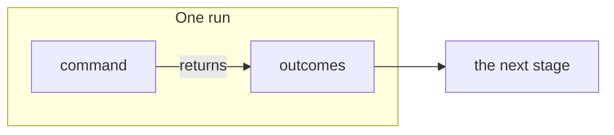

<!--
A concept doc explains how one part of KitCli works today, to someone
confused about it. One concept per doc: link neighbours instead of
absorbing them. Reference material, such as every signature, belongs in
source XML docs, where docfx surfaces it. Never describe intended behaviour
as current. Naming a gap, name the issue tracking it, or say none does.

How to explain. The model is
docs/investigations/can-an-artefact-outlive-the-run-that-made-it.md.

- Lead with the answer, in one or two bold sentences.
- Using more than two KitCli terms? Define them first in a
  Term | Meaning table, with the codebase's real names.
- Let diagrams carry the explanation. Pick the mermaid type by what it shows:
  - sequenceDiagram: what happens over time. `Note over` shows the state
    at each step. Show a change as a "before" and an "after" diagram.
  - stateDiagram-v2: a lifetime or a status.
  - classDiagram: the types a reader writes or extends. Generics are `Artefact~T~`.
  - flowchart LR: data moving through stages. One `subgraph` per run,
    request or package.
- Show usage with real code that compiles on `main`.
- Put facts in tables: Fact | Consequence, File | Shows.
- Prose only connects the visuals: a sentence or two saying what the next
  one shows. No paragraph that a diagram, snippet or table could replace.
  Keep prose under 60 lines; diagrams, code and tables don't count.
- Verify every name, signature and sample against source.
-->

# Title

**What this is, and what it does for the reader, in one or two bold
sentences.**

| Term | Meaning |
|---|---|
| Outcome | What a command returns: "show this", or "here's what happens next". |

## How it works



The shortest code that shows it working:

```csharp
public record ExampleOutcome(string Value) : Outcome(OutcomeKind.Reusable);
```

## The rule people miss

**The sentence a reader must not miss, in bold.**

| Fact | Consequence |
|---|---|
| What the code does. | What that means for the reader. |

## Gaps

Only if there are any. Name the tracking issue, or say none exists.

## See also

- [Sibling doc](sibling.md): one line on what it covers.
