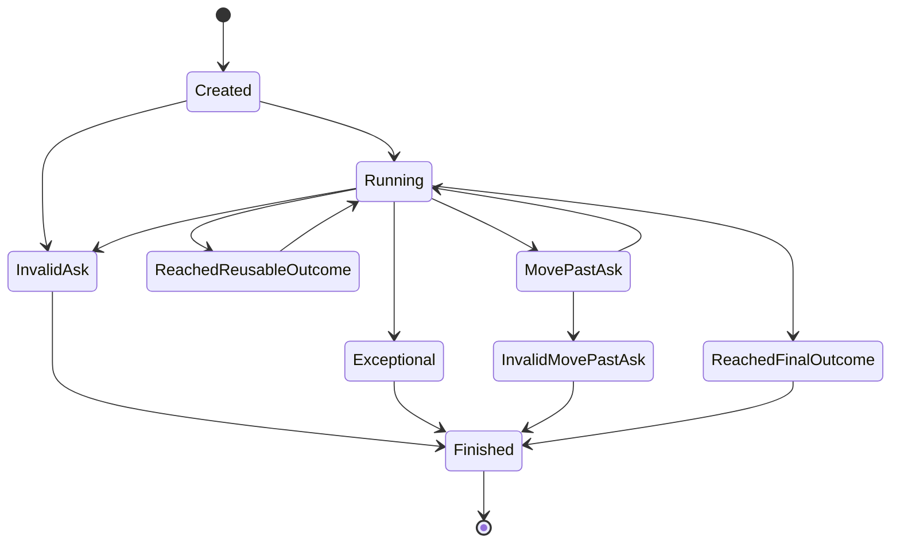

# Workflow run state machine

**A run is one arc from an ask to a final outcome, across as many commands as
that takes.** State survives inside a run and dies with it, unless its outcome
lasts the session. A run owns one DI scope.

| Term | Meaning |
|---|---|
| Ask | What the user typed. |
| Run | Every command from the first one up to a final outcome. |
| Status | Where a run is: `Created`, `Running`, `Finished` and the rest. |
| Reusable outcome | An outcome that parks the run so a later ask can continue it. |
| Final outcome | An outcome that ends the run. |

## How it works

`CliWorkflowRun` is a state machine: an append-only history of status
changes, plus a fixed table of legal from/to pairs. Anything else throws
`ImpossibleStateChangeException`.

`ReachedReusableOutcome` and `MovePastAsk` loop back to `Running`. That loop
keeps a multi-turn or multi-page run going.

## What decides the next status

`UpdateStateAfterOutcome` reads the **last** outcome that is not anonymous.
The run's own `RanCliCommandOutcome` comes first and is reusable, so a handler
returning only anonymous outcomes parks the run.

| Last non-anonymous outcome | Next status |
|---|---|
| None, or final | `ReachedFinalOutcome` |
| A `NextCliCommandOutcome` | `MovePastAsk`, awaiting `MoveToNext()` |
| Any other reusable outcome | `ReachedReusableOutcome` |

`MoveToNext()` builds the next command. A `SpecifiedNextCliCommandOutcome` is
resolved through its factory. A factory that cannot build it moves the run to
`Exceptional` like any other failure.

## Starting and finishing a run

`NextRun()` reuses the single run short of `Finished`, and creates one only
when none exists. `CreateNewRun()` gives each run its own DI scope and the
workflow's cancellation token. It also starts the run's history with one
`Created → Created` change carrying the session outcomes kept so far, empty in
the first run. The run is still at `Created` afterwards, so the table above is
unchanged.

`UpdateStateWhenFinished` checks whether the run reached one of the four
terminal statuses. If so, it moves the run to `Finished` and disposes its DI
scope.

## When an ask leads nowhere

An empty ask, one the validator turns down, and one naming no command are one
case. See the [next-commands ADR](../adr/suggest-next-commands-attribute.md).

| Where the run is | What happens |
|---|---|
| Parked at a reusable checkpoint | Zero state changes. The last command's `[CliNextCommandIs]` moves return as `SuggestionOutcome`s, or a silent `NothingOutcome` if none are declared. |
| Anywhere else | All three fail into `InvalidAsk` and finish. |

## The rule people miss

**A legal dead end in the table is not enough.** The code must call
`UpdateStateWhenFinished` there, or the run stops one step short and
`NextRun()` treats it as still active.

## Gaps

- One active run is assumed, enforced by `SingleOrDefault` rather than the
  type system. [#42](https://github.com/KitCli/KitCli/issues/42)
- `Runs` and `Changes` grow for the life of the process.
  [#23](https://github.com/KitCli/KitCli/issues/23)
- `FinalSayOutcome`'s message property is named `Something`.
  [#37](https://github.com/KitCli/KitCli/issues/37)
- `ClIWorkflowRunStateStatus` has a typo in its own name.
  [#41](https://github.com/KitCli/KitCli/issues/41)

## See also

- [Outcomes](outcomes.md): the kinds that pick the next status.
- [CliApp host loop](cli-app-host.md): the loop that drives each run.
- [Specified vs provided outcomes](specified-vs-provided-outcomes.md): how `MoveToNext()` builds the next command.
- [Resolve the whole run from its scope ADR](../adr/resolve-the-whole-run-from-its-scope.md): why a run owns one DI scope.
