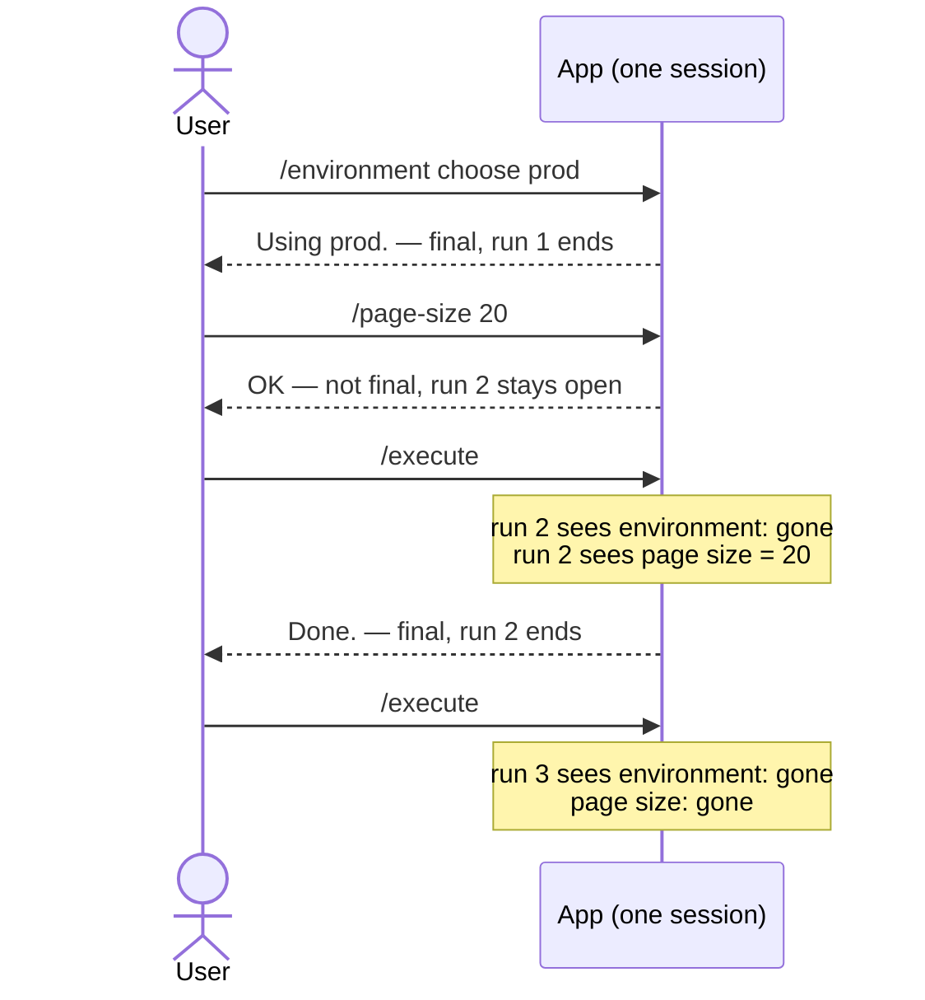
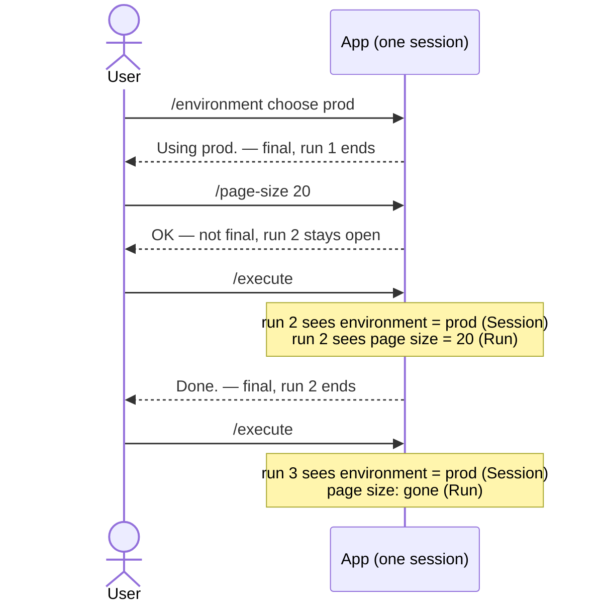
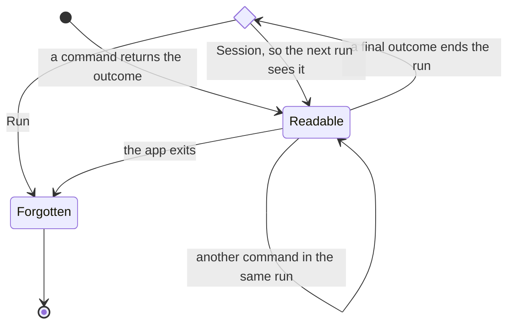
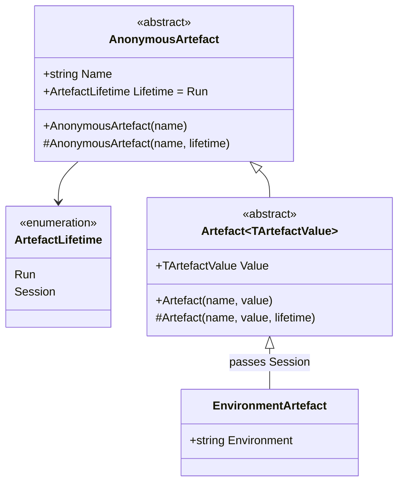
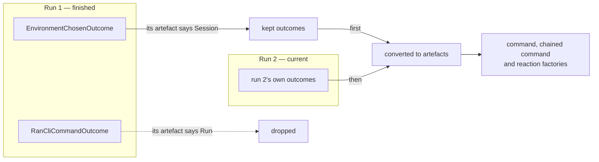
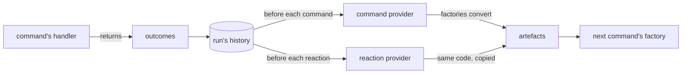

# 0011. Can an artefact outlive the run that made it?

- **Status:** In Review
- **Spike:** none filed — tests the shape proposed on
  [#311](https://github.com/KitCli/KitCli/issues/311), *No way to keep an
  artefact across runs in one session*
- **Time-box:** none agreed — ran inline
- **Date:** 2026-10-15

## Verdict

**No new complexity.** Finished runs already stay in memory, so each new run
only needs handing the outcomes to keep.

| Term | Meaning |
|---|---|
| Command | What the user types, e.g. `/execute`. |
| Outcome | What a command returns: "show this", or "here's what happens next". |
| Final outcome | An outcome that ends the run. |
| Artefact | An outcome turned into a value a later command can look up by type and name. |
| Run | Every command from the first one up to a final outcome. |
| Session | App launch to app exit. Holds many runs. |

### Today

Every value goes when its run ends:



### After this feature

A `Session` value survives every run. A `Run` value goes when its run ends:



## Recommendation

One delivery ticket, `release:minor`.

**1. Two lifetimes, set by the artefact's constructor.** `Run` keeps a value
until the next final outcome. `Session` keeps it until the app exits. Artefacts
default to `Run`, so existing apps behave as today.



The lifetime and a second constructor are new on both artefact types:



```csharp
public enum ArtefactLifetime { Run, Session }

public abstract record AnonymousArtefact(string Name)
{
    public ArtefactLifetime Lifetime { get; protected init; } = ArtefactLifetime.Run;

    protected AnonymousArtefact(string name, ArtefactLifetime lifetime) : this(name)
        => Lifetime = lifetime;
}

public abstract record Artefact<TArtefactValue>(string Name, TArtefactValue Value) : AnonymousArtefact(Name)
{
    protected Artefact(string name, TArtefactValue value, ArtefactLifetime lifetime) : this(name, value)
        => Lifetime = lifetime;
}
```

The artefact's lifetime is a new overload constructor, leaving the existing one
in place. Changing the constructor signature for a third parameter would be a
[major release](../adr/0012-derive-version-bumps-from-the-public-api-diff.md).

**2. An app keeps a value by passing `Session`.** The outcome and factory stay
as they are today:

```csharp
public record EnvironmentChosenOutcome(string Environment) : Outcome(OutcomeKind.Anonymous);

public record EnvironmentArtefact(string Environment)
    : Artefact<string>(nameof(EnvironmentArtefact), Environment, ArtefactLifetime.Session);

public class EnvironmentArtefactFactory : ArtefactFactory<EnvironmentChosenOutcome>
{
    protected override AnonymousArtefact CreateArtefact(EnvironmentChosenOutcome outcome)
        => new EnvironmentArtefact(outcome.Environment);
}
```

The choosing command ends on a final outcome:

```csharp
public class ChooseEnvironmentCliCommandHandler : CliCommandHandler<ChooseEnvironmentCliCommand>
{
    public override Task<Outcome[]> HandleCommand(ChooseEnvironmentCliCommand command, CancellationToken cancellationToken)
        => FinishThisCommand()
            .ByResultingIn(new EnvironmentChosenOutcome(command.Environment))
            .ByFinallySaying($"Using {command.Environment}.")
            .EndAsync();
}
```

A later run reads it back:

```csharp
public class ExecuteCliCommandFactory : BasicCreationCliCommandFactory<ExecuteCliCommand>
{
    public override CliCommand Create()
    {
        var environment = GetRequiredArtefact<string>(nameof(EnvironmentArtefact));

        return new ExecuteCliCommand(environment.Value);
    }
}
```

**3. Each new run starts with the kept outcomes.**



`CliWorkflow.CreateNewRun` keeps the outcomes whose artefact says `Session`:

```csharp
var sessionOutcomes = Runs
    .SelectMany(run => run.State.AllOutcomeStateChanges())
    .SelectMany(change => change.Outcomes)
    .Where(outcome => artefactFactories
        .FirstOrDefault(factory => factory.For(outcome))?
        .Create(outcome)
        .Lifetime == ArtefactLifetime.Session)
    .ToList();
```

`CliWorkflowRun` puts them first in all three places it builds artefacts. #311
names one:

```csharp
_workflowCommandProvider.GetCommand(instruction, [..sessionOutcomes, ..priorOutcomes]);
_workflowCommandProvider.GetCommand(instruction, [..sessionOutcomes, ..allPriorOutcomes]);
_workflowReactionProvider.GetReaction(type, [..sessionOutcomes, ..AllPriorOutcomes(), ..currentOutcomes]);
```

Suggestions and moving to the next command still read only the run's own
outcomes.

The same PR updates [artefacts.md](../concepts/artefacts.md) and
[user guide 0010](../user-guides/0010-reusable-outcomes-and-the-workflow-run.md),
which says values never cross runs.

## What was established

Today, every lookup rebuilds artefacts from outcomes:



| Fact | Consequence |
|---|---|
| A finished run stays in `CliWorkflow.Runs` until the app exits. | The outcomes to keep are already in memory. |
| A run's history is a plain object, not one of the run's services. | It stays readable after the run's services are disposed. |
| Every artefact factory is a singleton. | The workflow can convert outcomes outside any run. |
| Factories already convert the run's whole history before every command. | One more conversion per new run asks nothing new of a factory. |
| The factory picks each artefact's lifetime. | One outcome type can last a run in one place and a session in another. |
| `LastCommandIs<T>()` reads the run's last command artefact. | That artefact stays `Run`, so a new run never sees the previous run's command. |
| The other built-ins hold page size, page number, filters, aggregators and table builders. | Each belongs to one listing, so all stay `Run`. |
| A headless app makes exactly one run, chained commands included. | `Session` behaves like `Run` there. |

The last value set wins, so a run can replace a kept value:

| What happens | What the next command reads |
|---|---|
| Run 1 sets `"prod"` | `"prod"` |
| Run 2 sets `"staging"` | `"staging"`, the last value set |
| Run 3 starts | `"staging"`, kept because it is `Session` too |

## Evidence

Read against `3bf1f78` and checked line by line by a second reader.

| File | Shows |
|---|---|
| `KitCli.Workflow/CliWorkflow.cs:34-37` | `NextRun()` reuses the unfinished run, or creates one once every run is finished. |
| `KitCli.Workflow/CliWorkflow.cs:55` | `new CliWorkflowRunState()` — the history is built directly, not resolved from the run's services. |
| `KitCli.Workflow/CliWorkflow.cs:99` | `Runs.Add(run)`, the only change to `Runs` anywhere. |
| `KitCli.Workflow/Run/CliWorkflowRun.cs:289` | The run's services are disposed; its history stays. |
| `KitCli.Workflow/Run/CliWorkflowRun.cs:104, 224, 255` | The three calls that turn outcomes into artefacts. |
| `KitCli.Workflow/Run/CliWorkflowRun.cs:374` | `AllPriorOutcomes()` reads only this run's history. |
| `KitCli.Workflow.Commands/CliWorkflowCommandProvider.cs:46` and `CliWorkflowReactionProvider.cs:44` | The two copies of the conversion. |
| `KitCli.Commands.Abstractions/Extensions/ArtefactServiceCollectionExtensions.cs:50, 64, 88, 113` | Every registration path is `AddSingleton`. |
| `KitCli.Commands.Abstractions/Artefacts/AnonymousArtefact.cs:8` and `Artefact.cs:9` | Both artefact types are positional records. |
| `KitCli.Commands.Abstractions/Factories/CliCommandFactory.cs:162` | `LastCommandIs<T>()` reads the last command artefact. |
| `KitCli.Commands.Abstractions/Factories/CliCommandFactory.cs:175-182` | Lookup filters by type, then name, and takes `LastOrDefault`. |
| `KitCli/CliApp.cs:78` | One `NextRun()` per ask. Chained commands call `MoveToNext()` on the same run. |

Recommendation 1's constructor compiles and runs in .NET 10:

```text
new EnvironmentArtefact("prod").Lifetime      →  Session
new PageSizeArtefact(20).Lifetime             →  Run
var (name, value) = new PageSizeArtefact(20)  →  "PageSize 20"
```

`protected init` lets the new constructor set a lifetime its base declares.

## Open questions

None.

## Out of scope

- **Clearing a session value.** A command can replace one, since the last
  value set wins. Removing one so later reads find nothing, as a `/logout`
  would need, has no use case yet.
- **Surviving a restart.** Everything goes when the app quits. Saving run
  history is *Persist CliWorkflowRun history to disk for local playback*
  ([#48](https://github.com/KitCli/KitCli/issues/48)) and *No way to persist
  run history so a run can be resumed after it finishes*
  ([#123](https://github.com/KitCli/KitCli/issues/123)).
- **Factories with constructor dependencies.** See *construct artefact
  factories through DI instead of Activator*
  ([#144](https://github.com/KitCli/KitCli/issues/144)).
