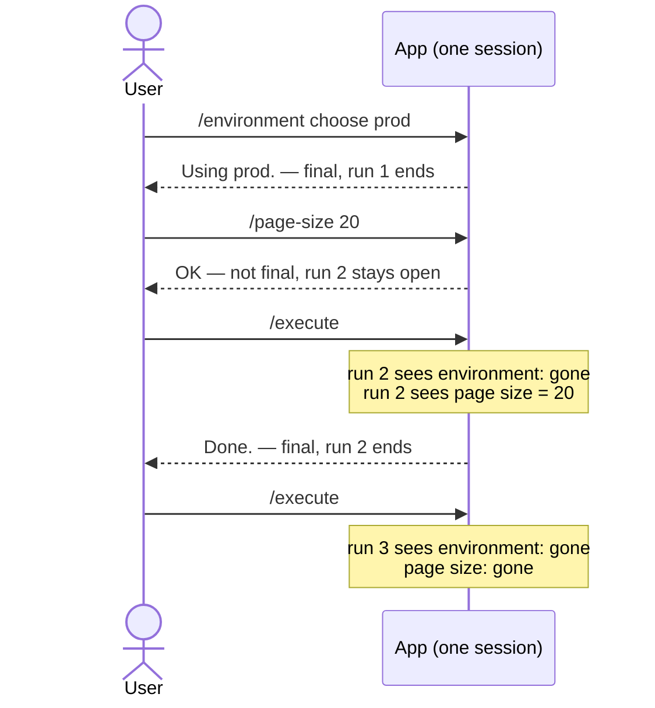
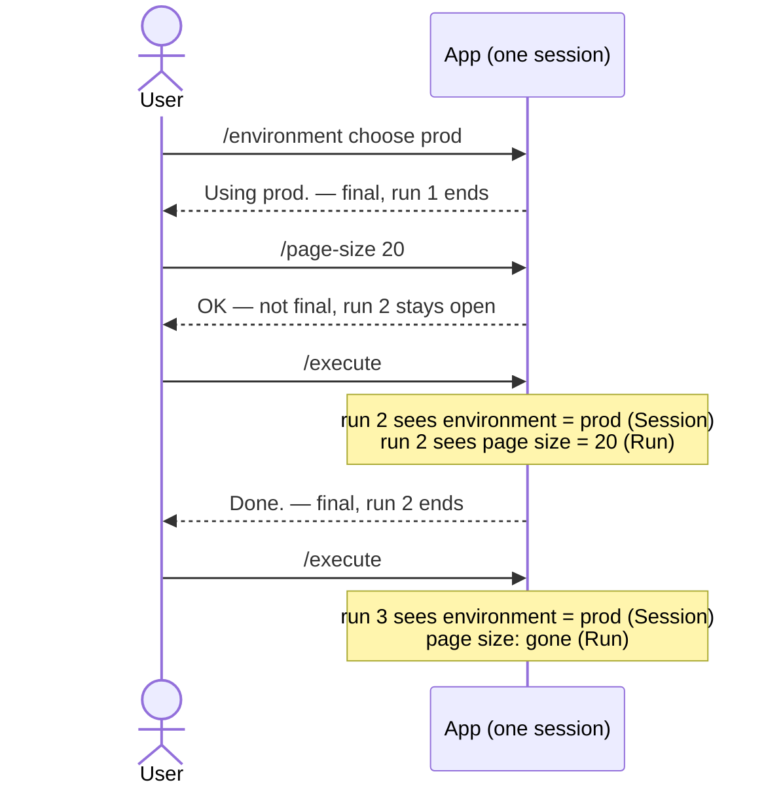
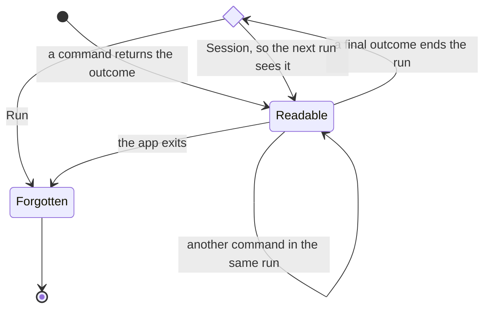
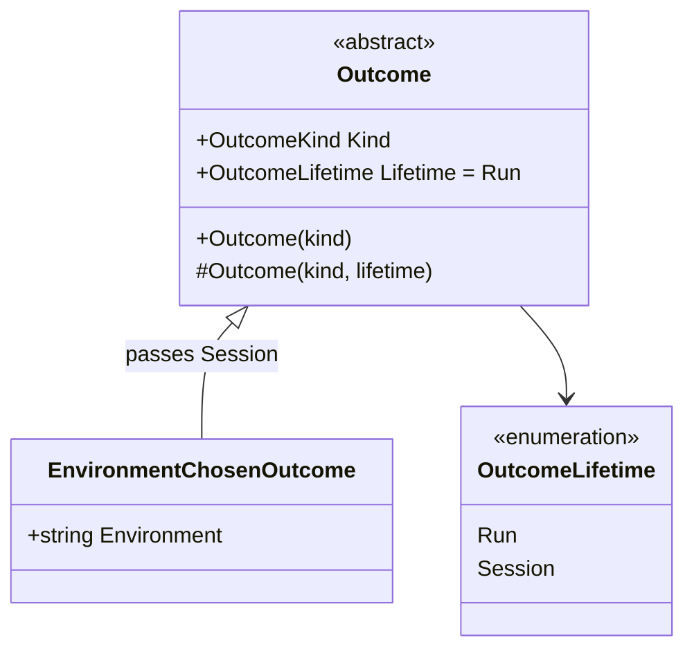
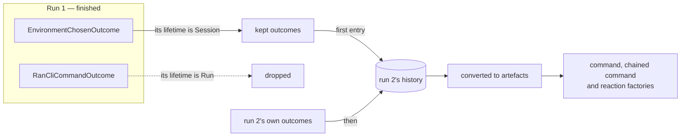
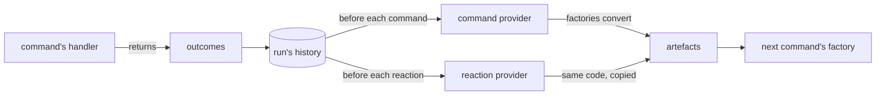

# Can an artefact outlive the run that made it?

- **Status:** In Review
- **Release:** 3.4.0
- **Spike:** none filed — tests the shape proposed on
  [#311](https://github.com/KitCli/KitCli/issues/311), *No way to keep an
  artefact across runs in one session*
- **Time-box:** none agreed — ran inline
- **Date:** 2026-10-15

## Verdict

**No new complexity.** Finished runs already stay in memory, so each new run
only needs handing the outcomes to keep.

| Term | Meaning |
|---|---|
| Command | What the user types, e.g. `/execute`. |
| Outcome | What a command returns: "show this", or "here's what happens next". |
| Final outcome | An outcome that ends the run. |
| Artefact | An outcome turned into a value a later command can look up by type and name. |
| Run | Every command from the first one up to a final outcome. |
| Session | App launch to app exit. Holds many runs. |

### Today

Every value goes when its run ends:



### After this feature

A `Session` value survives every run. A `Run` value goes when its run ends:



## Recommendation

One delivery ticket, `release:minor`.

**1. Two lifetimes, set by the outcome's constructor.** `Run` keeps an outcome
until the next final outcome. `Session` keeps it until the app exits. Outcomes
default to `Run`, so existing apps behave as today.



The lifetime and a second constructor are new on `Outcome`:



```csharp
public enum OutcomeLifetime { Run, Session }

public abstract record Outcome(OutcomeKind Kind)
{
    public OutcomeLifetime Lifetime { get; protected init; } = OutcomeLifetime.Run;

    protected Outcome(OutcomeKind kind, OutcomeLifetime lifetime) : this(kind)
        => Lifetime = lifetime;
}
```

The lifetime lives on the outcome because the workflow keeps outcomes and
rebuilds artefacts from them on every lookup. Reading it off the outcome needs
no artefact built just to ask.

The lifetime is a new overload constructor, leaving the existing one in place.
Changing the constructor signature for a second parameter would be a
[major release](../adr/derive-version-bumps-from-the-public-api-diff.md).

**2. An app keeps a value by passing `Session`.** The artefact and its factory
stay as they are today:

```csharp
public record EnvironmentChosenOutcome(string Environment)
    : Outcome(OutcomeKind.Anonymous, OutcomeLifetime.Session);

public record EnvironmentArtefact(string Environment)
    : Artefact<string>(nameof(EnvironmentArtefact), Environment);

public class EnvironmentArtefactFactory : ArtefactFactory<EnvironmentChosenOutcome>
{
    protected override AnonymousArtefact CreateArtefact(EnvironmentChosenOutcome outcome)
        => new EnvironmentArtefact(outcome.Environment);
}
```

The choosing command ends on a final outcome:

```csharp
public class ChooseEnvironmentCliCommandHandler : CliCommandHandler<ChooseEnvironmentCliCommand>
{
    public override Task<Outcome[]> HandleCommand(ChooseEnvironmentCliCommand command, CancellationToken cancellationToken)
        => FinishThisCommand()
            .ByResultingIn(new EnvironmentChosenOutcome(command.Environment))
            .ByFinallySaying($"Using {command.Environment}.")
            .EndAsync();
}
```

A later run reads it back:

```csharp
public class ExecuteCliCommandFactory : BasicCreationCliCommandFactory<ExecuteCliCommand>
{
    public override CliCommand Create()
    {
        var environment = GetRequiredArtefact<string>(nameof(EnvironmentArtefact));

        return new ExecuteCliCommand(environment.Value);
    }
}
```

**3. Each new run's history starts with the kept outcomes.**



`CliWorkflow.CreateNewRun` starts the new run's history with the kept outcomes:

```csharp
var sessionOutcomes = Runs.AllSessionOutcomes();

var state = new CliWorkflowRunState(sessionOutcomes);
```

`AllSessionOutcomes()` is a new extension method on the workflow's runs. It
reads only the last run, whose history already starts with the outcomes it was
handed:

```csharp
public Outcome[] AllSessionOutcomes()
    => runs
        .TakeLast(1)
        .SelectMany(lastRun => lastRun.State.AllOutcomeStateChanges())
        .SelectMany(change => change.Outcomes)
        .Where(outcome => outcome.Lifetime == OutcomeLifetime.Session)
        .ToArray();
```

The new `CliWorkflowRunState` constructor records them as one
`Created → Created` change. The run is still at `Created` afterwards, so the
transition table and `CliWorkflowRun` are unchanged: the run reads the kept
outcomes like its own. Suggestions and moving to the next command read them
too, but both look for outcomes that last a run, so neither changes.

The same PR updates [outcomes.md](../concepts/outcomes.md),
[artefacts.md](../concepts/artefacts.md),
[workflow-run-state-machine.md](../concepts/workflow-run-state-machine.md) and
[user guide 0010](../user-guides/0010-reusable-outcomes-and-the-workflow-run.md),
which says values never cross runs.

## What was established

Today, every lookup rebuilds artefacts from outcomes:



| Fact | Consequence |
|---|---|
| A finished run stays in `CliWorkflow.Runs` until the app exits. | The outcomes to keep are already in memory. |
| A run's history is a plain object, not one of the run's services. | It stays readable after the run's services are disposed. |
| Factories already convert the run's whole history before every command. | Outcomes at the start of a run's history reach every factory with no change to `CliWorkflowRun`. |
| A run is at `Created` until its first change, and stays there after a `Created → Created` change. | Kept outcomes can enter a run's history without a new status. |
| The outcome's type picks its lifetime. | Reading the lifetime needs no artefact built. |
| `LastCommandIs<T>()` reads the run's last command artefact. | Its outcome, `RanCliCommandOutcome`, stays `Run`, so a new run never sees the previous run's command. |
| The other built-ins hold page size, page number, filters, aggregators and table builders. | Each belongs to one listing, so all stay `Run`. |
| A headless app makes exactly one run, chained commands included. | `Session` behaves like `Run` there. |

The last value set wins, so a run can replace a kept value:

| What happens | What the next command reads |
|---|---|
| Run 1 sets `"prod"` | `"prod"` |
| Run 2 sets `"staging"` | `"staging"`, the last value set |
| Run 3 starts | `"staging"`, kept because it is `Session` too |

## Evidence

Read against `3bf1f78` and checked line by line by a second reader.

| File | Shows |
|---|---|
| `KitCli.Workflow/CliWorkflow.cs:34-37` | `NextRun()` reuses the unfinished run, or creates one once every run is finished. |
| `KitCli.Workflow/CliWorkflow.cs:55` | `new CliWorkflowRunState()` — the history is built directly, not resolved from the run's services. |
| `KitCli.Workflow/CliWorkflow.cs:99` | `Runs.Add(run)`, the only change to `Runs` anywhere. |
| `KitCli.Workflow/Run/CliWorkflowRun.cs:289` | The run's services are disposed; its history stays. |
| `KitCli.Workflow/Run/CliWorkflowRun.cs:104, 224, 255` | The three calls that turn outcomes into artefacts. |
| `KitCli.Workflow/Run/CliWorkflowRun.cs:374` | `AllPriorOutcomes()` reads only this run's history. |
| `KitCli.Workflow.Commands/CliWorkflowCommandProvider.cs:46` and `CliWorkflowReactionProvider.cs:44` | The two copies of the conversion. |
| `KitCli.Commands.Abstractions/Outcomes/Outcome.cs:9` | `Outcome` is a positional record. |
| `KitCli.Workflow/Run/State/CliWorkflowRunState.cs:89` | An empty history counts as `Created`. |
| `KitCli.Commands.Abstractions/Factories/CliCommandFactory.cs:162` | `LastCommandIs<T>()` reads the last command artefact. |
| `KitCli.Commands.Abstractions/Factories/CliCommandFactory.cs:175-182` | Lookup filters by type, then name, and takes `LastOrDefault`. |
| `KitCli/CliApp.cs:78` | One `NextRun()` per ask. Chained commands call `MoveToNext()` on the same run. |

The recommendation is built, with a playground scenario in
`KitCli.Playground.Scenarios/TestEnvironmentCliCommand.cs`. Its commands print
both values after each step:

```text
/test-environment prod  →  Environment: prod. Page size: none.
/test-page-size 20      →  Environment: prod. Page size: 20.
/test-execute           →  Environment: prod. Page size: 20.
/test-execute           →  Environment: prod. Page size: none.
```

`protected init` lets the new constructor set a lifetime its base declares.

## Open questions

None.

## Out of scope

- **Clearing a session value.** A command can replace one, since the last
  value set wins. Removing one so later reads find nothing, as a `/logout`
  would need, has no use case yet.
- **Surviving a restart.** Everything goes when the app quits. Saving run
  history is *Persist CliWorkflowRun history to disk for local playback*
  ([#48](https://github.com/KitCli/KitCli/issues/48)) and *No way to persist
  run history so a run can be resumed after it finishes*
  ([#123](https://github.com/KitCli/KitCli/issues/123)).
