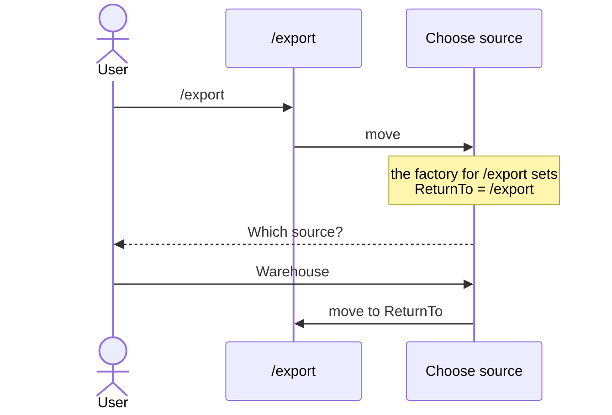
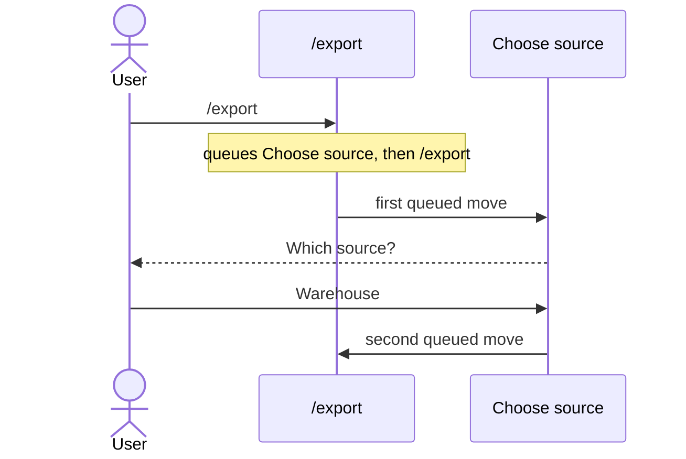
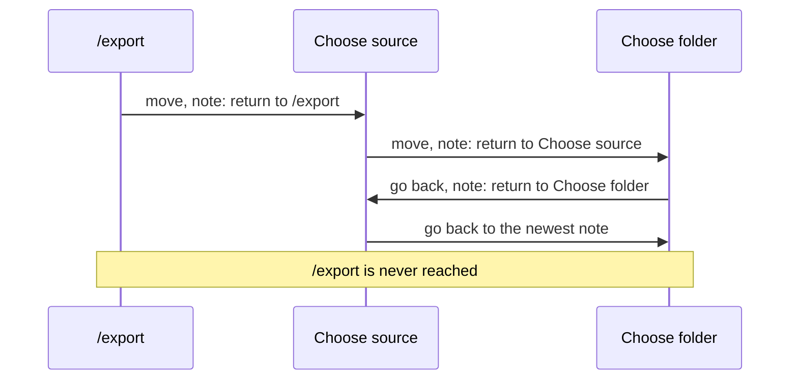

# How does a command know where it was sent from, and when to carry on?

- **Status:** In Review
- **Release:** Unreleased
- **Spike:** none filed — tests the hand-written `ReturnTo` in
  [Asking for a missing value and carrying on](../user-guides/asking-for-a-missing-value-and-carrying-on.md)
  against [#152](https://github.com/KitCli/KitCli/issues/152), *select the
  next command by queued outcome*
- **Time-box:** none agreed — ran inline
- **Date:** 2026-10-17

## Verdict

**No new complexity.** "Where" and "when" both work today: `/export` passes
where to carry on along with the move, and Choose source decides when.
Building it into KitCli, so it also works when one question leads to another,
is optional extra work after #152.

`/export` needs a source to export from. When the user has not chosen one,
`/export` sends them to Choose source, which asks "Which source?". Once they
answer, the app should carry on with `/export`. For that, Choose source must
know two things:

| Choose source must know | So that |
|---|---|
| **Where** it was sent from | It carries on with `/export`. Typed on its own, it just finishes. |
| **When** to carry on | It carries on only after a good answer. A bad answer asks again; cancelling stops. |

| Term | Meaning |
|---|---|
| Command | One step the app runs, such as `/export`. |
| Run | Every command from what the user typed up to the one that ends it. |
| Move | One command handing over to the next, written `ByMovingToCommand`. |
| Factory | Builds a command just before it runs. It can read values earlier commands remembered. |

### Today, as the guide shows

Choose source holds a `ReturnTo` field. One factory per sending command fills
that field in, each checking which command ran just before:



Every command that can send the user to Choose source needs its own factory.
Asking again is built by yet another factory, which must copy `ReturnTo`
across or lose it.

### Today, with fewer pieces

`/export` can pass where to carry on as part of the move. Choose source then
needs one factory, whoever sent the user there:

```csharp
// /export's handler
FinishThisCommand()
    .ByMovingToCommand<ChooseSourceCliCommand>(
        new NextCliCommandArgument<Type>("return-to", typeof(ExportCliCommand)))
    .EndAsync();

// Choose source's only factory
public override CliCommand Create()
    => new ChooseSourceCliCommand(GetArgument<Type>("return-to")?.Value);
```

Typed on its own, Choose source gets no `return-to`, so `ReturnTo` is `null`
and it finishes. Its handler decides when to carry on, as the guide already
shows: move to `ReturnTo` after a good answer, end the run on a cancel.

This breaks one level deeper. If Choose source sends the user to Choose
folder, Choose folder can carry on to Choose source, but Choose source has
lost its own `return-to`, so `/export` is never reached.

### After #152

`/export` queues Choose source, then itself. Each command's own moves run
before earlier ones resume, so nesting works:



"When" needs nothing new. Choose source finishes normally after a good answer,
and the waiting `/export` runs. A cancel ends the run, which should drop `/export`.
A bad answer moves to Choose source again, which runs before `/export`.

"Where" is not covered. Choose source cannot see `/export` waiting, so it
cannot tell being sent from typing on its own. A factory reads only remembered
values, and nothing remembers a queued move. KitCli needs one new check beside
`LastCommandIs`. The name below is a proposal, not on `main`:

```csharp
public override CliCommand Create()
    => new ChooseSourceCliCommand(SentFromExport: NextQueuedCommandIs<ExportCliCommand>());
```

## Recommendation

One ticket now, and one optional ticket after #152.

**1. Rewrite the guide to pass `return-to` with the move.** Docs only: it
replaces one factory per sending command with a single factory.

**2. Optional: let a factory check which command is queued after the one it
builds.** New public API, so a minor release. Only worth it if apps need one
question to lead to another.

## What was established

| Fact | Consequence |
|---|---|
| A move can carry typed values to the next command's factory. | "Where" can travel with the move today, without a factory per sender. |
| A value passed with a move reaches only the next command. | It is lost one level deeper, so nested sends break. |
| A factory reads only values turned into remembered values, and a queued move is not one. | After #152, Choose source still cannot see `/export` waiting without a new check. |
| `MoveToNext()` runs only the last queued move today. | Queueing `/export` behind Choose source needs #152 first. |
| `/export` runs again from the top, rebuilt by its factory. | A typed flag such as `--dry-run` is lost unless remembered first, and anything done before sending runs twice. |

The spike also considered saving a "return to" note on every move. Going back
is itself a move, so it saves a new note over the one still needed:



## Evidence

Read against `65934ad`. The "fewer pieces" sample was compiled against it.

| File | Shows |
|---|---|
| `docs/user-guides/asking-for-a-missing-value-and-carrying-on.md:35-65` | The `ReturnTo` field, the per-sender factory and the `null` check. |
| `KitCli.Commands.Abstractions/Arguments/NextCliCommandArgument.cs:13` | A typed value a move carries to the next factory. |
| `KitCli.Commands.Abstractions/Factories/CliCommandFactory.cs:87` | `GetArgument<T>`, matching a passed value by name and type. |
| `KitCli.Commands.Abstractions/Factories/CliCommandFactory.cs:162` | `LastCommandIs<T>()`, which each per-sender factory checks today. |
| `KitCli.Workflow.Commands/CliWorkflowCommandProvider.cs:46` | A factory sees only outcomes that an artefact factory turns into remembered values. |
| `KitCli.Workflow/Run/CliWorkflowRun.cs:140` | `MoveToNext()` takes only the last queued move. |
| [Run every queued hop, depth-first](../adr/run-every-queued-hop-depth-first.md) | The proposed order: a command's own moves first, then earlier ones resume. |

## Open questions

- After #152, when Choose source finishes on a remembered value, does the
  queued `/export` keep the run going? Today the run pauses for the user.
- Does ending the run throw away moves still queued? It must, or a cancel at
  "Which source?" carries on to `/export` anyway.
- Choose source asking again forever, with no way out, is
  [#173](https://github.com/KitCli/KitCli/issues/173).

## Out of scope

- **A pile of senders that going back removes from.** It would fix the
  note-per-move idea, but #152 gives the same order for free.
