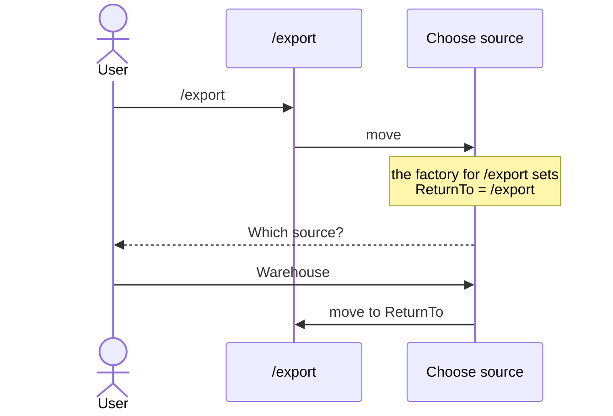
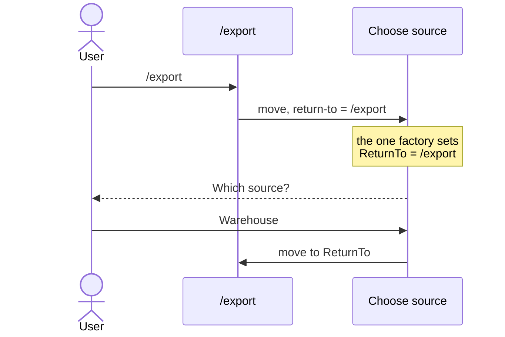

# How does a command know where it was sent from, and when to carry on?

- **Status:** In Review
- **Release:** Unreleased
- **Spike:** none filed — tests the hand-written `ReturnTo` in
  [Asking for a missing value and carrying on](../user-guides/asking-for-a-missing-value-and-carrying-on.md)
- **Time-box:** none agreed — ran inline
- **Date:** 2026-10-17

## Verdict

**No new complexity.** "Where" and "when" both work with what KitCli has
today: `/export` passes where to carry on along with the move, and Choose
source decides when.

`/export` needs a source to export from. When the user has not chosen one,
`/export` sends them to Choose source, which asks "Which source?". Once they
answer, the app should carry on with `/export`. For that, Choose source must
know two things:

| Choose source must know | So that |
|---|---|
| **Where** it was sent from | It carries on with `/export`. Typed on its own, it just finishes. |
| **When** to carry on | It carries on only after a good answer. A bad answer asks again; cancelling stops. |

| Term | Meaning |
|---|---|
| Command | One step the app runs, such as `/export`. |
| Run | Every command from what the user typed up to the one that ends it. |
| Move | One command handing over to the next, written `ByMovingToCommand`. |
| Factory | Builds a command just before it runs. It can read values earlier commands passed or remembered. |

### Today, as the guide shows

Choose source holds a `ReturnTo` field. One factory per sending command fills
that field in, each checking which command ran just before:



Every command that can send the user to Choose source needs its own factory.
Asking again is built by yet another factory, which must copy `ReturnTo`
across or lose it.

### With what exists, in fewer pieces

`/export` passes where to carry on as part of the move. Choose source then
needs one factory, whoever sent the user there:

```csharp
// /export's handler
FinishThisCommand()
    .ByMovingToCommand<ChooseSourceCliCommand>(
        new NextCliCommandArgument<Type>("return-to", typeof(ExportCliCommand)))
    .EndAsync();

// Choose source's only factory
public override CliCommand Create()
    => new ChooseSourceCliCommand(GetArgument<Type>("return-to")?.Value);
```



Typed on its own, Choose source gets no `return-to`, so `ReturnTo` is `null`
and it finishes. Its handler decides when to carry on:

| The user | Choose source |
|---|---|
| Picks a source | Moves to `ReturnTo`. |
| Picks something invalid | Moves to Choose source again, passing `return-to` along. |
| Cancels | Ends the run with a message. |

## Recommendation

**One docs ticket: rewrite the guide to pass `return-to` with the move.** It
replaces one factory per sending command with a single factory. No KitCli
code changes.

## What was established

| Fact | Consequence |
|---|---|
| A move can carry typed values to the next command's factory. | "Where" travels with the move, without a factory per sender. |
| A value passed with a move reaches only the next command. | A question that leads to another question loses it. See [Carrying on after nested questions](what-would-it-take-to-carry-on-after-nested-questions.md). |
| `/export` runs again from the top, rebuilt by its factory. | A typed flag such as `--dry-run` is lost unless remembered first, and anything done before sending runs twice. |

## Evidence

Read against `65934ad`. The sample above was compiled against it.

| File | Shows |
|---|---|
| `docs/user-guides/asking-for-a-missing-value-and-carrying-on.md:35-65` | The `ReturnTo` field, the per-sender factory and the `null` check. |
| `KitCli.Commands.Abstractions/Arguments/NextCliCommandArgument.cs:13` | A typed value a move carries to the next factory. |
| `KitCli.Commands.Abstractions/Factories/CliCommandFactory.cs:87` | `GetArgument<T>`, matching a passed value by name and type. |
| `KitCli.Commands.Abstractions/Factories/CliCommandFactory.cs:162` | `LastCommandIs<T>()`, which each per-sender factory checks today. |

## Open questions

None.

## Out of scope

- **A question that leads to another question.** It needs new code:
  [Carrying on after nested questions](what-would-it-take-to-carry-on-after-nested-questions.md).
