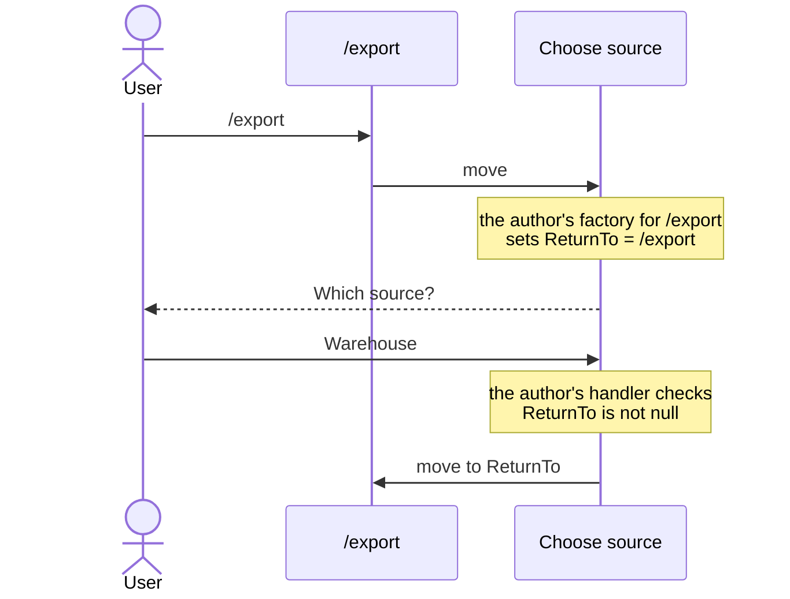
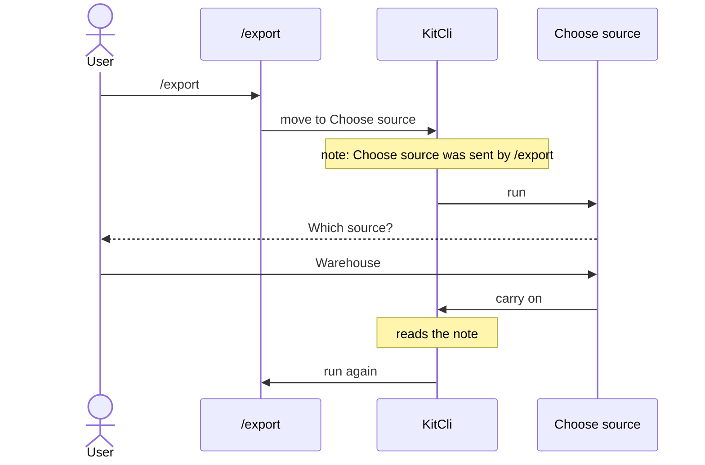

# How could KitCli know where a command was sent from, and when to carry on?

- **Status:** In Review
- **Release:** Unreleased
- **Spike:** none filed — tests building the hand-written `ReturnTo` in
  [Asking for a missing value and carrying on](../user-guides/asking-for-a-missing-value-and-carrying-on.md)
  into KitCli
- **Time-box:** none agreed — ran inline
- **Date:** 2026-10-17

## Verdict

**New complexity.** KitCli needs new code to write down which command sent the
user to a question, and to send them back when the question says "carry on".

`/export` needs a source to export from. When the user has not chosen one,
`/export` sends them to Choose source, which asks "Which source?". Once they
answer, the app should carry on with `/export`. For that, Choose source must
know two things:

| Choose source must know | So that |
|---|---|
| **Where** it was sent from | It carries on with `/export`. Typed on its own, it just finishes. |
| **When** to carry on | It carries on only after a good answer. A bad answer asks again; cancelling stops. |

| Term | Meaning |
|---|---|
| Command | One step the app runs, such as `/export`. |
| Run | Every command from what the user typed up to the one that ends it. |
| Move | One command handing over to the next, written `ByMovingToCommand`. |
| Factory | Builds a command just before it runs. It can read notes earlier commands left. |

### Today

The app's author builds both halves by hand. Choose source holds a `ReturnTo`
field, and one factory per sending command fills it in:



Every command that can send the user to Choose source needs its own factory.
Asking again needs another factory, which must copy `ReturnTo` across.

### After this work

KitCli writes a note when it follows a move: "Choose source was sent here by
`/export`." When Choose source says "carry on", KitCli reads the note and runs
`/export` again:



The author's code loses the `ReturnTo` field, the per-sender factories and the
`null` check. `/export` is unchanged. The names below are proposals, not on
`main`:

```csharp
// Choose source's handler, after a good answer
return FinishThisCommand()
    .ByResultingIn(new ChosenSourceOutcome(chosenSource))
    .ByCarryingOn()
    .End();

// Choose source's factory, to word a message such as "Back to export"
public override CliCommand Create()
    => new ChooseSourceCliCommand(BackToExport: WasSentFrom<ExportCliCommand>());
```

KitCli handles each case:

| What happens | What KitCli does |
|---|---|
| The user types Choose source on its own. | No note is written, so `ByCarryingOn()` does nothing and the command just finishes. |
| Choose source asks again by moving to itself. | It keeps the note it already has, instead of writing "sent by Choose source". |
| Choose source carries on. | It sends the user back without writing a new note. |
| The user cancels. | Choose source ends the run as it does today, and the note goes with it. |

## Recommendation

Three delivery tickets, in this order, as one minor release. An ADR comes with
the first, because the note is a new pattern every command can use.

**1. Write the "sent by" note when following a move, and add `WasSentFrom<T>()`.**

**2. Add `ByCarryingOn()`.** It sends the user back to the command in the note.

**3. Rewrite the asking guide around the two.**

## What was established

| Fact | Consequence |
|---|---|
| The run can already tell a typed command from a moved-to one. | KitCli knows when to write a note and when not to. |
| Factories already read earlier notes, such as the record of which command ran. | `WasSentFrom<T>()` can read the new note the same way. |
| The guide's factory checks only which command ran last. | Typing Choose source straight after `/export`, in the same run, wrongly sends the user back. The note fixes this. |
| `/export` runs again from the top, rebuilt by its factory. | A typed flag such as `--dry-run` is lost unless remembered first. |

## Evidence

Read against `eec501a`.

| File | Shows |
|---|---|
| `docs/user-guides/asking-for-a-missing-value-and-carrying-on.md:35-65` | The hand-written `ReturnTo` field, per-sender factory and `null` check. |
| `KitCli.Workflow/Run/CliWorkflowRun.cs:120` | A typed command is recorded with what the user typed. |
| `KitCli.Workflow/Run/CliWorkflowRun.cs:136` | A moved-to command is recorded without it. |
| `KitCli.Workflow/Run/CliWorkflowRun.cs:164` | Every command that runs is recorded. |
| `KitCli.Workflow/Run/CliWorkflowRun.cs:214` | A moved-to command is built from a blank instruction, which is why typed flags are lost. |
| `KitCli.Workflow.Commands/CliWorkflowCommandProvider.cs:46` | Factories read earlier outcomes turned into notes. |
| `KitCli.Commands.Abstractions/Factories/CliCommandFactory.cs:162` | `LastCommandIs<T>()`, the check the guide's factories use today. |

## Open questions

- Should asking again be its own call, such as `ByAskingAgain()`, or any move
  from a command to itself?
- When KitCli runs `/export` again, should it replay what the user first typed,
  so flags such as `--dry-run` survive?

## Out of scope

- **A question that leads to another question.** It needs more new code:
  [Carrying on after nested questions](what-would-it-take-to-carry-on-after-nested-questions.md).
