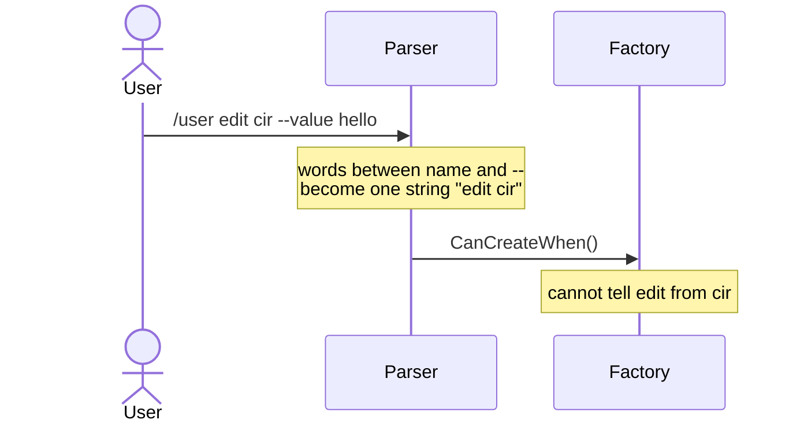
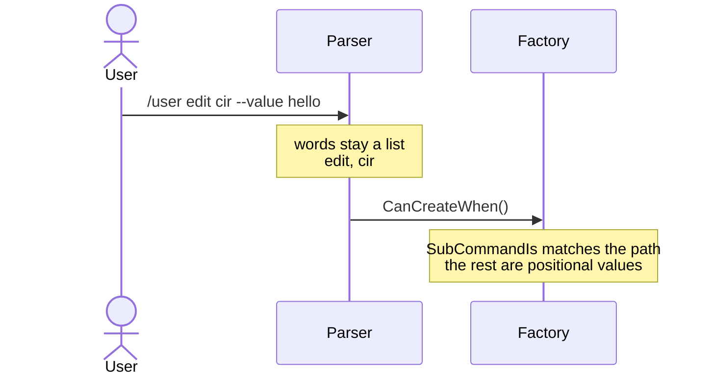

# How many sub-commands can one instruction address?

- **Status:** In Review
- **Release:** Unreleased
- **Spike:** not yet filed
- **Time-box:** none agreed — ran inline
- **Date:** 2026-09-11

## Verdict

**New complexity.** The depth limit is not real: every word between the command name and the first `--` is already captured. The words arrive glued into one string, which nothing can match against.

The complexity is knowing which word the list ends on. KitCli has no concept of a value without a `--name` in front of it, so that is a second deliverable, not a consequence of the first.

| Term | Meaning |
|---|---|
| Instruction | The parsed ask: a command name, sub-command words and `--name value` arguments. |
| Sub-command word | A plain word after the command name, such as `edit`. |
| Value | A plain word that is data, such as `cir`. |
| Factory | The class that decides whether it applies to an instruction. |

### Today



### After this work



In `/user edit cir`, `edit` names a command and `cir` is a value. Reading left to right, nothing tells them apart: both are plain words.

## Recommendation

**Three tickets, in this order, under *Describing a Command*.**

**1. Carry the words as a list.** `Instruction` holds ordered segments instead of one sub-name string, the indexer stops joining them, and `SubCommandIs` compares a sequence. This is a breaking change to a public record, so an ADR rides along in the same pull request.

**2. Teach the descriptor a word path.** [#190](https://github.com/KitCli/KitCli/issues/190)'s `SubCommandIs(name)` accepts several names.

**3. Positional arguments, on their own ticket.** A command declares how many unnamed values follow its path. Decide alongside [#244](https://github.com/KitCli/KitCli/issues/244): both replace guessing from text with a declaration.

## What was established

| Fact | Consequence |
|---|---|
| The parser hands over an instruction. `CliWorkflowCommandProvider` then finds factories by command name and asks each one `CanCreateWhen()`. | KitCli already defers this decision to the command. The word path can be matched at factory selection, so no tree is needed while parsing. |
| [System.CommandLine](https://learn.microsoft.com/en-us/dotnet/standard/commandline/syntax) splits input into tokens that carry no meaning and leaves the invoked app to say which are commands and which are values. Its sub-commands nest without limit. | The field defers the same way. |
| [Cobra](https://github.com/spf13/cobra/blob/main/command.go) drops the flags. If the first remaining word names a child command, it recurses. The first word that doesn't ends the path, and the rest are values. [Clap](https://deepwiki.com/clap-rs/clap/7.3-subcommands) breaks ties toward the command. | The matching rule is short and settled. |
| Python's [argparse](https://docs.python.org/3/library/argparse.html) lets an optional value swallow the sub-command name, then reports the sub-command as missing. | Guessing without the tree is the known failure. |

## Evidence

`TestSubCommandPathCliCommand` in the playground says back whatever sub-command name it was handed. Run against `3d282e7`:

```
dotnet run --project KitCli.Playground.App.Headless -- "/test-sub-command-path user edit cir"

Sub-command name: "user edit cir"
```

Three words arrive as one string, and nothing can tell which named a command and which was a value.

## Open questions

- How does a wrong word report? `/user edt cir` and `/user edit cir extra` both end the path early and look identical to a missing command.
- Does this enter through the Ideas board for a WAG, or straight onto the *Describing a Command* milestone alongside #190?

## Out of scope

- **Quoting.** `"hello!"` keeps its quote marks. Already [#39](https://github.com/KitCli/KitCli/issues/39).
- **How commands are registered.** Factories stay keyed on the first word only. Nothing here changes the [first-match-wins ADR](../adr/first-match-wins-resolution.md).
