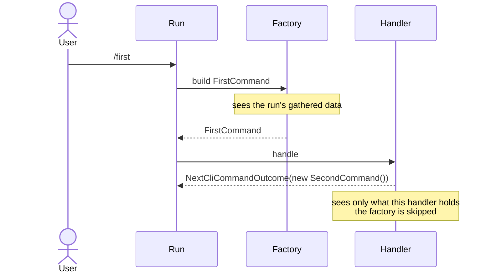
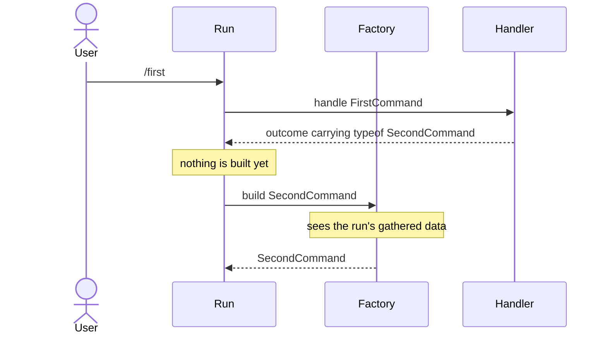

# How should a chained command be selected and constructed?

- **Status:** In Review
- **Release:** 2.0.0
- **Superseded in part by** the [chain-by-type ADR](../adr/chain-to-a-command-by-type.md):
  the finding below that `ICliWorkflowCommandProvider` should gain a
  type-resolving method as a default interface member was not built. A chained
  hop is written as an instruction naming the command instead, so the existing
  `GetCommand` resolves it and the provider is untouched. Every other finding
  here stands.
- **Spike:** #148
- **Time-box:** 30 minutes
- **Date:** 2026-08-25

## Verdict

**New complexity.** [#147](https://github.com/KitCli/KitCli/issues/147) asks for one method. It needs four tickets and an ADR.

| Term | Meaning |
|---|---|
| Chain | One thing the user typed running several commands in a row, because a handler ends by handing on to another command. |
| Factory | The class that builds a command from the instruction and everything the run has gathered so far. |
| Outcome | What a handler returns. `NextCliCommandOutcome` means "run this command next". |
| Hop | One step of a chain. |

Today a handler builds the next command itself with `new`, which skips the factory. The same command is built two ways depending on how it was reached, and only the factory path can see what the run gathered:

After this work the handler names a type, and the factory builds it when the run arrives:

Every design question this raised has an answer below, and nothing is unresolved. Answering them did not make the work smaller. Building it means:

- a new kind of outcome;
- a shared base type over two outcomes;
- a new method on an interface that is already published;
- changes at three places in `CliWorkflowRun`;
- four rewritten guides;
- #124 rewritten around a rule it does not currently propose.

No single piece is hard. There are a lot of pieces.

Two things must happen first. #11: `MoveToNext()`'s main path has no test, and every ticket below edits that path. #142: factories are registered as singletons while holding state that changes per command.

## Recommendation

Break #147 into four tickets, in this order. All of them wait on #142.

**1. Test `MoveToNext()`'s happy path.** This is the half of #11 still outstanding. Everything below edits that path, and nothing covers it today.

**2. Add `ByMovingToCommand<TCommand>()`.** The handler names the command type and the factory builds it when the run gets there. Details are in the findings below. This ticket needs an ADR: it changes the shape of published API, and someone will later ask why there are two ways to queue a command.

**3. Rewrite #124's selection rule around the queued outcome, not the command.** Settle the multiple-hop guard in the same ticket. They are one decision.

**4. Rewrite the chaining guides.** Update [Chaining commands](../user-guides/chaining-commands.md), `artefacts.md`, `outcomes.md` and `workflow-run-state-machine.md` to teach the new method first.

## What was established

Each finding below changes what the design must do:

| Finding | Consequence |
|---|---|
| **A chained hop that cannot be built is a bug.** A user who types something unmatched gets `SuggestNextCommands`, a kindness to someone guessing. A chain is not a guess: an engineer wrote the hop. | Fail loudly. |
| `ExecuteCommand` wraps everything in a try/catch and moves the run to `Exceptional`. `Running → Exceptional` is already legal. | No new state. Resolution must happen inside that try block so the failure is caught like any other. |
| **The new outcome carries a type and nothing else.** `NextCliCommandOutcome` means "run this command next" and carries the finished command. The new one means "run this *kind* of command next". | Nothing is built when the hop is queued. The factory builds it on arrival, and `RanCliCommandOutcome` records what was built. An instance stored on the outcome is the thing being removed. |
| **It must be a sibling, not a subclass.** `NextCliCommandOutcome` requires a command in its constructor, and a subclass would have to invent one. | Both sit under a shared base type. Three places in `CliWorkflowRun` that look for `NextCliCommandOutcome` by name look for the base: `MoveToNext`, `IsValidMovePastAsk` and `UpdateStateAfterOutcome`. |
| **Adding an outcome here is safe.** `CliApp` picks the first writer that claims an outcome, and #106 records that a parent's writer can swallow a child. No writer claims `NextCliCommandOutcome`: it is an instruction to the run, and `WriteOutcomes` skips anything unclaimed. | The #106 danger cannot occur. |
| **Track what has run against the queued outcome, not the command.** #124 wants several hops per handler and proposes matching `RanCliCommandOutcome`, which records the command. | That stops working once a hop carries only a type: two hops to the same kind of command become indistinguishable, so a chain visiting a step twice repeats or stalls. Each `ByMovingToCommand` call creates its own outcome object, so matching on it works for both kinds of hop. |
| **The factory has what it needs.** It is handed the instruction and the run's gathered data. The instruction sits in the run's history through `IInstructionCliWorkflowRunStateChange`. `CliWorkflowCommandProvider` already assembles the gathered data for the normal path. | Resolve inside that provider, not `CliWorkflowRun`, and nothing new is exposed. |
| **The factory is found from the type with what exists.** `CliCommand.GetInstructionName()` and `StripCommandName` turn a type's name into its registered name. | Nothing new for lookup. Shorthands and aliases can collide, but a lookup by the derived full name is unaffected. Where two command types share a name, the ambiguity is #19's, not this feature's. |
| **A command with constructor arguments and no factory cannot be chained this way.** KitCli only auto-registers a factory for a command it can build with `new`. | No compiler check catches it. Constraining the method to types with an empty constructor would exclude exactly the commands this feature is for. Per the first finding, failing at runtime is right. |
| **Adding to the provider's interface need not break anyone.** `ICliWorkflowCommandProvider` ships in a published package. C# default interface members let existing implementations inherit a new method, and every project targets `net10.0`. | Give the method a default that throws, which surfaces as `Exceptional`. The change stays additive and the package takes an ordinary patch bump, which is all the release tooling can produce anyway (#127). |
| **The alternative is worse.** A second interface, resolved where the run is built, adds a parameter to `CliWorkflowRun`'s public constructor. | It breaks eight test call sites for the same result. |

## Evidence

| File | Shows |
|---|---|
| `KitCli.Workflow/Run/State/CliWorkflowRunState.cs:117-139` | The legal state moves, including `Running → Exceptional`. |
| `KitCli.Workflow/Run/CliWorkflowRun.cs:143-166` | `ExecuteCommand` catching everything and returning an `ExceptionOutcome`. |
| `KitCli.Workflow/Run/CliWorkflowRun.cs:139`, `:174-176`, `:199` | The three places that look for `NextCliCommandOutcome`. |
| `KitCli.Commands.Abstractions/Io/*.cs` | Every `CanWriteFor` tests one exact type, and none tests `NextCliCommandOutcome`. |
| `KitCli/CliApp.cs:50-59` | `WriteOutcomes` skipping outcomes no writer claims. |
| `KitCli.Commands.Abstractions/CliCommand.cs:19-36` | `GetInstructionName` and `StripCommandName`. |
| `KitCli.Commands.Abstractions/Outcomes/Reusable/RanCliCommandOutcome.cs` | Records the built command. |
| `KitCli.Workflow.Abstractions/Run/State/Change/IInstructionCliWorkflowRunStateChange.cs` | Exposes the instruction publicly. |
| `KitCli.Workflow.Commands/CliWorkflowCommandProvider.cs:22-58` | Factory lookup, and the private assembly of the run's gathered data. |
| `KitCli.Commands.Abstractions/Extensions/CommandServiceCollectionExtensions.cs:66-71` | Auto-registration skipping commands without an empty constructor. |
| `KitCli.Workflow/CliWorkflow.cs` | `CreateNewRun` building the run. `new CliWorkflowRun(` appears at eight test call sites. |
| `KitCli.Workflow.Commands/KitCli.Workflow.Commands.csproj:11-12` | Published package, version 1.0.10. `net10.0` throughout. |
| [Safely update interfaces using default interface methods](https://learn.microsoft.com/en-us/dotnet/csharp/advanced-topics/interface-implementation/default-interface-methods-versions) | The C# feature behind the default-member finding. |

## Open questions

None about the design. Three arose during the spike and all three closed: both
overloads survive with the guides leading on the new one, the multiple-hop guard
is #124's decision and belongs in the run, and the interface gains its method
through a default implementation.

What remains is procedural. CONTRIBUTING describes what to do when a spike finds
the work is as small as expected. It does not describe this case.

## Out of scope

- `[CliNextCommandIs]` and `SuggestNextCommands`, past establishing that a chain
  does not need them.
- #124's other idea, an attribute that documents a chain without changing how it
  runs.
- `ActivatorUtilities`, rejected on #147 before the spike because it skips the
  factory, which is the thing being asked for.
- Bright.DataTool.Cli, the app that prompted both issues.
