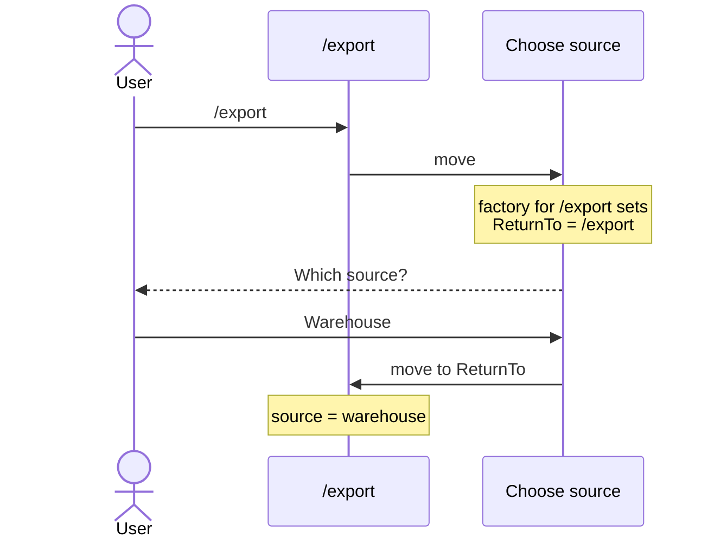
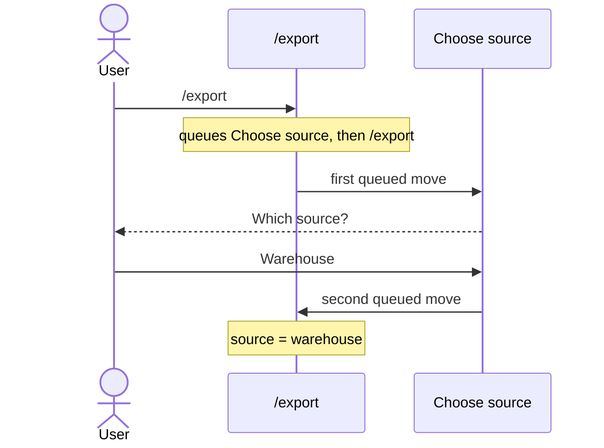
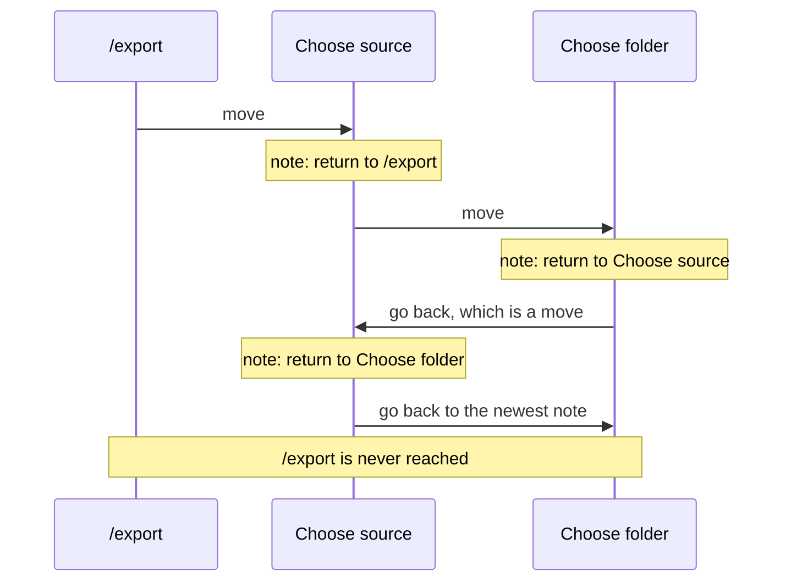

# How should an asking command send the user back?

- **Status:** In Review
- **Release:** Unreleased
- **Spike:** none filed — tests the hand-written `ReturnTo` in
  [Asking for a missing value and carrying on](../user-guides/asking-for-a-missing-value-and-carrying-on.md)
  against [#152](https://github.com/KitCli/KitCli/issues/152), *select the
  next command by queued outcome*
- **Time-box:** none agreed — ran inline
- **Date:** 2026-10-17

## Verdict

**No new complexity.** Going back needs nothing beyond #152. Once a command
can queue several moves, the command that sent the user to ask queues itself
again behind the question.

| Term | Meaning |
|---|---|
| Asking command | A command that prompts the user for a missing value, such as choosing a source. |
| Caller | The command that moved to the asking command, such as `/export`. |
| Move | A command naming the command to run next, with `ByMovingToCommand`. |
| Run | Every command from the first one up to a final outcome. |

### Today

The asking command carries the caller in a `ReturnTo` field. One factory per
caller fills that field in, each checking `LastCommandIs<…>()`:



### After #152

The caller queues the question, then itself. The asking command needs no
`ReturnTo` field and one factory:



```csharp
FinishThisCommand()
    .ByMovingToCommand<ChooseSourceCliCommand>()
    .ByMovingToCommand<ExportCliCommand>()
    .EndAsync();
```

The code compiles on `main` today, but only the second move runs until #152 ships.

## Recommendation

**No ticket for a `ReturnTo` feature.** Once #152 ships, one docs ticket
rewrites the asking guide to queue the caller. Raise the open questions below
on #152 first, since the rewrite depends on their answers.

## What was established

The spike also considered a built-in alternative: save a "return to" note on
every move, and have the asking command go back to the newest note. It breaks
when one asking command leads to another:



| Fact | Consequence |
|---|---|
| Going back is itself a move. | A note saved on every move overwrites the one the next step back needs. |
| Fixing that means going back removes the newest note instead of adding one. | That is a pile of callers, and a second way to chain beside moving on: new complexity, for what #152 gives free. |
| Under #152, a command's own queued moves run before moves queued earlier resume. | A caller queued behind the question is the same pile, and nests correctly. |
| The run already records every command that ran, as a `RanCliCommandOutcome`. | A saved "return to" note would mostly copy that record. |
| The caller runs again from the top, rebuilt by its factory from remembered values. | A typed flag such as `--dry-run` is lost unless saved first, and anything done before asking runs twice. Today's `ReturnTo` has the same gap. |
| Moving to a `null` type throws inside the handler. | Today's guide needs a `null` check before going back. Queueing removes the check. |

## Evidence

Read against `e544c2c`.

| File | Shows |
|---|---|
| `docs/user-guides/asking-for-a-missing-value-and-carrying-on.md:35-65` | The hand-written `ReturnTo` field, per-caller factory and `null` check. |
| `KitCli.Workflow/Run/CliWorkflowRun.cs:140` | `MoveToNext()` takes only the last queued move. |
| `KitCli.Workflow/Run/CliWorkflowRun.cs:164` | Every command that runs is recorded as a `RanCliCommandOutcome`. |
| `KitCli.Workflow/Run/CliWorkflowRun.cs:259-276` | Whether the run keeps going depends only on the last command's own outcomes. |
| `KitCli.Commands.Abstractions/Outcomes/OutcomeList.cs:164` | `ByMovingToCommand(Type)` throws on anything that is not a command. |
| `KitCli.Commands.Abstractions/Factories/CliCommandFactory.cs:162` | `LastCommandIs<T>()`, which each per-caller factory checks today. |
| [Run every queued hop, depth-first](../adr/run-every-queued-hop-depth-first.md) | The proposed order: a command's own moves first, then earlier ones resume. |

## Open questions

- When the asking command ends on a remembered value, does a move still queued
  from `/export` keep the run going? Today the run pauses and waits for the user.
- Does a final outcome throw away moves still queued? It must, or pressing
  Ctrl+C at the question sends the user back to `/export` anyway.
- An asking command that never gets an answer and never ends sends the user
  round forever. That loop is [#173](https://github.com/KitCli/KitCli/issues/173).

## Out of scope

- **Building the pile of callers.** Rejected above, not prototyped.
- **`/source choose` typed on its own.** Nothing is queued behind it, so the
  run ends after the question either way.
