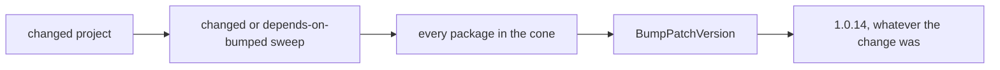
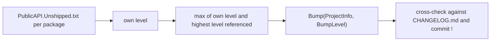

# Respect SEMVER in Release

- **Status:** In Review
- **Release:** Unreleased
- **Spike:** [#135](https://github.com/KitCli/KitCli/issues/135)
- **Time-box:** none agreed — #135 was an inline TODO promoted to an issue, not an estimated spike
- **Date:** 2026-08-25
- **Justifies** the [API-diff versioning ADR](../adr/derive-version-bumps-from-the-public-api-diff.md)

## Verdict

**New complexity.** [#135](https://github.com/KitCli/KitCli/issues/135) asks whether there is a real bug. There is, it shipped, and v2.0.0's breaking change was sized 1.0.14 by the tool and corrected by hand.

The complexity is not the patch-only arithmetic. The obvious fix is also wrong, and one class of break cannot be detected mechanically at all. [#127](https://github.com/KitCli/KitCli/issues/127) proposes deriving the bump from Conventional Commit types. The commit that made v2.0.0 breaking carried no `!`, so that derivation lands on 1.1.0.

| Term | Meaning |
|---|---|
| Bump level | `Major`, `Minor` or `Patch`: the part of `X.Y.Z` the release increments. |
| Cone | A changed package plus every package that references it. |
| Public API baseline | `PublicAPI.Shipped.txt` per package, listing the API released so far. |
| `PublicAPI.Unshipped.txt` | API changed since the last release. A `*REMOVED*` line marks a removal. |

Fixing this properly needs a public API baseline across nine packages, a change to two places in the tool, a cross-check layer, and a decision that does not exist yet ([#128](https://github.com/KitCli/KitCli/issues/128)).

Two findings #135 did not assume. The tool's *choice of packages* is already correct and only the size is wrong. Behavioural breaking changes have shipped as patches with no signature change to detect.

### Today



### After this work



## Recommendation

#135 stays open as the parent. The build hangs off it in this order. The ADR comes first, because the analyzer baseline is a wide diff that should not land before the model it serves is agreed.

**1. Blocked on #128.** It decides per-package versus lockstep versioning. Everything below assumes per-package.

**2. ADR: derive bumps from the public API diff.** Written as the [API-diff versioning ADR](../adr/derive-version-bumps-from-the-public-api-diff.md).

**3. Adopt `Microsoft.CodeAnalysis.PublicApiAnalyzers`** across the nine packable projects, with a committed `PublicAPI.Shipped.txt` baseline. Standalone value: silent signature breaks become build failures whether or not the tool ever reads the files. Wide diff, its own PR.

**4. Derive the level.** `VersionBumper.BumpPatchVersion` becomes `Bump(ProjectInfo, BumpLevel)`. Releasing moves `Unshipped` into `Shipped`. `ReleaseRunner`'s `changed || dependsOnBumped` sweep becomes `max(own level, highest level of anything referenced)`.

| In `PublicAPI.Unshipped.txt` | Level |
|---|---|
| A `*REMOVED*` line | `Major` |
| Any other line | `Minor` |
| An empty file over a changed project | `Patch` |

**5. Cross-checks.** Fail the release when `CHANGELOG.md`'s `**Breaking:**` markers or a commit's `!` disagree with the API diff.

**6. Release skill,** next to `repo-operating-model`: the procedure, not the arithmetic. It includes bumping `KitCli.Tooling.Release`'s own `KitCli` pin, still on 1.0.12.

## What was established

| Fact | Consequence |
|---|---|
| **The tool is structurally patch-only.** `VersionBumper` exposes one operation, `BumpPatchVersion`, which parses three integers and increments the third. | No argument makes it produce anything else. |
| **Its choice of packages is already right.** The `changed \|\| dependsOnBumped` sweep produced exactly the six packages v2.0.0 needed: the transitive cone of `KitCli.Commands.Abstractions`. | Only the number was wrong. |
| **`dotnet pack` emits exact inter-package versions, not ranges.** | Every package in a break's cone must carry that break's level. A "minor" on an intermediate would still drag the incompatible type to its consumers. This is the constraint behind the `max` rule. |
| **Conventional Commit types are an insufficient signal alone.** The commit was `feat(workflow): resolve a chained command through its factory (#154)`, with no `!`, for a change that removed public API. | Commit types can only cross-check. |
| **`CHANGELOG.md` held the only correct signal,** a hand-written `**Breaking:**` line. | Nothing read it. |
| **Behavioural breaks leave no signature to diff.** v1.0.13 turned a captured `Scoped` dependency into a startup failure. v1.0.12 made an unhandled handler exception end the session. Both shipped as patches. | No API-diff tool detects either, which bounds what any of this can guarantee. |
| **The plumbing for a commit-based cross-check exists.** `ProjectChangeDetector` computes `{lastReleaseCommit}..HEAD` per project to answer "did this change". | That is the same range whose subjects a cross-check needs. |
| **Microsoft does not derive the major from breakage.** `Microsoft.Extensions.DependencyInjection` and `Microsoft.EntityFrameworkCore` publish majors 1, 2, 3, 5, 6, 7, 8, 9, 10: the annual .NET release train, with 4 skipped to avoid colliding with .NET Framework 4.x. | Their major tracks the platform band, not the API diff this investigation proposes reading. |
| **Microsoft's advice to library authors is weaker than semver, and points elsewhere.** [Versioning and .NET libraries](https://learn.microsoft.com/en-us/dotnet/standard/library-guidance/versioning) says only "CONSIDER using SemVer 2.0.0". The firmer rules sit on [Breaking changes](https://learn.microsoft.com/en-us/dotnet/standard/library-guidance/breaking-changes): "DO minimize breaking changes when developing a low-level .NET library", "CONSIDER placing the ObsoleteAttribute on types and members that you intend to remove", and "CONSIDER keeping types and methods with the ObsoleteAttribute indefinitely in low and middle-level libraries". | KitCli is a low-level library by that page's own definition. |
| **A climbing major is a break-rate symptom, not a numbering defect.** Microsoft sits at 10 by not removing public API. Libraries that rename freely reach Newtonsoft.Json 13, MediatR 14, AutoMapper 16. KitCli moved 1.0.13 to 3.0.0 in roughly 36 hours. | Deriving the level correctly makes that rate legible. It does not slow it. Only a deprecation policy does. |
| **Deprecation would have downgraded most of the host-merge ADR.** `TerminalCliApp`, `ArgsCliApp`, `BasicTerminalCliApp` and `WithBasicTerminalApp()` could each have stayed as an `[Obsolete]` forwarder, leaving a minor. | `ExecuteRunOperation` is the exception: its `protected` signature changed, which breaks a subclass override with or without the shims. |
| **Three docs disagree about the model today.** `CHANGELOG.md`'s header says "All 9 packages version together" and `CLAUDE.md` says the projects "publish as a single, unified-version set". `CONTRIBUTING.md#versioning--releases` says they do not ship in lockstep, and the committed versions agree with it. | Whichever way #128 lands, two of the three need rewriting. |

## Evidence

Last release commit and the subjects a commit-derived bump would have read:

```
$ last=$(git log -1 --format=%H -S'<Version>1.0.9</Version>' main \
    -- KitCli.Commands.Abstractions/KitCli.Commands.Abstractions.csproj)
$ git log --format='%s' $last..main -- KitCli.Commands.Abstractions/
feat(workflow): resolve a chained command through its factory (#154)
```

The break itself, `KitCli.Commands.Abstractions/Outcomes/Reusable/NextCliCommandOutcome.cs`:

In 1.0.9:

```csharp
public record NextCliCommandOutcome(CliCommand NextCommand) : Outcome(OutcomeKind.Reusable);
```

In 2.0.0:

```csharp
public abstract record NextCliCommandOutcome() : Outcome(OutcomeKind.Reusable);
```

Exact dependency versions in the packed umbrella, from `dotnet pack KitCli/KitCli.csproj`:

```xml
<dependency id="KitCli.Workflow.Abstractions" version="2.0.0" exclude="Build,Analyzers" />
<dependency id="KitCli.Workflow" version="2.0.0" exclude="Build,Analyzers" />
```

The tool's own dry run, which named the right six packages and the wrong size:

```
$ dotnet run --project KitCli.Tooling.Release -- /release --dry-run
Bumping (changed, or depends on something that changed):
  - KitCli.Commands.Abstractions   - KitCli.Workflow.Abstractions
  - KitCli.Commands               - KitCli.Workflow.Commands
  - KitCli.Workflow               - KitCli
```

Stable majors published by comparable packages, from the NuGet flat container:

```
$ curl -s https://api.nuget.org/v3-flatcontainer/{id}/index.json \
    | tr -d ' "\r\n' | sed 's/.*versions:\[//;s/\]}//' | tr ',' '\n' \
    | awk -F'[.]' '!/-/ && NF>=3 {print $1}' | awk '!s[$0]++'

microsoft.extensions.dependencyinjection   1 2 3 5 6 7 8 9 10
microsoft.entityframeworkcore              1 2 3 5 6 7 8 9 10
newtonsoft.json                            3 4 5 6 7 8 9 10 11 12 13
mediatr                                    0 1 2 3 4 5 6 7 8 9 10 11 12 13 14
automapper                                 1 2 3 4 5 6 7 8 9 10 11 12 13 14 15 16
```

## Open questions

- Does #128 land on per-package or lockstep? Every recommendation above assumes
  per-package, and lockstep would make step 4's `max` propagation unnecessary.
- What does the `PublicAPI.Shipped.txt` baseline actually cost across nine
  packages? The analyzer's code fix generates it, but the diff size is unmeasured.
- Should behavioural breaks get an explicit `CHANGELOG.md` convention, given they
  are undetectable mechanically and the marker is the only signal? That is a
  process decision this spike did not take.
- Should the cross-checks fail the release or warn? Failing is stated above;
  nothing tested how often a legitimate disagreement occurs.
- Should KitCli deprecate rather than remove, as Microsoft advises indefinitely
  for low-level libraries? That is a policy decision this spike did not scope,
  and it — not the bump level — governs how fast the major climbs.

## Out of scope

- **Whether v2.0.0's numbers were correct.** They shipped, and this investigation
  takes them as given rather than re-deriving them.
- **The tool's `--publish` path.** It duplicates `ci.yml` as documented break-glass,
  but reads a plaintext key from `~/.kitcli/nuget-api-key` where CI uses
  short-lived OIDC tokens. A different question, and worth its own issue.
- **Prerelease and build-metadata versions.** Nothing in the repo uses them and
  nothing here considered them.
