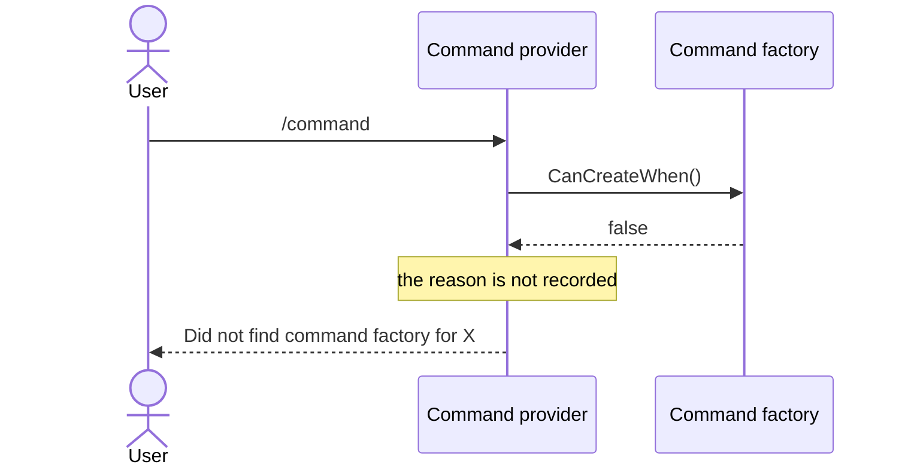
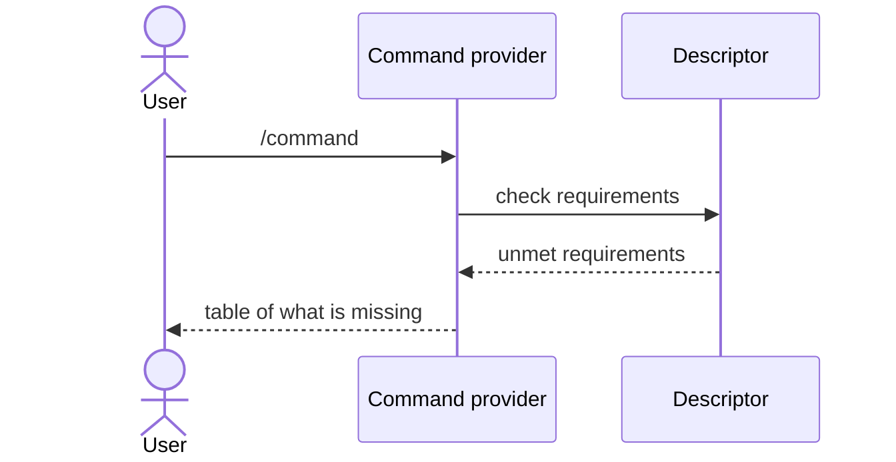

# Should a command factory declare what it needs instead of overriding CanCreateWhen?

- **Status:** In Review
- **Release:** Unreleased
- **Spike:** [#184](https://github.com/KitCli/KitCli/issues/184)
- **Time-box:** 45 minutes
- **Date:** 2026-08-26

## Verdict

**New complexity, in the half the spike did not expect.** Declaring is easy: all 28 `CanCreateWhen()` overrides ask the same four questions, so a builder can replace them. Reporting is hard, and it is what makes a descriptor worth having.

| Term | Meaning |
|---|---|
| Command factory | The class that decides whether it applies to an ask, and builds the command. |
| `CanCreateWhen()` | The method a factory overrides to say whether it applies. |
| Descriptor | A declaration of what a factory needs and produces, built at registration. |
| Artefact | An outcome turned into a value a later command can look up by type and name. |

### Today

Every unmet requirement becomes the same message:

### After this work

The factory declares its needs, so the provider can name the one that failed:

KitCli tried the reporting half once. `MissingOutcomesCliCommand` printed a hand-passed list of missing prerequisites under a `// TODO: Revisit strategy for reporting missing outcomes.` It was deleted in `d3c5c0f` on 2026-02-13 and the revisit never happened. Reporting is a second deliverable, not a free consequence.

## Recommendation

**#184 closes.** A fresh parent ticket carries the build, in this order.

**1. Cover `CliCommandFactory`** ([#114](https://github.com/KitCli/KitCli/issues/114)). Its contract is what changes, and it has no tests.

**2. The builder.** It offers seven verbs. `OnDescribing` chains up the inheritance line. The descriptor builds at registration, so startup checks it and `--help` renders without instantiating a factory.

| Verb | Declares |
|---|---|
| `SubCommandIs` | The sub-instruction equals a named constant. |
| `HasNoSubCommand` | The sub-instruction is absent. |
| `LastCommandWas<T>` | A given command ran last. |
| `RequiresArgument<T>` | An argument of that type is present. |
| `RequiresArtefact<T>` | An artefact of that type exists. |
| `RequiresOneOf` | Any one of several requirements holds. |
| `ProducesOutcome<T>` | The command returns that outcome. |

**3. Merge identity into the same descriptor.** `OnDescribing` fills it from the factory, and the [`[CliCommandAlias]`](../adr/cli-command-alias-attribute.md) and [`[CliNextCommandIs]`](../adr/suggest-next-commands-attribute.md) readers fill it from the command type. Neither ADR is superseded, and a command with no factory still gets a descriptor.

**4. Default `CanCreateWhen()` to the declaration.** `abstract` becomes `virtual`, so existing overrides still compile.

**5. An ADR**, since a hook on every factory is a cross-cutting pattern.

**6. The reporting path, on its own ticket.** Unmet requirements render as a table and travel as an exception. No factory and no attributes means no descriptor, so no table. [#183](https://github.com/KitCli/KitCli/issues/183) shares this path: decide both together, or the app grows two vocabularies for "that didn't work".

**7. Docs in the same PR:** [command registration](../concepts/command-registration.md), [writing a basic command](../user-guides/writing-a-basic-command.md) and `CHANGELOG.md`.

## What was established

The vocabulary is closed. The 28 implementations fall into four shapes, with no arbitrary predicates:

| Shape | Count |
|---|---|
| Sub-instruction equals a named constant | 12 |
| Sub-instruction absent | 6 |
| A given command ran last | 6 |
| A base class's answer `&&` an argument check | 4 |

| Fact | Consequence |
|---|---|
| Requirements compose through inheritance (`base.CanCreateWhen(…) && …`, four factories). | The builder chains up the inheritance line. |
| Requirements compose with `or` (`ranAggregatorCommand \|\| ranFilterCommand`). | `RequiresOneOf` exists. |
| Factories are singletons mutated by `Attach()` ([#142](https://github.com/KitCli/KitCli/issues/142)). | A descriptor must come from the factory type alone, or it adds a second piece of shared mutable state. |
| A command produces outcomes, but a requirement is checked against artefact values. | `Produces` and `Requires` cannot be joined. |
| `ArtefactFactory<TOutcome>` hides the artefact type behind `AnonymousArtefact`, and two of the three artefacts mint their name from a runtime value. | `ProducesOutcome<T>` is declared and rendered, never checked. |

## Evidence

| Source | Shows |
|---|---|
| `grep -rl "bool CanCreateWhen"` | 23 factories in SpendfulnessCli, 4 in `KitCli.Playground.Scenarios`, 1 in KitCli.Example.Filtering. SpendfulnessCli predates the `Attach` rewrite, so the shapes count and the signatures do not. |
| `git log --diff-filter=D -- "*MissingOutcomes*"` | The deleted report. |
| `Bright.DataTool.Cli`'s `ConnectorDescriptorBuilder` | The borrowed shape, after `DbContext.OnConfiguring`. Its `SetId` and `SetName` do not carry over, because KitCli derives a command's name from its type. |

## Open questions

- **Should overriding `CanCreateWhen()` stay possible?** None of the 28 needs it, and an override is invisible to the descriptor, so the table would describe requirements the factory is not really deciding on. Removing it strands any consumer case the seven verbs miss.

## Out of scope

- **Instruction and argument-value validation.** Tracked at [#183](https://github.com/KitCli/KitCli/issues/183).
- **Making the produces/requires join checkable.** It needs a second type parameter on `ArtefactFactory<>`, breaking six untested implementations ([#116](https://github.com/KitCli/KitCli/issues/116)).
- **Most-specific-match instead of first-match-wins.** It would supersede the [first-match-wins ADR](../adr/first-match-wins-resolution.md).
- **Keyed transient `ICliCommandFactory`.** Tracked at [#142](https://github.com/KitCli/KitCli/issues/142).
