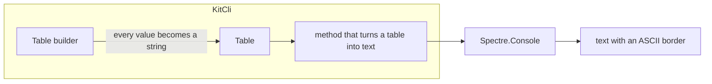

# Should table rendering be rebuilt on Spectre.Console?

- **Status:** In Review
- **Release:** 3.1.1
- **Spike:** [#215](https://github.com/KitCli/KitCli/issues/215)
- **Time-box:** 60 minutes
- **Date:** 2026-09-11

## Verdict

**New complexity.** The swap is one ticket: one method changes and nobody's code breaks. It shipped as [#252](https://github.com/KitCli/KitCli/pull/252).

#215 wanted the swap because it assumed that picking a renderer settles the five issues underneath. It settles exactly one, a cell holding a line break (#214). The other four are still work. A row count cannot be built on Spectre at all, and two more were never the renderer's fault.

| Issue | Settled by the swap? | Why |
|---|---|---|
| #214 line break in a cell | Yes | Spectre handles it. |
| #210 border style | No | `Table.ToString()` fixes `TableBorder.Ascii`. |
| #212 row count | No | Spectre has no row count. |
| #211, #213 alignment and formats | No | KitCli blocked both. Folded into [#260](https://github.com/KitCli/KitCli/issues/260). |

## Recommendation

**#215 stays open as the parent, with three pieces under it.**

**1. Expose the border style** (#210). `Table.ToString()` fixes it to `TableBorder.Ascii`, so the complaint survived the swap intact: a different library, still one look nobody can change. Markdown output has no replacement at all.

**2. Re-scope #212**, which cannot be built as written.

**3. Leave alignment and formats to [#260](https://github.com/KitCli/KitCli/issues/260)**, which #211 and #213 folded into. KitCli blocked both, not the old library.

## What was established

| Fact | Consequence |
|---|---|
| The renderer appears once, in the method that turns a table into text. | It never reaches the public surface, so the swap was one ticket. |
| Spectre has no row count and no way to choose where a long cell breaks. | Both halves of #212 die here. Permanent home: [the Spectre.Console page](../technology/spectre-console.md). |
| The table builder turns every value into a string before anything draws it. | The column's type is gone by then, so alignment and per-column formats were never the renderer's problem. That is the line #260 has to move, and no library choice helps. |
| Both libraries handle Japanese and Chinese. | #215 listed this among the things a swap would fix. It was already correct. |

## Evidence

Both libraries were drawn side by side in a scratch project, ConsoleTables 2.7.0 against Spectre.Console 0.57.2. The input was the stack trace from the playground command `/test-stack-trace-table`.

| Step | Found |
|---|---|
| Force the old library's hidden list of column types by reflection | Alignment appeared. That is how the blockage was identified. |
| Ship the swap in #252 | Confirms everything above in code. |

## Open questions

- Does KitCli count its own rows, or does #212 close unbuilt?
- What replaces markdown output: another border, or KitCli writing markdown itself rather than asking a renderer to?

## Out of scope

- **Colour, prompts, progress bars and Spectre.Console's own command handling.**
- **Plain-text screen output.** Whether KitCli should keep writing to the screen as plain text was not reached.
