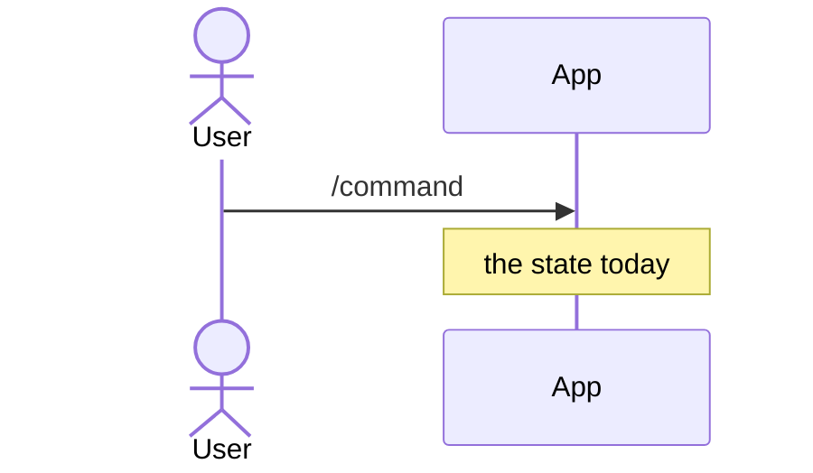
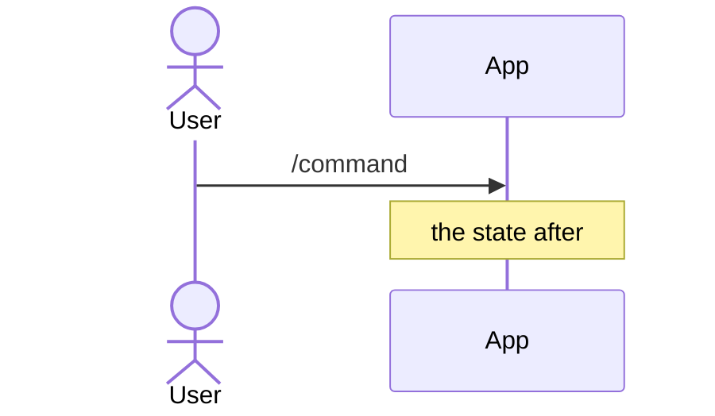

<!--
An investigation is what a technical spike produces: what was found, and
what to do. Lead with the verdict. Evidence goes underneath, for the reader
who wants to check the reasoning or reuse a fact later.

- Investigation: "what did we find out, and what should we do?"
- ADR: "what did we decide, and why did the alternatives lose?"
- Concept: "how does this work today?"

An investigation that leads to a decision justifies an ADR. Write both and
link them.

How to explain. The model is
docs/investigations/can-an-artefact-outlive-the-run-that-made-it.md.

- Lead with the answer, in one or two bold sentences.
- Using more than two KitCli terms? Define them first in a
  Term | Meaning table, with the codebase's real names.
- Let diagrams carry the explanation. Pick the mermaid type by what it shows:
  - sequenceDiagram: what happens over time. `Note over` shows the state
    at each step. Show a change as a "before" and an "after" diagram.
  - stateDiagram-v2: a lifetime or a status.
  - classDiagram: the types a reader writes or extends. Generics are `Artefact~T~`.
  - flowchart LR: data moving through stages. One `subgraph` per run,
    request or package.
- Show usage with real code that compiles on `main`.
- Put facts in tables: Fact | Consequence, File | Shows.
- Prose only connects the visuals: a sentence or two saying what the next
  one shows. No paragraph that a diagram, snippet or table could replace.
  Keep prose under 60 lines; diagrams, code and tables don't count.
- Verify every name, signature and sample against source.
-->

# The question being answered

- **Status:** In Development | In Review | Complete
- **Release:** Unreleased | X.Y.Z
- **Spike:** #NN
- **Time-box:** the box agreed when the spike was estimated
- **Date:** YYYY-MM-DD

## Verdict

**New complexity, or no new complexity.** One or two sentences saying why.

| Term | Meaning |
|---|---|
| Run | Every command from the first one up to a final outcome. |

### Today



### After this work



## Recommendation

How many delivery tickets, and their release level.

**1. The first ticket, as a bold one-line summary.** One sentence, then the
shape it adds:

```csharp
public enum ExampleLifetime { Run, Session }
```

## What was established

| Fact | Consequence |
|---|---|
| A fact that stays true whatever gets decided. | What it means for the work. |

## Evidence

Read against `<commit>`.

| File | Shows |
|---|---|
| `KitCli.Workflow/CliWorkflow.cs:34` | What that line proves. |

## Open questions

What remains unanswered, as questions. "None." if nothing does.

## Out of scope

- **The thing not examined.** Why, and where it is tracked.
