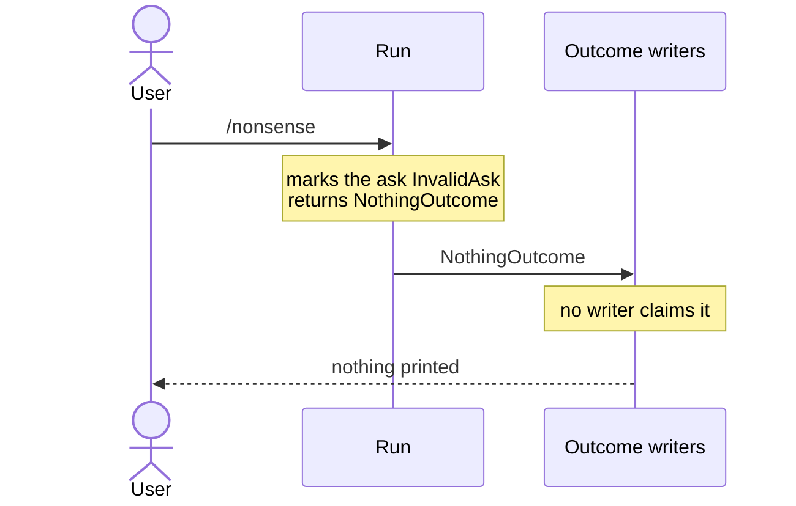
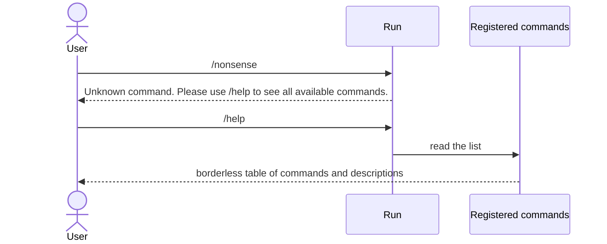

# What would a built-in /help command list?

- **Status:** In Review
- **Release:** Unreleased
- **Spike:** not yet filed
- **Time-box:** none agreed — ran inline
- **Date:** 2026-09-12

## Verdict

**New complexity, and none of it is in the command.** Shipping a `/help` to every app built on KitCli is a solved shape: `/exit` is already one.

KitCli cannot answer the question `/help` asks. An app has no way to list its own commands, and no command holds a sentence saying what it does. *Describing a Command* exists to close both gaps, so `/help` waits on that milestone and reads what it produces.

| Term | Meaning |
|---|---|
| Descriptor | A declaration of a command, built while the app starts and readable without constructing anything ([#188](https://github.com/KitCli/KitCli/issues/188)). |
| Outcome | What a command returns. A writer turns it into screen output. |
| Run | Every command from the first one up to a final outcome. |

### Today



### After this work



## Recommendation

**Five tickets, filed.** Only the second starts unblocked.

| Ticket | Delivers | Notes |
|---|---|---|
| [#262](https://github.com/KitCli/KitCli/issues/262) | **A wrong command prints nothing.** Say *Unknown command. Please use /help to see all available commands.* | Blocked by [#219](https://github.com/KitCli/KitCli/issues/219), which splits the two reasons a name fails. |
| [#263](https://github.com/KitCli/KitCli/issues/263) | **A table can drop its borders.** Help listings are drawn without rules or boxes. | [#260](https://github.com/KitCli/KitCli/issues/260) covers only columns. |
| [#264](https://github.com/KitCli/KitCli/issues/264) | **A command carries a description.** | Written into [#191](https://github.com/KitCli/KitCli/issues/191)'s descriptor, not added as a fourth label beside the three already there. |
| [#265](https://github.com/KitCli/KitCli/issues/265) | **Registration keeps a list of what it registered**, which the scan already walks. | The cheap half of [#190](https://github.com/KitCli/KitCli/issues/190). |
| [#266](https://github.com/KitCli/KitCli/issues/266) | **`/help` itself.** Three files beside `Exit`, printing a borderless table. | A second permutation takes a command name and shows that one in full, which needs #190's argument declarations. |

The first two sit in *Print More Than Plain Text*, with #219 moved there as the enabler. The last three hang off #188 in *Describing a Command*.

## What was established

| Fact | Consequence |
|---|---|
| The name lookup only runs one way. Every command is filed under its full name, shorthand and aliases. | Ask for `spare-money` and it answers. Ask what names it holds and it cannot, once the app has started. |
| A command's name comes from its type name, and nothing else is kept. | Nothing holds a description. Documentation comments never reach the finished program, only a separate file each app would have to switch on and ship. Other .NET libraries all ask the author to write the sentence somewhere the program carries. |
| [#188](https://github.com/KitCli/KitCli/issues/188) lists "there is no `--help`, no catalogue" among its consequences. | The descriptor it proposes is the missing list. |
| The run marks a wrong ask invalid and returns an outcome that no writer claims. | A wrong command prints nothing at all. A "Command Not Found" outcome and its writer already exist, and the only thing producing them is a playground handler. |
| No command under the name is a wrong command. A command that exists but declines to run is not. | Two different failures share that silence. `/help` would send the second reader to an entry already in the list. |
| Every table draws with an ASCII border and a line between rows, set where the table renders itself and exposed nowhere. | The table frame is fixed in code. Spectre.Console can draw no border at all. |
| git, npm and Cobra name the closest command they know to what was typed, Cobra at an edit distance of two. | Offering a near match is what other tools do. Each needs the list first. |

## Evidence

The output below is the playground's own lifecycle messages. Run a wrong command against `5123d0e`:

```
dotnet run --project KitCli.Playground.App.Headless -- "/nonsense"

TestCliApp run completed.
Run state changes: Running, InvalidAsk, Finished
Run outcomes achieved: NothingOutcome
```

The run knew the ask was bad and finished quietly. A real app shows nothing.

## Open questions

- **Three shape questions, carried on #266.** One row per command or one per name. What order, and how a built-in is marked. What an empty description column shows.

## Out of scope

- **Argument and flag help.** Nothing declares arguments yet. That is [#190](https://github.com/KitCli/KitCli/issues/190).
- **Whether an outcome with no writer should be silent.** Already [#18](https://github.com/KitCli/KitCli/issues/18).
