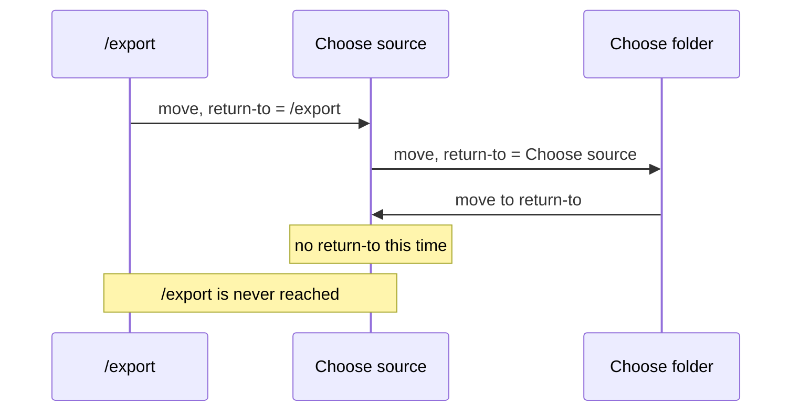
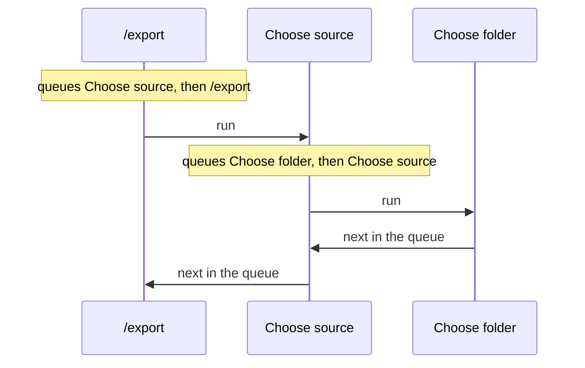
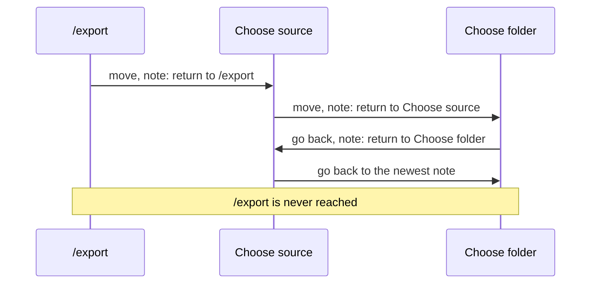

# What would it take to carry on after nested questions?

- **Status:** In Review
- **Release:** Unreleased
- **Spike:** none filed — follows on from
  [How does a command know where it was sent from](how-does-a-command-know-where-it-was-sent-from.md),
  against [#152](https://github.com/KitCli/KitCli/issues/152), *select the
  next command by queued outcome*
- **Time-box:** none agreed — ran inline
- **Date:** 2026-10-17

## Verdict

**New complexity.** It needs #152, plus one new check that lets a factory
see which command is waiting to run after the one it builds.

`/export` sends the user to Choose source. Choose source sends them on to
Choose folder. After the folder is chosen, the app should carry on with Choose
source, then `/export`. Passing "where to carry on" along with each move, which
works for one question, loses `/export`:



| Term | Meaning |
|---|---|
| Command | One step the app runs, such as `/export`. |
| Move | One command handing over to the next, written `ByMovingToCommand`. |
| Queue | The moves waiting to run, once #152 lets a command make several. |
| Factory | Builds a command just before it runs. It can read values earlier commands passed or remembered. |

### After #152

`/export` queues Choose source, then itself. Choose source queues Choose
folder, then itself. Each command's own moves run before earlier ones resume,
so the order comes out right:



"When" needs nothing more. A command that finishes normally lets the queue
carry on. A bad answer moves to the same command again, which runs first.

"Where" still needs new code. Choose source cannot see `/export` waiting, so
it cannot tell being sent from being typed on its own. A factory reads only
passed or remembered values, and nothing remembers a queued move. The check
would sit beside `LastCommandIs`. The name below is a proposal, not on `main`:

```csharp
public override CliCommand Create()
    => new ChooseSourceCliCommand(SentFromExport: NextQueuedCommandIs<ExportCliCommand>());
```

## Recommendation

**One feature ticket after #152: let a factory check which command is queued
after the one it builds.** New public API, so a minor release.

## What was established

| Fact | Consequence |
|---|---|
| A value passed with a move reaches only the next command. | It is lost one question deeper. |
| `MoveToNext()` runs only the last queued move today. | Queueing `/export` behind Choose source needs #152 first. |
| A factory reads only outcomes turned into remembered values, and a queued move is not one. | After #152, Choose source cannot see `/export` waiting without the new check. |

The spike also considered saving a "return to" note on every move. Going back
is itself a move, so it saves a new note over the one still needed:



## Evidence

Read against `65934ad`.

| File | Shows |
|---|---|
| `KitCli.Workflow/Run/CliWorkflowRun.cs:140` | `MoveToNext()` takes only the last queued move. |
| `KitCli.Workflow.Commands/CliWorkflowCommandProvider.cs:46` | A factory sees only outcomes that an artefact factory turns into remembered values. |
| `KitCli.Commands.Abstractions/Factories/CliCommandFactory.cs:162` | `LastCommandIs<T>()`, the check the new one would sit beside. |
| [Run every queued hop, depth-first](../adr/run-every-queued-hop-depth-first.md) | The proposed order: a command's own moves first, then earlier ones resume. |

## Open questions

- After #152, when Choose source finishes on a remembered value, does the
  queued `/export` keep the run going? Today the run pauses for the user.
- Does ending the run throw away moves still queued? It must, or a cancel at
  "Which source?" carries on to `/export` anyway.
- Choose source asking again forever, with no way out, is
  [#173](https://github.com/KitCli/KitCli/issues/173).

## Out of scope

- **A pile of senders that going back removes from.** It would fix the
  note-per-move idea, but #152 gives the same order without it.
